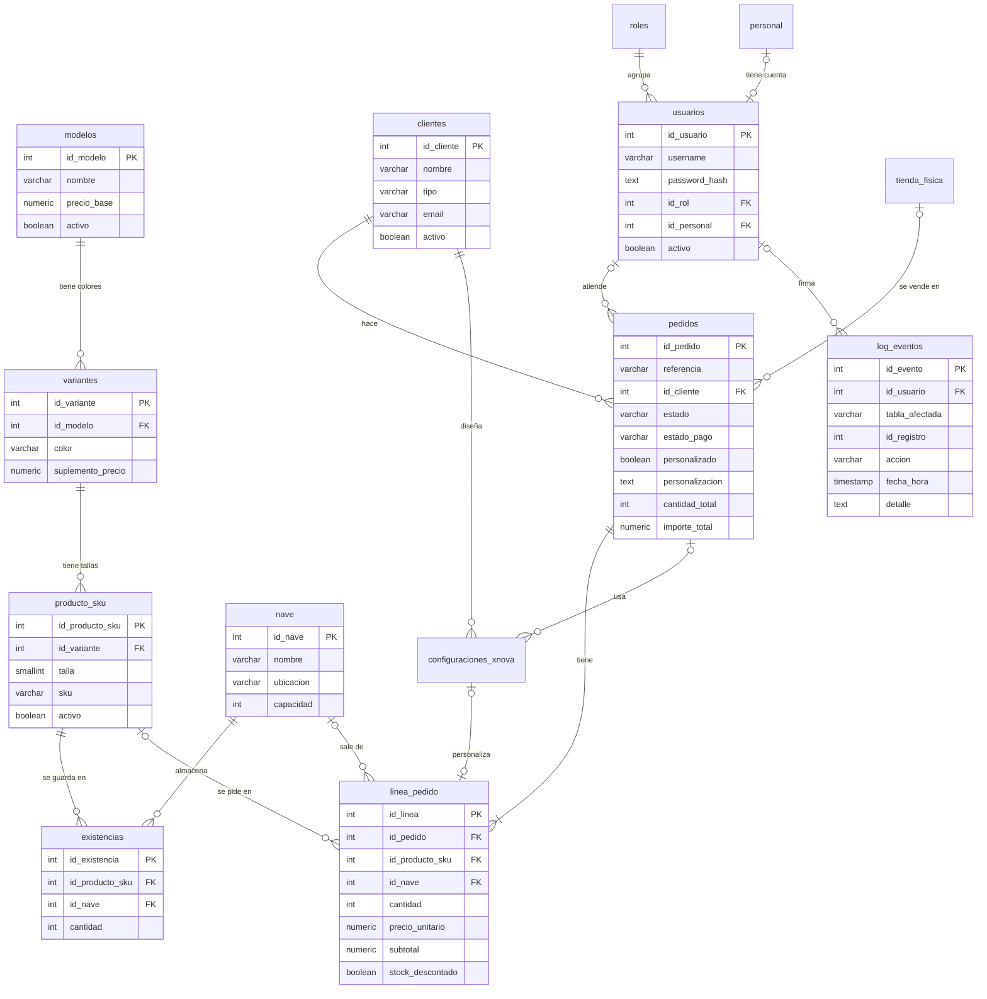

# NOVA Sneakers · Apartado de Acceso a Datos

Entregable 05 de la rúbrica de Acceso a Datos: «Apartado de Acceso a Datos dentro de la memoria común: decisiones, pruebas, dificultades y aportaciones» (AD-121). Forma parte de la memoria del proyecto (`Memoria_NOVA_Sneakers.pdf`).

> **Importante.** La rúbrica dice: «Es imprescindible aprobar todas las partes de los requisitos de Acceso a Datos para aprobar (Tribunal, memoria, entregable y defensa)» (AD-138). Este apartado es la parte de memoria.

**Convenciones.** Las rutas son relativas a la raíz del repositorio.md`, donde está también el estado de cada uno (§2.2). Marcas: **[PENDIENTE (quién): …]** es trabajo que falta de verdad; , una decisión del equipo; , una pregunta de la lista de dudas de la matriz; **[EQUIPO: …]**, **[ÁLVARO: …]** u **[OMAR: …]**, un dato o una confirmación que solo puede dar el equipo o esa persona; **Límite declarado**, algo que no está hecho o probado en esta entrega y se dice así.

**Versión:** rama `main`, commit `372f811`; el código es el del commit `4f09742` (13/11/2026). En la regresión de cierre, sobre ese código y en un clon nuevo, se repitieron el montaje SQL y la batería 09-16 (123 PASS, 0 FAIL y 1 ERROR previsto), las salidas de los scripts 10, 11, 12, 14, 15, 16 y 18, y `PruebasRubrica` (47/47) (la regresión del 13/11). El resto de pruebas que se citan, entre ellas las ventanas Swing (76/76), son de la regresión histórica del 13/11, sobre un árbol anterior con la estructura de carpetas antigua y en bases desechables (la regresión del 13/11).

---

## 1. Qué hace la base y cómo encaja en el proyecto común

La base `nova_sneakers` (PostgreSQL 17, probada con la 17.11) guarda el catálogo (modelos, colores y tallas), el inventario de los almacenes, los clientes, los pedidos y las personalizaciones X-NOVA. La aplicación Java Swing se conecta por JDBC para dar de alta, confirmar, cancelar y consultar pedidos, gestionar usuarios y generar los tres archivos externos (`02_Acceso_Datos/documentacion/README.md` §1, `02_Acceso_Datos/java/README.md`).

Relación con el resto del proyecto (AD-01, AD-02 y AD-22):

- **Una sola empresa:** la misma marca NOVA que la web, PSP y Python. No es otra empresa ni otro proyecto.
- **El ensayo SO024 PROVISIONAL**, con la misma referencia en PostgreSQL, en la ficha de PSP y en Python. Es una prueba histórica del ejemplo; no acredita el caso S00005 documentado en Odoo. El script 18 carga el cliente Club Halcones y el modelo Runner X; el pedido se crea desde Java.md`).
- **PostgreSQL alimenta a los otros módulos:** el script 15 exporta la orden de fabricación para PSP y el 16, los cinco CSV de Python.
- **Las ampliaciones web usan la misma base**, cada una con su propio rol mínimo: el panel de administración (19 y 22), la tienda (20 y 21) y el portal del trabajador (23). Comparten las cuentas de la tabla `usuarios` y la misma auditoría (§9.8).
- **Odoo:** hay una correspondencia documental parcial, no una integración (la memoria del proyecto (`Memoria_NOVA_Sneakers.pdf`) §6.1): el mismo cliente y 40 pares en S00005 y en `CUSTOM-40`, aunque con precios distintos (89 € frente a 119,90 €), y la referencia `NOVA-0011` con el mismo importe, 4.796,00 €, en S00001 (solo en el texto del PDF de Berme, p. 13; hay que comprobarlo en su Odoo). Los SKU no coinciden: en Odoo, `NOVA-4-38` … `NOVA-4-46` son variantes de Runner X; aquí, `NOVA-4-40` … `NOVA-4-44` son de NOVA Velocity Rojo. **Límite declarado:** no hay exportación de Odoo ni conciliación probada.md`.

---

## 2. Diseño: modelo entidad-relación y normalización (AD-05 a AD-09)

### 2.1 Diagrama entidad-relación

**[PENDIENTE (Álvaro): elegir el diagrama oficial entre `02_Acceso_Datos/modelo/sneaker-factory.dbm` (pgModeler) y `02_Acceso_Datos/modelo-er/Modelo-Er-Intermodular.drawio` (draw.io), y exportarlo a PNG para la memoria.]** El `.dbm` declara las 14 tablas y las 16 claves ajenas de la base, pero nadie lo ha abierto todavía en pgModeler (`02_Acceso_Datos/documentacion/README.md` §12, problema 6b). El `.drawio` no se ha comparado con el esquema final.

Mientras tanto, este diagrama se ha sacado de las 16 claves ajenas que se comprobaron en PostgreSQL (`02_Acceso_Datos/documentacion/modelo_relacional.md` §3) y de los `CREATE TABLE` de `02_Acceso_Datos/sql/sneaker-factory-esquema.sql` y `04_xnova.sql`:



(Se omiten algunas columnas para que se lea bien: `pedidos.fecha_pedido`, `fecha_objetivo`, `id_usuario` e `id_tienda`; `linea_pedido.id_configuracion_xnova`; los datos de `personal`, `roles`, `tienda_fisica` y `configuraciones_xnova`. La tabla `cuentas_cliente` de la tienda, del script 20, es una ampliación y no está en el diagrama.)

### 2.2 Las 14 tablas y por qué están así

| Tabla | Qué guarda | Por qué es una tabla aparte |
|---|---|---|
| `modelos` | Nombre, descripción, precio base y si está activo | El modelo se escribe una vez, aunque tenga muchos colores y tallas |
| `variantes` | Color y suplemento de precio de un modelo | Un modelo tiene varios colores (UNIQUE `id_modelo, color`) |
| `producto_sku` | Una talla concreta de una variante y su código SKU | Es lo que se vende y se guarda en el almacén (UNIQUE `id_variante, talla` y `sku`) |
| `nave` | Almacenes | El stock puede estar en varios sitios |
| `existencias` | Cantidad de un SKU en una nave | Una fila por SKU y nave (UNIQUE), con `CHECK (cantidad >= 0)` |
| `clientes` | Particulares y empresas (clubes) | `tipo` en `particular` o `empresa`; email único |
| `personal`, `roles`, `usuarios` | Empleados, roles funcionales y cuentas de la aplicación | Un empleado puede no tener cuenta; la contraseña solo existe como hash |
| `tienda_fisica` | Tiendas | Un pedido puede venderse en tienda (hoy ninguno de los de demostración) |
| `pedidos` | La cabecera: referencia única, cliente, estado, pago, personalización y totales | Los datos generales no se repiten en cada línea |
| `linea_pedido` | Cada talla pedida: SKU, cantidad, precio, subtotal, nave y si ya se descontó el stock | **Cada línea registra talla y cantidad** y, a través del SKU, el color (AD-07) |
| `configuraciones_xnova` | El diseño de una zapatilla X-NOVA | Una línea es de un SKU normal **o** de una configuración X-NOVA, nunca de las dos (`linea_tipo_producto_check`) |
| `log_eventos` | La auditoría | La escriben solo los triggers |

**Cómo queda identificable la personalización (AD-07).** En un pedido Custom normal, la personalización es el texto de `pedidos.personalizacion` con `personalizado = true`, y el color va en la variante del SKU de cada línea. En X-NOVA, cada línea apunta a su configuración.

### 2.3 Normalización

La documentación del modelo es prudente y no afirma la 3FN de todo el esquema sin una revisión formal (`modelo_relacional.md` §10 y §14). Este es el razonamiento, sacado de las claves y dependencias que ya documenta ese archivo. En el repositorio no consta que Álvaro lo haya revisado. **[ÁLVARO: dar por bueno este razonamiento de normalización, o corregirlo]**

- **1FN.** Cada columna guarda un solo valor (no hay listas de tallas ni de colores en un campo) y cada tabla tiene clave primaria. Las tallas de un pedido son filas de `linea_pedido`, no columnas.
- **2FN.** Todas las tablas tienen una clave primaria simple (`GENERATED ALWAYS AS IDENTITY`), así que no puede haber dependencias parciales de esa clave. Las claves candidatas compuestas (las restricciones UNIQUE) son `variantes (id_modelo, color)`, `producto_sku (id_variante, talla)` y `existencias (id_producto_sku, id_nave)`. En cada una, los demás atributos (`suplemento_precio`; `sku` y `activo`; `cantidad`) dependen de la combinación entera, no de una parte.
- **3FN.** Ningún atributo no clave depende de otro atributo no clave: el nombre y el precio base del modelo no se repiten en `variantes` ni en `producto_sku`; el cliente no se copia en el pedido; el producto no se copia en el stock.
- **Atributos derivados, y por qué se guardan.** `linea_pedido.subtotal` (cantidad × precio), `pedidos.cantidad_total` y `pedidos.importe_total` (sumas de sus líneas) son derivables. Se guardan por decisión operativa: los consultan el panel, las exportaciones y los informes sin recalcular cada vez. Su coherencia la mantienen los triggers (`trg_calcular_subtotal` y `trg_actualizar_totales`). `nova_admin` tiene `UPDATE` sobre `pedidos` (`07_seguridad.sql:27-31`) y podría escribirlos a mano: no hacerlo es una norma del contrato de uso. La prueba P3 comprueba que ningún pedido tiene totales incoherentes y el script 16 no exporta si un total no cuadra con sus líneas.
- **`linea_pedido.precio_unitario` no es una copia redundante.** Es el precio **del momento del pedido** (lo pone `anadir_linea_pedido` a partir del precio base y el suplemento). Si mañana cambia el precio del catálogo, los pedidos antiguos no deben cambiar.

---

## 3. Implementación: scripts, datos de prueba y DML (AD-10 a AD-14)

### 3.1 Los scripts

Están en `02_Acceso_Datos/sql/`: son 23. **El número del archivo no es el orden de ejecución**; el orden y los comandos están en `manuales/MANUAL_INSTALACION.md` §3. Resumen (`02_Acceso_Datos/documentacion/README.md` §3):

| Grupo | Scripts | Qué hacen |
|---|---|---|
| Creación | `sneaker-factory-esquema.sql`, `04_xnova.sql`, `02_funciones.sql`, `03_triggers.sql`, `07_seguridad.sql`, `08_auditoria.sql` | Esquema (14 tablas, claves y restricciones), funciones, triggers, roles y permisos, auditoría |
| Carga inicial | `05_datos_prueba.sql` | Los datos de demostración (los únicos que se insertan de forma permanente) |
| Consultas | `06_consultas.sql` (las 8 del enunciado) y `12_consultas_panel.sql` (búsquedas e indicadores del panel Java, y el contraste del caso N de Python) | Solo leen |
| Pruebas | `09_pruebas.sql`, `10_caso_custom.sql`, `11_dml_ejemplos.sql` | Todo dentro de `BEGIN … ROLLBACK`: se pueden repetir sin ensuciar la base |
| Cuentas | `13_activar_usuarios.sql` (contraseñas de demostración), `17_usuario_java.sql` (usuario `java_nova`) y `19_usuario_web.sql` (usuario `web_nova` del servidor) | Piden las contraseñas por teclado; no se guarda ninguna en el repositorio |
| Caso Custom y exportaciones | `14_caso_custom_persistente.sql` (guarda `CUSTOM-40`), `15_exportar_fabricacion.sql` (CSV para PSP), `16_exportar_csv_dashboard.sql` (5 CSV para Python) | — |
| Caso común | `18_datos_so024.sql` | Club Halcones y Runner X (tallas 38–46); el pedido se crea desde Java. Sin `-v precio=… -v color=… -v stock=…` no inserta nada |
| Ampliaciones | `19` (panel: `panel_lectura`), `20` (tienda: `cuentas_cliente`, 5 funciones, `tienda_web` y `tienda_nova`), `21` (los 100 modelos de la web), `22` (reparto: `marcar_pedido_en_reparto` y `panel_reparto`) y `23` (portal del trabajador: `avanzar_pedido_trabajador`, `ajustar_existencias_trabajador` y `portal_trabajador`) | Ver la memoria del proyecto (`Memoria_NOVA_Sneakers.pdf`), anexo A, y §9.8 |

La base **se reconstruye desde cero** con estos archivos sobre una base vacía (AD-132), incluidos los roles, los usuarios ficticios y los permisos (AD-133). Último montaje completo: 13/11, 00:58, los 23 scripts con salida 0 y el 23 lanzado dos veces, porque se puede repetir (la regresión del 13/11). Se repitió igual en una segunda base y, siguiendo el manual al pie de la letra, sobre un clon nuevo del repositorio (la regresión del 13/11).

### 3.2 Datos de demostración (AD-11 y AD-12)

`05_datos_prueba.sql` deja (`02_Acceso_Datos/documentacion/README.md` §4):

| Qué | Cuántos | Mínimo de la rúbrica |
|---|---|---|
| Clientes | 6 (5 particulares y el Club Atlético NOVA, empresa) | 5 |
| Modelos / variantes | 7 modelos y 12 variantes de color | 6 modelos o variantes |
| SKU | 60 (12 variantes × tallas 40 a 44) | — |
| Pedidos | 11, de ellos 4 personalizados | 10, al menos 3 personalizados |
| Pedido con varias tallas | `NOVA-0011`: 40 pares de NOVA Velocity rojo, 10 en cada talla de la 40 a la 43 | Al menos 1 |
| Stock | 60 registros × 20 pares = 1.200 pares en NOVA Central | — |
| Usuarios | `admin.demo` (administrador), `tienda.demo` (comercial) y `taller.demo` (trabajador), sin contraseña hasta el 13 | Uno por rol |

La prueba M1 de `09_pruebas.sql` lo comprueba: 6 clientes, 7 modelos, 11 pedidos y 4 personalizados; M2, un pedido con varias tallas; M4, un usuario activo por rol. Con `14_caso_custom_persistente.sql` se añade `CUSTOM-40` (confirmado, 40 pares en 4 tallas).

### 3.3 INSERT, UPDATE y DELETE (AD-13)

`11_dml_ejemplos.sql` hace un INSERT, un UPDATE y un DELETE válidos y seis intentos que rechazan las restricciones: R1 cantidad 0 (`linea_pedido_check_1`), R2 email repetido (`clientes_email_uq`), R3 cliente que no existe (`pedidos_id_cliente_fk`), R4 modelo sin nombre (NOT NULL), R5 estado que no existe (`pedidos_check_3`) y R6 línea sin SKU ni X-NOVA (`linea_tipo_producto_check`). Resultado del 13/11: **12 PASS** (la regresión del 13/11).

### 3.4 Alta desde Java (AD-14)

La pestaña «Nuevo pedido» (`PanelNuevoPedido.java`) permite elegir cliente, modelo y color, talla y cantidad, con varias líneas, y marcar «Pedido Custom» con su personalización. `PedidoDAO.crearPedido` lo hace todo en una transacción: `iniciar_sesion` → `realizar_compra` (primera línea) → `anadir_linea_pedido` (las demás) → `UPDATE` de `personalizado` y `personalizacion` → `COMMIT` (`02_Acceso_Datos/java/README.md`, «Cómo funciona un pedido»).

---

## 4. Las ocho consultas (AD-15 a AD-19)

Están en `02_Acceso_Datos/sql/06_consultas.sql`. Los resultados de la tabla son los del 13/11, con los datos de demostración del 05: en el orden del manual, el 06 se lanza justo después de cargar los datos (la regresión del 13/11).

| Nº | Consulta | Técnica | Para qué sirve | Resultado con los datos de prueba |
|---|---|---|---|---|
| 1 | Ventas por modelo: unidades e importe | `JOIN` + `LEFT JOIN`, `GROUP BY`, `SUM`, sin cancelados | Saber qué modelos se venden más (AD-18: volumen por modelo) | 6 filas; NOVA Velocity, 42 pares y 5.035,80 € |
| 2 | Ranking de clientes: pedidos e importe | `LEFT JOIN` con la condición de no cancelado en el `ON`, `COUNT`, `SUM` | Ver quién compra más sin perder a los clientes que no han comprado (AD-18: pedidos por cliente) | 6 filas; el Club Atlético NOVA, 4.796,00 € |
| 3 | **Stock bajo previsto** | `LEFT JOIN` a una subconsulta agrupada, `GROUP BY` + **`HAVING`** | Reponer antes de servir lo pedido (AD-19) | **1 fila:** `NOVA-4-43`, 20 en stock y 11 pendientes → 9 (§4.1) |
| 4 | Pedidos personalizados | `JOIN` + `WHERE personalizado` | Búsqueda por tipo de pedido (AD-16) | 4 filas |
| 5 | Inventario por almacén | `LEFT JOIN`, `COUNT(DISTINCT)`, `SUM` | Ocupación de cada nave | 1 fila: NOVA Central, 60 SKU, 1.200 pares, capacidad 2.000 |
| 6 | Tallas más solicitadas | `LEFT JOIN` a SKU y a X-NOVA, `COALESCE` | Planificar la producción por talla (AD-18: unidades por talla) | 5 filas; la 42, 13 pares |
| 7 | Pedidos por mes | `DATE_TRUNC`, `COUNT(*) FILTER` | Búsqueda por periodo (AD-16) | 1 fila: noviembre de 2026, 11 pedidos, 5.890,45 € |
| 8 | Resumen de pagos | `GROUP BY estado_pago` | Seguimiento de cobros | 1 fila: pendiente, 11 pedidos |

Las búsquedas por **cliente, modelo, estado y fechas** con filtros combinables están además en `12_consultas_panel.sql` (C5 y C6) y en `PedidoDAO.buscarPedidos`, que es la consulta visual de Java (§8).

**Criterio con los cancelados (AD-108).** Las consultas 1 y 2 excluyen los cancelados porque son informes de ventas. La 6, la 7 y la 8 los incluyen porque miden actividad o estados de pago (`02_Acceso_Datos/documentacion/README.md` §10 y §12, problema 8b). Por eso el total de la 1 y el de la 7 no tienen por qué coincidir.

### 4.1 La consulta con HAVING (AD-19)

```sql
-- Pregunta: que referencias se quedaran con menos de 10 pares cuando se
-- sirvan los pedidos pendientes?
SELECT m.nombre AS modelo, v.color, s.talla, s.sku,
       COALESCE(SUM(e.cantidad), 0) AS stock,
       COALESCE(pendiente.pares, 0) AS pares_pendientes,
       COALESCE(SUM(e.cantidad), 0) - COALESCE(pendiente.pares, 0) AS stock_previsto
FROM public.producto_sku s
JOIN public.variantes v ON v.id_variante = s.id_variante
JOIN public.modelos m ON m.id_modelo = v.id_modelo
LEFT JOIN public.existencias e ON e.id_producto_sku = s.id_producto_sku
LEFT JOIN (
    SELECT l.id_producto_sku, SUM(l.cantidad) AS pares
    FROM public.linea_pedido l
    JOIN public.pedidos p ON p.id_pedido = l.id_pedido
    WHERE p.estado = 'pendiente'
    GROUP BY l.id_producto_sku
) AS pendiente ON pendiente.id_producto_sku = s.id_producto_sku
GROUP BY m.nombre, v.color, s.talla, s.sku, pendiente.pares
HAVING COALESCE(SUM(e.cantidad), 0) - COALESCE(pendiente.pares, 0) < 10
ORDER BY stock_previsto ASC, m.nombre;
```

**Utilidad empresarial.** Responde a «¿qué referencias se quedarán con menos de 10 pares cuando se sirvan los pedidos pendientes?». Como el stock baja al confirmar (§6.3), son las que hay que reponer **antes** de confirmar lo que ya está pedido. Para cada SKU resta a sus existencias los pares de sus pedidos pendientes; el umbral de 10 es el mismo de stock bajo que se usa en el resto del proyecto.

**Por qué `HAVING`.** Filtra **después** de agrupar, que es la única forma de preguntar por la suma de las existencias de todos los almacenes. Con un `WHERE` se filtraría almacén por almacén, y una referencia repartida entre dos naves parecería baja sin serlo. El `LEFT JOIN` y el `COALESCE` hacen que una referencia sin existencias o sin pedidos pendientes salga con 0 (`02_Acceso_Datos/documentacion/README.md` §10).

**Resultado verificable (AD-134).** Con los datos de prueba devuelve **1 fila**: `NOVA-4-43` (NOVA Velocity rojo, talla 43) tiene 20 pares y 11 pendientes (los 10 de `NOVA-0011` y uno más), así que se quedaría en 9. En una base con todo instalado (después de `CUSTOM-40`, que baja a 10 las tallas 40 a 43, y del catálogo de la web del 21) salen más filas: 110 el 13/11 (la regresión del 13/11). El stock bajo **de hoy**, con el umbral que se quiera, es la consulta `C8` de `12_consultas_panel.sql`, la que usa el panel de Java.

Antes del 13/11 la consulta 3 era un stock bajo sin los pendientes y, con los datos de prueba (20 pares en cada SKU), devolvía 0 filas. Se cambió en el commit `e36fdfa` para que tuviera filas que enseñar sin tocar los datos de demostración ni las pruebas que los cuentan (P2 y J5).

---

## 5. Integridad y operaciones seguras (AD-20 y AD-21)

### 5.1 Restricciones

Además de las 14 claves primarias y las 16 ajenas (`02_Acceso_Datos/documentacion/README.md` §8):

| Restricción | Qué impide |
|---|---|
| `linea_pedido_check_1` | Una línea con cantidad 0 o negativa |
| `existencias_check_1` | Stock negativo |
| `pedidos_check_3` / `pedidos_check_4` | Un estado o un estado de pago fuera de la lista |
| `producto_sku_check_1` | Una talla fuera de 20–55 |
| `linea_tipo_producto_check` | Una línea que sea a la vez de SKU y de X-NOVA, o de ninguno |
| `linea_stock_descontado_check` | Marcar como descontada una línea sin SKU ni almacén |
| `clientes_email_uq`, `pedidos_referencia_uq`, `producto_sku_sku_uq` | Repetir correos, referencias de pedido o códigos SKU |

**Demostradas** (AD-20, se piden al menos dos): E8 (cantidad cero) y E6 (referencia repetida) en `09_pruebas.sql`, y los seis rechazos R1–R6 del `11_dml_ejemplos.sql`. En Java, la prueba H4 fuerza una referencia repetida: la base la rechaza, Java enseña «Ese dato ya existe y no se puede repetir…» y no se crea ningún pedido (la regresión del 13/11). En la ventana, la captura 14 de `02_Acceso_Datos/evidencias/java-swing/` enseña el rechazo de una talla que no existe.

### 5.2 Transacción con BEGIN, COMMIT y ROLLBACK (AD-21)

- **El ejemplo ejecutable.** Cada una de las 91 pruebas de `09_pruebas.sql` va dentro de su `BEGIN … ROLLBACK`, y `10_caso_custom.sql` recorre el caso completo (crear, confirmar, auditar, cancelar y devolver) dentro de otra. Al terminar, la base queda igual.
- **En Java.** Toda operación que escribe abre una transacción (`ConexionBD.empezarTransaccion`), y si algo falla `hacerRollback()` la deshace entera (`02_Acceso_Datos/java/README.md`).
- **Qué pasa si una operación se deshace.** Se pierden **todos** los cambios de la transacción: las filas de `pedidos` y `linea_pedido`, los totales recalculados, el stock descontado y **también las entradas de auditoría**, porque los triggers las escriben dentro de la misma transacción. No queda nada a medias.
- **Demostración.** Prueba D de `PruebasRubrica` (13/11): dentro de la transacción el stock había bajado de 20 a 19; tras el ROLLBACK, el pedido sigue pendiente, el stock en 20 y la auditoría con el mismo número de eventos que antes (D1–D3). La prueba E11 del 09 hace lo mismo tras un error: stock intacto y 0 pedidos creados.
- **Confirmación imposible = nada cambia.** Si una línea no cabe en el stock, falla la confirmación entera (prueba P9b: pedido de dos líneas en el que la primera cabe y la segunda no) y el pedido sigue `pendiente`.

---

## 6. Automatizaciones: funciones y triggers (AD-26 a AD-31 y AD-36)

La instalación tiene **19 funciones** (9 de negocio, 5 de sesión y usuarios y 5 de auditoría) y **10 triggers** (`02_Acceso_Datos/documentacion/README.md` §6 y §7). Se piden «como mínimo, dos funciones de trigger» (AD-26); hay una por cada automatización: importes, existencias y auditoría.

Las ampliaciones añaden **8 funciones `SECURITY DEFINER`** (5 del 20 para la tienda, 1 del 22 para el reparto y 2 del 23 para el portal del trabajador) y **ningún trigger**: lo que cambian pasa por los mismos triggers de siempre, así que los importes, el stock y la auditoría funcionan igual que desde Java.

### 6.1 Qué dispara cada trigger y qué modifica (AD-36)

| Trigger (script) | Tabla que lo dispara | Momento y condición | Función | Qué tablas modifica | ¿Dispara otros? |
|---|---|---|---|---|---|
| `trg_calcular_subtotal` (03) | `linea_pedido` | BEFORE INSERT OR UPDATE | `calcular_subtotal_linea` | Solo la fila nueva (`subtotal`) | No |
| `trg_proteger_linea_pedido` (03) | `linea_pedido` | BEFORE UPDATE OR DELETE | `proteger_linea_pedido` | Ninguna: lanza un error si se intenta tocar una línea de un pedido ya confirmado | No |
| `trg_actualizar_totales` (03) | `linea_pedido` | AFTER INSERT OR DELETE OR UPDATE | `actualizar_totales_pedido` | `pedidos.cantidad_total` e `importe_total` | No: los triggers de `pedidos` son `UPDATE OF estado` y aquí no cambia el estado |
| `trg_descontar_stock_confirmacion` (03) | `pedidos` | AFTER UPDATE OF estado, `WHEN (NEW.estado = 'confirmado' AND OLD.estado <> 'confirmado')` | `descontar_stock_confirmacion` (SECURITY DEFINER) | `existencias.cantidad` (con `descontar_stock`) y `linea_pedido.stock_descontado` | Sí: `trg_auditar_existencias` y los tres de `linea_pedido`. Ninguno vuelve a cambiar `pedidos.estado` |
| `trg_devolver_stock_cancelacion` (03) | `pedidos` | AFTER UPDATE OF estado, `WHEN (OLD.estado IS DISTINCT FROM NEW.estado)`; actúa si el nuevo es `cancelado` | `devolver_stock_cancelacion` (SECURITY DEFINER) | `existencias.cantidad` y `linea_pedido.stock_descontado` | Ídem |
| `trg_auditar_alta_pedido` (08) | `pedidos` | AFTER INSERT | `auditar_alta_pedido` | `log_eventos` | No: `log_eventos` no tiene triggers |
| `trg_auditar_estado_pedido` (08) | `pedidos` | AFTER UPDATE OF estado, `WHEN (OLD.estado IS DISTINCT FROM NEW.estado)` | `auditar_estado_pedido` | `log_eventos` (la cancelación se apunta como `BAJA_LOGICA`) | No |
| `trg_auditar_existencias` (08) | `existencias` | AFTER UPDATE OF cantidad, `WHEN` la cantidad cambia | `auditar_existencias` | `log_eventos` | No |
| `trg_auditar_baja_modelo` (08) | `modelos` | AFTER UPDATE OF activo, `WHEN (OLD.activo = true AND NEW.activo = false)` | `auditar_baja_modelo` | `log_eventos` | No |
| `trg_auditar_baja_sku` (08) | `producto_sku` | AFTER UPDATE OF activo, ídem | `auditar_baja_sku` | `log_eventos` | No |

**Por qué no hay recursión ni cascadas accidentales.** Los triggers de auditoría solo escriben en `log_eventos`, que no tiene triggers. Los de stock escriben en `existencias` y `linea_pedido`, y lo que eso dispara nunca vuelve a cambiar `pedidos.estado`, que es lo que cerraría el círculo. Los `WHEN … IS DISTINCT FROM` hacen que repetir el mismo estado no dispare nada (`02_Acceso_Datos/documentacion/README.md` §7).

**Dos detalles de diseño** (mismo apartado, 7b):

- El trigger de cancelación tiene que ser **AFTER**: cuando apaga `stock_descontado`, el trigger de protección solo lo permite si el pedido ya está cancelado, y con BEFORE leería todavía el estado anterior.
- Los dos BEFORE de `linea_pedido` saltan por orden alfabético (`trg_calcular_subtotal` antes que `trg_proteger_linea_pedido`). No pasa nada porque la protección no vigila la columna `subtotal`.

### 6.2 Importes (AD-27 y AD-28)

Al insertar, modificar o borrar una línea, `trg_calcular_subtotal` pone `subtotal = cantidad × precio_unitario` y `trg_actualizar_totales` **vuelve a sumar todas las líneas** del pedido. No va sumando lo que llega: recalcula el total desde cero, así que no puede sumar dos veces ni quedarse con un total viejo. Pruebas: P3 (ningún pedido incoherente), D5 (al borrar una línea) y A3 de Java (importe 599,50 = suma de las líneas, 13/11).

### 6.3 Existencias, y por qué el stock no se descuenta dos veces (AD-29 a AD-31)

| Paso | Stock | Marca `stock_descontado` |
|---|---|---|
| `realizar_compra` crea el pedido en `pendiente` | No se toca | false |
| `anadir_linea_pedido` añade líneas, o se edita una línea pendiente | No se toca | false |
| `UPDATE pedidos SET estado = 'confirmado'` | **Se descuenta una vez** | pasa a true |
| Se vuelve a confirmar | No se toca | sigue true |
| `UPDATE pedidos SET estado = 'cancelado'` | **Se devuelve** | vuelve a false |

Lo sostienen tres piezas (`02_Acceso_Datos/documentacion/README.md` §7b):

1. El `WHEN` del trigger de confirmación solo se cumple al pasar de otro estado a `confirmado`, y su bucle solo recorre las líneas con `stock_descontado = false`. Confirmar dos veces no descuenta dos veces (prueba P4c: se descuentan 3 pares una sola vez).
2. `descontar_stock` pone la comprobación dentro del `WHERE` del `UPDATE`, así que **nunca deja existencias negativas**. Con dos sesiones a la vez, la segunda espera y vuelve a comprobar (prueba de concurrencia del 7/11, `02_Acceso_Datos/documentacion/README.md` §11).
3. Si una línea no cabe, **falla la confirmación entera** (prueba B de Java: «Stock insuficiente o producto no encontrado», estado pendiente y stock 20 → 20).

**Cómo se revierte una cancelación:** el trigger devuelve solo las líneas con la marca encendida y la apaga. Cancelar un pedido que nunca se confirmó no mueve nada (P9), y cancelar dos veces no duplica el stock (P6b). Prueba C de Java: tallas 41 y 42 vuelven de 18 y 17 a 20.

En el caso SO024 provisional del 13/11, cada una de las 9 tallas bajó una sola vez: con 10 pares de stock inicial, quedaron 8, 7, 5, 4, 3, 4, 5, 6 y 8 (la regresión del 13/11). Las compras de la tienda web, el botón «Marcar en reparto» y el portal del trabajador tampoco descuentan dos veces: lo comprueban sus pruebas (la compra en Edge, 139/139; el SQL del 22, 37/37; el del 23, 50/50; la regresión del 13/11).

---

## 7. Auditoría (AD-33 a AD-35 y AD-63)

### 7.1 La tabla `log_eventos`

| Columna | Qué guarda |
|---|---|
| `id_evento` | Identificador |
| `fecha_hora` | `CURRENT_TIMESTAMP` (la hora del inicio de la transacción: todos los eventos de una misma transacción llevan la misma hora) |
| `tabla_afectada` | `pedidos`, `existencias`, `modelos` o `producto_sku` |
| `accion` | `ALTA`, `CAMBIO_ESTADO`, `CAMBIO_STOCK` o `BAJA_LOGICA` |
| `id_registro` | El identificador de la fila afectada |
| `detalle` | El resumen del cambio, por ejemplo «Pedido PRUEBA-A-110189: confirmado -> cancelado. Usuario del pedido: 3» |
| `id_usuario` | **El operador**: el usuario autenticado que hizo la operación, no el asignado al pedido |

Se registran el alta del pedido, cada cambio de estado (la cancelación es la **baja lógica** del pedido), cada cambio de stock y la baja lógica de un modelo o un SKU. Los pedidos nunca se borran físicamente: un pedido cancelado no se puede borrar (problema 2 del §12 del README).

### 7.2 Quién firma cada evento

1. Java empieza cada transacción que escribe con `SELECT iniciar_sesion(?, ?)`.
2. `iniciar_sesion` comprueba la contraseña con bcrypt y guarda el operador en un ajuste **local a la transacción** (`nova.id_usuario`), **firmado** con HMAC-SHA256.
3. Los triggers lo leen con `usuario_sesion()`, que vuelve a comprobar la firma y que el usuario sigue activo, y lo escriben en `log_eventos.id_usuario`.
4. Con el COMMIT o el ROLLBACK el ajuste desaparece, así que en un pool de conexiones no pasa a la petición siguiente (prueba A12).

Si no se inicia sesión, la operación se hace igual (la autoriza el rol de conexión) y el evento queda **sin operador**, que es lo honesto (prueba G6). La prueba P11 comprueba que consta quien ejecuta (`taller.demo`) y no el dueño del pedido (`tienda.demo`).

Las funciones de las ampliaciones usan **el mismo mecanismo**: `marcar_pedido_en_reparto` (22) firma el cambio a nombre del administrador del panel, y `avanzar_pedido_trabajador` y `ajustar_existencias_trabajador` (23), a nombre del trabajador del portal. Así, un cambio hecho desde la web queda en `log_eventos` con su autor, igual que desde Java (`02_Acceso_Datos/documentacion/README.md` §3, filas 22 y 23).

### 7.3 Auditoría, COMMIT y ROLLBACK (AD-35)

El evento se escribe **en la misma transacción** que el cambio. Prueba a mano con dos sesiones, del 8/11 (`02_Acceso_Datos/documentacion/README.md` §11, «Visibilidad con COMMIT y ROLLBACK, con dos sesiones»):

| Momento | Eventos que ve la otra sesión | Pedido que ve la otra sesión |
|---|---|---|
| Antes | 0 | 0 |
| Durante la transacción de A | **0** | **0** |
| Después del COMMIT de A | 1 | 1 |

Con ROLLBACK, la sesión A veía sus 2 eventos dentro de su transacción, la otra sesión no vio ninguno ni antes, ni durante, ni después, y al terminar el pedido no existía. **Los cambios y su auditoría desaparecen juntos.** En Java, la prueba D3 lo comprueba de nuevo el 13/11 («1 eventos antes y 1 después» del ROLLBACK).

**[PENDIENTE (Omar): capturas para la memoria de la prueba de dos sesiones (COMMIT y ROLLBACK), con los comandos del README §11. Hoy solo está la tabla medida el 8/11.]**

---

## 8. Acceso desde Java (AD-37 a AD-52)

| Requisito | Cómo se cumple | Dónde |
|---|---|---|
| Swing + JDBC | Ventana de login y ventana principal con pestañas según el rol | `VentanaLogin.java`, `VentanaPrincipal.java` |
| Cliente, modelo, talla y cantidad; crear, ver el detalle, confirmar y cancelar | «Nuevo pedido» y «Consultas» | `PanelNuevoPedido.java`, `PanelConsultas.java`, `PedidoDAO.java` |
| Mensajes comprensibles | `ConexionBD` traduce los errores de PostgreSQL (permiso denegado, dato repetido, stock insuficiente…) | Capturas 14 y 16 de `02_Acceso_Datos/evidencias/java-swing/` |
| `PreparedStatement`, cierre de recursos y transacciones | Todos los DAO con `try` con recursos; `empezarTransaccion`, `hacerCommit`, `hacerRollback` | `ConexionBD.java` y DAO |
| Credenciales fuera del código | `conexion.properties` (en el `.gitignore`) a partir de `conexion.properties.ejemplo` | `02_Acceso_Datos/java/` |
| Java no toca totales, stock ni log | Solo llama a funciones y cambia el estado; lo demás lo hacen los triggers | `PedidoDAO.java` |
| Consulta visual: «Buscar / Consultar» y JTable | Filtros de cliente, modelo, estado y fechas desde/hasta, combinables | `PanelConsultas.java`, `PedidoDAO.buscarPedidos`; capturas 06 y 08 |
| Un filtro vacío no restringe | Solo se añade al `WHERE` el trozo de los filtros usados, y su valor va como `?` en una lista de parámetros | Ídem |
| «Limpiar filtros» | Vacía los filtros y vuelve a buscar | Ídem; captura 19 (los filtros vacíos y los 12 pedidos) |
| Sin datos viejos | La tabla se vacía antes de cada búsqueda, también si hay un error | Ídem |
| Resultado vacío, error de conexión y consulta incorrecta | «No hay pedidos con esos filtros.», mensaje de conexión y fecha mal escrita | Capturas 08, 18 y 09 |

**Prueba de las ventanas, del 13/11 (regresión histórica, sobre un árbol anterior; no se repitió en el cierre).** Un programa de prueba abre la aplicación real (`VentanaLogin`), escribe en los campos y pulsa los botones con los tres roles, y compara lo que sale en pantalla con consultas SQL: **76 PASS, 0 FAIL y 1/1 sin conexión**, con una base nueva montada con los scripts 1–17 (la regresión del 13/11 y `02_Acceso_Datos/evidencias/java-swing/resultado-prueba-ventanas.txt`). Las 19 capturas de `02_Acceso_Datos/evidencias/java-swing/` son del 13/11; su README dice qué requisito demuestra cada una. La lógica de los botones se probó además con `PruebasRubrica` (47/47, §12.1).

**[PENDIENTE (Omar): capturas para la memoria que hay que hacer a mano en la ventana: crear, ver el detalle y confirmar un pedido Custom (A y H), confirmar sin stock y cancelar (B y C), el ROLLBACK (D, que se enseña con SQL), `actividad_sneaker.txt` abierto (G), la pestaña Usuarios con el JSON y la exportación denegada al comercial (I) y el CSV abierto en un editor (lista en `02_Acceso_Datos/evidencias/java-swing/README.md`, «Lo que todavía no tiene captura»).]** Los archivos que escribió la aplicación ya están guardados: `actividad_sneaker-prueba-ventanas.txt` y `consulta_pedidos-exportada-captura-07.csv` en `02_Acceso_Datos/evidencias/java-swing/`, y el TXT, el JSON y el CSV de `PruebasRubrica` en `02_Acceso_Datos/evidencias/java-pruebas-rubrica/` y en la regresión del 13/11.

---

## 9. Usuarios, roles y permisos (AD-53 a AD-74)

### 9.1 Roles de la aplicación frente a roles de PostgreSQL (AD-67)

Son tres cosas distintas que se llaman «usuario» (`02_Acceso_Datos/documentacion/README.md` §9):

| Qué es | Dónde vive | Para qué sirve |
|---|---|---|
| **Rol funcional** de la aplicación: `administrador`, `comercial`, `trabajador` | Tabla `roles` | Qué puede hacer una persona en la aplicación |
| **Usuario de la aplicación**: `admin.demo`, `tienda.demo`, `taller.demo` | Tabla `usuarios` (con `password_hash` bcrypt) | Quién hace login y quién firma la auditoría |
| **Rol de PostgreSQL**: `nova_admin`, `nova_comercial`, `nova_trabajador` y `nova_cliente`, todos `NOLOGIN` | En el servidor, fuera de las tablas | Qué tablas y funciones se pueden tocar de verdad |

La correspondencia es uno a uno (prueba G8): `administrador` → `nova_admin`, `comercial` → `nova_comercial`, `trabajador` → `nova_trabajador`. `nova_cliente` es del escaparate web y no es un rol de la aplicación de gestión. Java se conecta con **un solo usuario de PostgreSQL**, `java_nova` (script 17), que es `NOINHERIT`: sin `SET ROLE` no puede leer nada.

**Por qué se usan también roles de PostgreSQL (AD-69, opcional y justificado).** La rúbrica pide que un usuario sin permiso no pueda hacer una operación «ni siquiera intentando invocar directamente la operación de persistencia» (AD-62). Una comprobación solo en Java se salta llamando al DAO o a la función a mano. Con el rol de PostgreSQL, la base la rechaza igualmente: pruebas F3, P2 y P4 (`permission denied for table log_eventos`, `… for function realizar_compra` y `… for function crear_usuario`, 13/11).

### 9.2 Matriz de permisos (AD-58 y AD-59)

**En la aplicación** (`02_Acceso_Datos/java/README.md` y `Sesion.java`):

| Operación | administrador | comercial | trabajador |
|---|---|---|---|
| Crear pedidos | sí | sí | **no** |
| Consultar pedidos y su detalle | sí | sí | sí |
| Confirmar o cancelar pedidos | sí | sí | sí |
| Indicadores y stock bajo | sí | sí | sí |
| Ver la auditoría (`log_eventos`) | sí | **no** | **no** |
| Gestionar usuarios y exportar el JSON | sí | **no** | **no** |

**Por qué así:** el comercial vende y sigue sus pedidos, pero no gestiona cuentas. El trabajador (almacén y taller) prepara los pedidos y controla el almacén, así que confirma y cancela, pero no vende. Solo el administrador ve quién hizo cada cambio y gestiona usuarios.

**En PostgreSQL** (resumen de `02_Acceso_Datos/documentacion/README.md` §9; la tabla completa está allí):

| | `nova_comercial` | `nova_trabajador` | `nova_admin` |
|---|---|---|---|
| `realizar_compra` y `anadir_linea_pedido` | sí | no | sí |
| Cambiar `pedidos.estado` | sí | sí | sí |
| Insertar líneas a mano | no | no | **no** (se le quitó: un INSERT directo no movería stock) |
| Leer `log_eventos` | no | no | sí (solo leer) |
| `crear_usuario` y `establecer_password` | no | no | sí, solo él |
| Leer `usuarios.password_hash` | no | no | **no** (permisos por columna) |
| `descontar_stock` | no | no | no |

### 9.3 Dos barreras (AD-60 y AD-62)

1. **Java:** cada método de los DAO empieza con `Sesion.comprobarPermiso(...)`, y la ventana solo enseña las pestañas que el rol puede usar.
2. **PostgreSQL:** al iniciar sesión, Java hace `SET ROLE` al rol de la base que corresponde. Si alguien se saltara Java, la base rechazaría la operación igual.

El botón «Ver auditoría» se deja visible a propósito para todos: así se puede enseñar que el comercial y el trabajador reciben «Acceso denegado» (prueba F, captura 16).

### 9.4 Cómo llega la identidad de Java a PostgreSQL (AD-64)

- Java guarda en memoria, mientras dura la sesión, el usuario y la contraseña que se teclearon en el login. No los escribe en ningún sitio.
- En cada transacción que escribe, lo primero es `SELECT iniciar_sesion(?, ?)` con un `PreparedStatement`. PostgreSQL comprueba la contraseña y marca el operador de **esa** transacción (§7.2).
- Hay que desactivar `autoCommit`: con él activado, cada sentencia sería una transacción y el operador se perdería antes de la siguiente.
- **Identidad no es permiso.** La identidad sirve para que la auditoría sepa quién fue. Lo que autoriza es el rol de PostgreSQL de la conexión. Por eso Java nunca se conecta como `nova_admin` para todo: si lo hiciera, cualquier usuario podría gestionar cuentas llamando a la función.
- **Lo que no resuelve:** quien tenga las credenciales de `java_nova` puede abrir una sesión y hacer lo que su rol le permita (aunque no hacerse pasar por otro usuario). Por eso las credenciales de conexión no pueden estar en manos del usuario final (`02_Acceso_Datos/documentacion/README.md` §9, «Qué garantiza y qué no»).

### 9.5 Contraseñas (AD-65 y AD-66)

- Se guardan con bcrypt y sal (`crypt` y `gen_salt('bf')` de pgcrypto). El hash empieza por `$2a$06$` y dos usuarios con la misma contraseña tienen hashes distintos (pruebas A6 y A7).
- Las tres cuentas llegan **sin contraseña utilizable** (`!`) y se activan con `13_activar_usuarios.sql`, que las pide por teclado. En el repositorio no hay ninguna contraseña.
- Se pueden cambiar con `establecer_password` (mínimo 8 caracteres, prueba A8).

### 9.6 Administración de usuarios (AD-57 y AD-73)

El administrador existe desde la carga inicial y, en la pestaña Usuarios (`PanelUsuarios.java`), crea usuarios, les cambia el rol y los activa o desactiva (pruebas I1–I4). La matriz de permisos es fija (`Sesion.java` y SQL) y no se puede editar desde la aplicación.

### 9.7 Las cinco pruebas mínimas de roles (AD-70 a AD-74)

| Prueba de la rúbrica | Prueba | Resultado (13/11) |
|---|---|---|
| Acceso correcto de un usuario por rol | L1 | Los tres entran y se conectan con su rol de PostgreSQL |
| Operación permitida desde Java | A1 (el comercial crea), C1 (el trabajador cancela) | Bien |
| Operación denegada sin modificar datos | P1–P5, F2–F3 | Denegadas por Java y por PostgreSQL; 16 → 16 pedidos y 4 → 4 usuarios |
| Gestión administrativa de usuarios | I1–I4 | Crear, cambiar el rol y desactivar |
| Identidad y hora en el log | A5 | `tienda.demo`: ALTA 01:01:51, CAMBIO_ESTADO 01:01:51 |

Fuente: la regresión del 13/11.

### 9.8 Las mismas cuentas en el panel web y en el portal del trabajador (ampliación)

No lo pide la rúbrica de Acceso a Datos, pero usa el mismo modelo de usuarios y permisos, y conviene saber explicarlo:

- **Login único** (`/login.html` de `servidor-admin`): comprueba la contraseña con la misma `iniciar_sesion` que Java. Según el rol de la tabla `usuarios`, el `administrador` entra al panel, el `trabajador` al portal del trabajador y el `comercial` recibe 403, porque trabaja con la aplicación Java. El rol se vuelve a mirar en la base en cada petición.
- **Un usuario de conexión con roles mínimos:** el servidor se conecta como `web_nova` (script 19, `NOINHERIT`) y en cada transacción pasa con `SET LOCAL ROLE` al rol que toca: `panel_lectura` (solo lee, por columnas, sin `password_hash` ni `dni`), `panel_reparto` (solo ejecuta `marcar_pedido_en_reparto`, 22) o `portal_trabajador` (lee las columnas que enseña el portal y solo ejecuta sus dos funciones, 23). Ninguno puede escribir en una tabla por su cuenta.
- **Pruebas del 13/11:** SQL del 23, 50/50; SQL del 22, 37/37; `npm run test:portal`, 24/24; login único, roles y portal en Edge, 82/82 (la regresión del 13/11, `03_node/` y `05_web/06_edge_portal.txt`; capturas en `01_Interfaces/evidencias/portal-trabajador/capturas/`).

---

## 10. Archivos externos: TXT, JSON y CSV (AD-82 a AD-100)

Se guardan en la carpeta `carpeta_salida` de `conexion.properties` (por defecto `salidas/`, en el `.gitignore`), en UTF-8.

### 10.1 `actividad_sneaker.txt`

- `FileWriter` en modo anexado (`true`): cada acción añade una línea y no se sobrescribe nada. Se ve en disco sin cerrar Java (prueba G1).
- Formato: `fecha | usuario | rol | acción | resultado | detalle`. El resultado es `correcto`, `rechazado` (permiso, regla de negocio o restricción) o `error`.
- Se apuntan el inicio de sesión, las consultas (con el número de filas, también 0), «Limpiar filtros», crear, confirmar y cancelar pedidos, y los intentos sin permiso.
- Nunca lleva contraseñas, hashes ni SQL. Los filtros se apuntan por id, no por nombre.
- **Solo se escribe `correcto` después del COMMIT**, para no apuntar como exitosa una operación que luego se deshizo.

Ejemplo real de la prueba G del 13/11 (la regresión del 13/11):

```
2026-11-13 01:01:52 | taller.demo | trabajador | CONSULTA PEDIDOS | correcto | 15 filas; cliente=null, modelo=null, estado=null, desde=null, hasta=null
2026-11-13 01:01:52 | taller.demo | trabajador | CONSULTA PEDIDOS | correcto | 1 filas; cliente=6, modelo=null, estado=pendiente, desde=null, hasta=null
2026-11-13 01:01:52 | taller.demo | trabajador | CONSULTA PEDIDOS | correcto | 0 filas; cliente=null, modelo=null, estado=entregado, desde=2000-01-01, hasta=2000-01-02
```

El de la prueba de ventanas, con sus 52 líneas (también «LIMPIAR FILTROS»), está en `02_Acceso_Datos/evidencias/java-swing/actividad_sneaker-prueba-ventanas.txt`.

En Java no existe la operación «modificar pedido» que nombra AD-86: un pedido se crea, se confirma o se cancela.

### 10.2 Diferencia entre `log_eventos` y el TXT (AD-90)

| | `log_eventos` | `actividad_sneaker.txt` |
|---|---|---|
| Quién lo escribe | Los triggers de PostgreSQL | La aplicación Java |
| Qué guarda | Cambios **persistidos** de los datos | Todo lo que hace el usuario: consultas, cambios, rechazos y errores |
| Con ROLLBACK | Desaparece con la transacción | La línea queda, marcada como `rechazado` o `error` |
| Para qué | Auditoría fiable de los datos | Seguimiento de la actividad de la aplicación |

Por eso pueden tener eventos distintos. En la prueba H, con una referencia repetida, el TXT apunta el rechazo y `log_eventos` solo tiene el alta buena (H4 y H5).

### 10.3 `usuarios_sneaker.json`

- Lista de objetos con `id_usuario`, `username`, `rol` y `activo`. Sin contraseñas, hashes ni datos personales (prueba I2: sin `password` ni `$2a$`). El del 13/11 está en la regresión del 13/11.
- El botón «Exportar usuarios a JSON» está en la pestaña Usuarios, que solo ve el administrador; además, `Sesion` rechaza la exportación a otros roles (prueba I5: «Acceso denegado: el rol comercial no puede gestionar usuarios»).
- **Se regenera solo** después de cada cambio confirmado: crear, cambiar el rol, activar o desactivar (I1 e I4).
- **Escritura segura:** primero un archivo temporal, después se cambia por el definitivo y se vuelve a leer para comprobar que está entero (`Archivos.guardarUsuariosJson`).
- **Quién puede exportarlo y por qué:** solo el administrador, porque el inventario de cuentas sirve para atacar logins y no lo necesitan ni el comercial ni el trabajador.
- Tras un error o un ROLLBACK, el JSON no publica cambios que no existen porque se exporta **después** del COMMIT (AD-96). **[PENDIENTE (Omar): una prueba y una captura para la memoria que lo fuercen (un cambio de usuario que falla y el JSON sin cambiar). Hoy ninguna prueba lo provoca.]**

### 10.4 CSV

- **Consulta filtrada** (`consulta_pedidos.csv`, `Archivos.exportarCsv`): lo que hay en la JTable, con la misma cabecera y las mismas filas, en UTF-8. Prueba J6 (13/11): 11 filas y 9 columnas iguales a la tabla. En la ventana: capturas 06 y 07 y el CSV exportado, `02_Acceso_Datos/evidencias/java-swing/consulta_pedidos-exportada-captura-07.csv`.
- **Pedido Custom para PSP** (`fabricacion_psp.csv`, script 15): se conserva (AD-107). Formato y comprobaciones en `03_PSP/memoria/DOCUMENTACION_PSP.md` §3 y §9.
- **Los cinco CSV de Python** (script 16): `clientes`, `modelos`, `pedidos`, `lineas_pedido` y `stock`, en una transacción `REPEATABLE READ` para que sean la misma foto, y con comprobaciones antes de escribir. El enunciado de AD no los pide.

Los tres archivos externos se comparan con PostgreSQL en las pruebas G, I y J6 (AD-137).

---

## 11. Indicadores y análisis (AD-101 a AD-108)

La pestaña Indicadores (`PanelIndicadores.java` con `IndicadoresDAO.java`) calcula todo en PostgreSQL con `COUNT`, `SUM` y `GROUP BY`. Nada se escribe a mano.

| Indicador | Consulta | Prueba (13/11) |
|---|---|---|
| Pedidos, pares solicitados e importe de ventas | P-A de `12_consultas_panel.sql` | J1: 13 pedidos, 92 pares y 10.946,43 €, igual que el SQL |
| Pedidos por estado | P-B | J2: la suma por estados da el total (16 = 16) |
| Modelos más solicitados | P-C | J4: el primero, NOVA Velocity con 82 pares |
| Pares por talla | `IndicadoresDAO` | J3: suman los pares vendidos (92 = 92) |
| Stock bajo con umbral configurable, ordenado de menos a más | C8 | J5: con umbral 19, 111 referencias, igual que el SQL. Un umbral negativo se rechaza (captura 13) |

(Las cifras de J son de la base de la prueba, con los pedidos `PRUEBA-*` que crean A y H.)

**Utilidad para producción (AD-104).** Los modelos más pedidos dicen qué fabricar primero y la distribución por talla, cuántas hormas y materiales de cada talla preparar. El stock bajo, ordenado, da la lista de reposición; la consulta 3 del 06 (§4.1) avisa además de lo que se quedará bajo al servir los pendientes.

**Criterios de interpretación (AD-108).**

- **Las ventas excluyen los cancelados.** P-A cuenta todo pedido que no esté `cancelado`, también los pendientes.
- **Una cabecera no se cuenta dos veces:** pedidos y pares se cuentan en `pedidos` (sus totales los mantienen los triggers), no sumando filas de líneas por pedido.
- Nulos con `COALESCE(…, 0)` en las sumas; un resultado vacío sale como tabla vacía con su aviso; el orden es estable (por cantidad y luego por nombre).

**Contraste con Python.** Las mismas cifras se comparan con lo que calcula Python: P-A, P-B y P-C en la conciliación, y el bloque «CASO N» de `12_consultas_panel.sql` (N-1 ingresos de un mes, N-2 matriz talla × modelo y N-3 clientes únicos) con 17 de 17 cifras iguales (la regresión del 13/11).

---

## 12. Pruebas A–J y batería SQL

### 12.1 Pruebas de extremo a extremo desde Java

Se lanzan con `02_Acceso_Datos\java\pruebas.bat` (pide las tres contraseñas de demostración). Usan los mismos métodos que los botones y comprueban cada resultado con una consulta SQL. Resultado de la regresión de cierre, sobre el código entregado (`4f09742`) en un clon nuevo: **47 PASS, 0 FAIL** (la regresión del 13/11). Antes, en la regresión histórica del 13/11 a las 01:01, sobre un árbol anterior y una base 01–23 desechable, dio lo mismo (la regresión del 13/11), y también siguiendo el manual de instalación sobre un clon nuevo (la regresión del 13/11).

| Prueba | Qué pide la rúbrica | Qué se comprobó | Resultado |
|---|---|---|---|
| L | — | Login de cada rol con su rol de PostgreSQL; contraseña incorrecta rechazada | 4 PASS |
| **A** | Alta de un pedido Custom válido por un usuario autorizado | Cabecera confirmada y personalizada; 2 líneas (tallas 41 y 42); total 599,50 = suma de las líneas; stock 20 → 18 y 20 → 17; ALTA y CAMBIO_ESTADO de `tienda.demo` con hora; 2 cambios de stock firmados | 6 PASS |
| **B** | Confirmar sin stock | «Stock insuficiente o producto no encontrado»; pedido pendiente y stock 20 → 20 | 2 PASS |
| **C** | Cancelar un pedido confirmado | Estado cancelado; stock devuelto (18 → 20, 17 → 20); BAJA_LOGICA de `taller.demo` | 3 PASS |
| **D** | ROLLBACK deliberado | Dentro, 20 → 19; después, pendiente, 20 y la misma auditoría | 3 PASS |
| **E** | Sin filtros, dos filtros y «Limpiar filtros» | 15 filas = SQL; cliente + estado, 1 = SQL; cliente + modelo + fechas, 3 = SQL; limpiar vuelve a 15 | 4 PASS |
| **F** | Sin coincidencias y perfil sin permiso | 0 filas; el comercial no ve la auditoría ni en Java ni saltándose Java | 3 PASS |
| **G** | Tres consultas, tres líneas en el TXT | Tres líneas nuevas con fecha, usuario, filtros y filas | 1 PASS |
| **H** | Pedido completo y error forzado | Tablas, consulta visual y TXT; referencia repetida rechazada sin pedido nuevo; en `log_eventos`, solo el alta buena | 5 PASS |
| **I** | Crear y desactivar un usuario; JSON; denegación | 4 usuarios en el JSON, sin hashes; el nuevo entra; cambio de rol y desactivación sin perder a nadie; el comercial no puede exportar | 5 PASS |
| **J** | Indicadores y CSV comparados con SQL | J1–J6 (§11) | 6 PASS |
| P | — | El trabajador no crea pedidos y el comercial no crea usuarios, ni por Java ni saltándose Java, sin cambiar datos | 5 PASS |

**Lo que estas pruebas no cubren:** que los botones de las ventanas llamen a esos métodos. Eso lo cubre la prueba de ventanas del 13/11 (76/76, §8) y, en la defensa, la demostración en directo.

### 12.2 Batería SQL

`09_pruebas.sql` (91 veredictos), `10_caso_custom.sql` (6), `11_dml_ejemplos.sql` (12), `12_consultas_panel.sql` (1), `14_caso_custom_persistente.sql` (9), `15_exportar_fabricacion.sql` (2) y `16_exportar_csv_dashboard.sql` (2): **123 PASS, 0 FAIL y 1 ERROR previsto** (S4b: el cliente intenta ejecutar `descontar_stock` y PostgreSQL se lo deniega, que es lo que se quiere demostrar). Última ejecución: 13/11 a las 00:58, en una base nueva con los 23 scripts; igual en una segunda base, en otra sin el 23 y siguiendo el manual sobre un clon nuevo (la regresión del 13/11 y `08_manual_instalacion/`). Cada prueba dice ella misma `PASS` o `FAIL`; las que esperan un error comparan el SQLSTATE (`02_Acceso_Datos/documentacion/README.md` §11).

Las pruebas SQL de las ampliaciones, con sus scripts en la regresión del 13/11: tienda (20 y 21) 55/55, reparto (22) 37/37 y portal (23) 50/50.

---

## 13. El caso común en Acceso a Datos (AD-113 a AD-116)

Probado el 13/11 de principio a fin con **datos PROVISIONALES** en una base desechable, en la regresión histórica (no se repitió en el cierre) (la regresión del 13/11; la evidencia de PSP está en `03_PSP/evidencias/so024_provisional/`):

1. `18_datos_so024.sql` con precio 99,90 (valor provisional del ensayo; NOVA Velocity, que representa a Runner X en la base, cuesta 119,90 €), color «PROVISIONAL» y 10 pares de stock por talla: Runner X con sus 9 SKU (tallas 38 a 46) y el Club Halcones. Sin los `-v`, el 18 no inserta nada (comprobado en otra copia).
2. Alta y confirmación de SO024 con los mismos métodos que la pestaña «Nuevo pedido» (`PedidoDAO.crearPedido` y `confirmarPedido`, con la sesión de `admin.demo`), desde un lanzador de prueba que no está en el repositorio, con el reparto inventado 2/3/5/6/7/6/5/4/2 de la talla 38 a la 46. No se usó la ventana.
3. Resultado: confirmado, 40 pares, 9 líneas, 3.996,00 € (igual a la suma de las líneas); cada talla bajó una vez; auditoría ALTA y CAMBIO_ESTADO de `admin.demo`.
4. Exportación con `15 -v referencia=SO024`: 9 filas y 40 pares, con sus dos comprobaciones en PASS. PSP lo procesó con código 0.
5. Exportación con el 16 y `main.py`: en Python, SO024 es **un solo pedido** de 9 líneas, 40 pares y 3.996 €.

**Límite de evidencia (AD-114 a 116):** el ensayo no se hizo desde la ventana de Java. No se exige crear SO024 como venta oficial; faltan evidencias de algunas operaciones manuales. Tampoco hay prueba de que S00005 se haya registrado o procesado en PostgreSQL/Java. Se conservan todos los datos y resultados del ensayo.

---

## 14. Dificultades y decisiones de Acceso a Datos

| Dificultad | Qué se decidió | Por qué |
|---|---|---|
| Cuándo mover el stock | Al confirmar, no al crear la línea | Lo pide el enunciado (§3.6) y permite editar un pedido pendiente sin tocar el inventario |
| Un comercial solo podía trabajar como administrador | Se creó un cuarto rol, `nova_comercial` | Si no, podría crear usuarios llamando a la función (README §9, «Por qué hay un cuarto rol») |
| Insertar líneas a mano descuadraba el stock | Ningún rol, ni `nova_admin`, puede insertar en `linea_pedido`; solo las funciones `SECURITY DEFINER` | Así no hay líneas que se salten el circuito del stock |
| La identidad de la auditoría se podía falsificar | Firma HMAC con el hash del propio usuario; `REVOKE SET ON PARAMETER` no servía | Se comprobó atacando la base (pruebas F1–F4) |
| Un usuario desactivado seguía operando con su testigo | `usuario_sesion()` comprueba `activo = true` | Pruebas G1 y G3 |
| Nadie podía cancelar | El trigger de cancelación es `SECURITY DEFINER` | Abrir UPDATE sobre `linea_pedido` habría roto la regla anterior |
| El CSV se alteraba en Windows | `\copy` con nombre fijo | Medido byte a byte |
| `log_eventos` estaba vacía y no se podía probar la auditoría | Tres usuarios ficticios y el 08 después de los datos | Así la auditoría arranca vacía y solo registra lo que pasa después |
| La consulta HAVING devolvía 0 filas con los datos de prueba (AD-134) | Se reformuló como «stock previsto tras servir los pendientes», con el mismo umbral de 10 (§4.1) | Da una fila verificable sin cambiar los datos de demostración ni las pruebas que los cuentan |
| El portal del trabajador de Berme cambiaba estados y stock con `UPDATE` directos y sin login | Sus dos cambios pasan por funciones `SECURITY DEFINER` del 23 que comprueban el rol y firman la auditoría, y el rol `portal_trabajador` solo lee por columnas | Así el portal no se salta el circuito del stock ni la auditoría, igual que Java |

Problemas conocidos que siguen abiertos (`02_Acceso_Datos/documentacion/README.md` §12): la base no comprueba de quién es un pedido (lo hace la aplicación), cancelar no cambia el estado de pago, un pedido pendiente no reserva stock, `nave.capacidad` no se comprueba y los scripts de instalación no se pueden relanzar sobre la misma base. Además, hay dos pedidos de 40 pares del mismo club, `NOVA-0011` y `CUSTOM-40` (`04_Python/calidad_datos.md`, caso A). **Límite declarado:** se entregan como dos pedidos distintos, sin cambiar los datos de PRUEBA. **[EQUIPO: decir si son el mismo encargo]**

---

## 15. Aportaciones de cada miembro

Este apartado lo completan los tres. Aquí solo está lo que se puede comprobar en Git y, para el resto, un hueco para cada persona; no se inventa ninguna aportación.

**Lo que dice Git** (rama `main`, commit `372f811`; comando de solo lectura `git log --full-history --no-merges --format=%an HEAD -- <carpeta> <carpeta antigua>`, contando también las rutas de antes de la reorganización, `acceso-datos/` y `docs/modelo-er/`):

| Carpeta (nombre anterior) | Commits de omar1676 | Commits de Alvarobaz | Commits de Ivan Bermejo |
|---|---|---|---|
| `02_Acceso_Datos/sql` (`acceso-datos/sql`) | 37 | — | — |
| `02_Acceso_Datos/java` (`acceso-datos/java`) | 6 | — | — |
| `02_Acceso_Datos/documentacion` (`acceso-datos/documentacion`) | 17 | — | — |
| `02_Acceso_Datos/modelo` (`acceso-datos/modelo`, pgModeler) | 4 | — | — |
| `02_Acceso_Datos/modelo-er` (`acceso-datos/modelo-er` y `docs/modelo-er`, draw.io) | 1 | 2 (`5ac049e` y `0aa059f`) | — |
| `02_Acceso_Datos/memoria` y `02_Acceso_Datos/evidencias` | 2 y 1 | — | — |
| `acceso-datos/jdbc` (proyecto JDBC propio de Álvaro, subido y quitado) | — | 2 (`187e9ff` y `13c89a6`) | — |
| **Total de `02_Acceso_Datos` con sus rutas antiguas** | 52 | 4 | — |

Notas:

- **El autor de un commit no prueba quién hizo el trabajo** (ver la memoria del proyecto (`Memoria_NOVA_Sneakers.pdf`) §9.1): las fusiones las firmó `omar1676`.
- Las evidencias de AD estaban antes en la carpeta antigua `pruebas/`, que se cuenta aparte en la memoria común (§9.1).

| Persona | Qué hizo en Acceso a Datos | Qué revisó o probó | Qué sabe explicar en la defensa |
|---|---|---|---|
| Omar | **[OMAR]** | **[OMAR]** | **[OMAR]** |
| Álvaro | **[ÁLVARO]** | **[ÁLVARO]** | **[ÁLVARO]** |
| Berme | **[BERME]** | **[BERME]** | **[BERME]** |

Si alguien no confirma su parte, se escribe «No verificable: [persona] no ha confirmado su aportación», sin inventarla.

«Todos los miembros deben comprender el modelo y poder explicar consultas representativas» (AD-135).md`.
