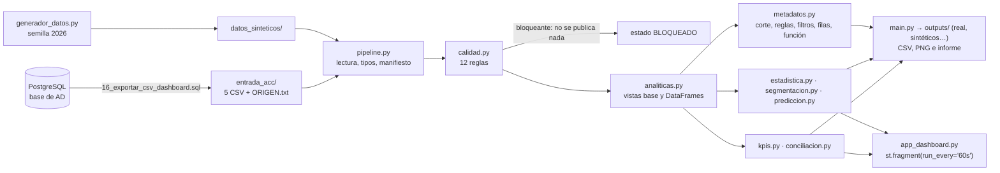

# NOVA Sneakers · Informe técnico de Python

Ampliación de Python: ciencia de datos y dashboard. Es el informe técnico que pide la rúbrica: «Uno técnico (método, pruebas, métricas, sesgos)» (PY-194), con el contenido de la memoria técnica de Python (PY-215). El informe ejecutivo, con las cinco decisiones priorizadas, es `04_Python/informe_ejecutivo.md`.

**Convenciones.** Las rutas son relativas a la raíz del repositorio; casi todo el código está en `04_Python/`. Los IDs PY-xx son los de la matriz de requisitos de la rúbrica de Python, y el estado de cada uno está en `06_Intermodular/rubricas/MATRIZ_RUBRICAS.md` §2.4. Marcas:

- **[PENDIENTE (quién): …]**: falta hacerlo;
- **[POR DECIDIR (los tres): …]**: una decisión del equipo;
- **[DUDA PARA EL PROFESOR (Dn): …]**: una pregunta abierta.

**Versión:** rama `integracion/candidata-2`, commit `1bcbb10`. Todas las cifras de pruebas son de la **regresión final del 13/11/2026**, sobre ese árbol exportado con `git archive` (`06_Intermodular/evidencias/regresion-final/`).

---

## 0. Antes de leer: de dónde sale cada cifra

La rúbrica obliga a no mezclar nunca datos reales y sintéticos, ni a presentar predicciones sintéticas como conclusiones de negocio (PY-29). En este informe cada cifra lleva su origen:

| Etiqueta | Qué es | De dónde sale | Para qué se usa |
|---|---|---|---|
| **PRUEBA** | Exportación de Acceso a Datos de una base **de prueba** reconstruida desde cero con los scripts 1–17 | `entrada_acc/` (`ORIGEN.txt`: «Tipo: PRUEBA») | El dashboard operativo por defecto, la calidad, los KPIs y la conciliación con SQL |
| **SINTÉTICO** | Histórico inventado por `generador_datos.py` con la semilla 2026 | `datos_sinteticos/limpios/` y `con_errores/` | Estadística, RFM, KMeans y predicción, que necesitan historial |
| **REAL** | Exportación de la base **del equipo** | **[PENDIENTE (los tres): todavía no existe]** | Lo que se tiene que enseñar en la defensa (PY-40, 130 y 138) |

**Ninguna cifra de este informe es una venta real de NOVA.** Los datos de PRUEBA son 12 pedidos de un solo día y 6 clientes, de los que solo uno tiene una compra válida (`04_Python/kpis_y_graficos.md`).

**Decisión de entrega (13/11):** los cinco CSV se entregan como PRUEBA (`entrada_acc/ORIGEN.txt`, «Tipo: PRUEBA»); no hay exportación REAL de la base del equipo. Si se hiciera, los pasos están en `04_Python/conciliacion_sql.md` (exportar con el 16 y regenerar a la vez P-A, P-B, P-C y N-1 a N-3). **[DUDA PARA EL PROFESOR (D11): ¿cuenta como REAL una base de prueba montada con los scripts?]**

---

## 1. Objetivo y preguntas

El sistema responde a las seis preguntas del apartado 2 de la rúbrica (PY-04 a PY-09):

| Pregunta | Dónde se responde |
|---|---|
| ¿Qué volumen se ha vendido y qué parte es cancelada, pendiente o personalizada? | KPIs K01–K12, `pedidos_por_estado`, `custom_vs_estandar` |
| ¿Qué modelos, tallas y periodos concentran la demanda? ¿Hay estacionalidad? | `modelos_abc`, `matriz_modelo_talla`, `matriz_modelo_mes`, `ventas_por_periodo` |
| ¿Qué clientes tienen más valor, recurrencia o tiempo sin comprar? | RFM y KMeans (`segmentacion.py`) |
| ¿Qué problemas de los CSV impiden confiar en los resultados? | Las 12 reglas (`calidad.py`) |
| ¿Dónde puede haber rotura de stock? | `stock_variantes`, `stock_bajo` y cobertura |
| ¿Se puede estimar la demanda y superar a una predicción ingenua? | `prediccion.py` |

---

## 2. Método: arquitectura y flujo

Flujo obligatorio de la rúbrica (PY-10), tal como está implementado:

- **Dos entradas ejecutables** que usan las mismas funciones: `main.py` (consola) y `streamlit run app_dashboard.py` (navegador). Así no hay dos fórmulas para el mismo KPI (PY-115).
- **La interfaz no calcula.** `app_dashboard.py` solo llama a `actualizacion`, `filtros`, `analiticas`, `kpis`, `visualizaciones`, `metadatos` e `informe`. Esos módulos no importan Streamlit y se prueban con `unittest` (PY-15 y PY-177).
- **Configuración fuera del código** (`config.py`): carpetas, formato, catálogos de estados, criterio de venta, umbrales (stock bajo 10, demanda 28 días, ABC 80/95 %), semilla 2026, 2.000 remuestreos, k de 2 a 5, 3 meses de evaluación y 60 segundos de refresco.
- **Tres modos** con carpetas separadas, para que nunca se mezclen: `real` (lee `entrada_acc/`, escribe `outputs/real/`), `sintetico` y `sintetico-errores` (`04_Python/README.md`, «Ejecución»).
- **Dependencias fijas** (`requirements.txt`): pandas 3.1.1, NumPy 2.5.4, Matplotlib 3.11.2, scikit-learn 1.9.1 y Streamlit 1.67.0. Python 3.12 o superior (probado con 3.13.5).

El código se simplificó el 12/11 para que sea más fácil de leer y explicar (cambios de comentarios y simplificaciones locales). Después de cada grupo de cambios se pasaron todas las pruebas y se compararon las 93 salidas de `main.py` con el original: idénticas (el informe de la simplificación está en el informe de integración). La regresión del 13/11 lo ha vuelto a comprobar sobre el árbol final (§15.2).

---

## 3. Contrato de datos (PY-19 a PY-28)

Python no se conecta a PostgreSQL: lee los cinco CSV que exporta Acceso a Datos.

| Archivo | Columnas reales (equivalencia con la rúbrica en `diccionario_datos.md`) |
|---|---|
| `clientes.csv` | `id_cliente`, `nombre`, `tipo`, `correo`, `telefono`, `activo` |
| `modelos.csv` | `id_modelo`, `nombre_modelo`, `descripcion`, `precio_base`, `activo` (no hay categoría en el esquema) |
| `pedidos.csv` | `id_pedido`, `referencia`, `id_cliente`, `fecha_pedido`, `tipo_pedido`, `estado_pedido`, `estado_pago`, `personalizacion`, `cantidad_total`, `importe_total` |
| `lineas_pedido.csv` | `id_linea`, `id_pedido`, `sku`, `id_modelo`, `talla`, `cantidad`, `precio_unitario`, `importe_linea` |
| `stock.csv` | `sku`, `id_modelo`, `color`, `talla`, `activo`, `stock_disponible`, `fecha_corte` |

**Formato** (`diccionario_datos.md`, «Formato de los cinco archivos»; `02_Acceso_Datos/documentacion/README.md` §14): UTF-8 (se acepta el BOM de Excel), coma como separador, primera fila con los nombres, punto decimal y sin símbolo de moneda (euros), fechas `AAAA-MM-DD HH:MM:SS`, lógicos `true`/`false` y un campo vacío es un nulo.

**Los ID son identificadores, no cantidades:** se leen como texto y nunca entran en un cálculo estadístico (PY-26; prueba `test_identificadores_que_no_se_confunden`).

El diccionario de datos, con significado, origen, tipo, valores y tratamiento de nulos, está en `diccionario_datos.md` (PY-25). La unidad va dentro de la columna de valores, no en una columna propia.

---

## 4. ETL: ingesta y trazabilidad (PY-42 a PY-47)

- **Comprobación anticipada:** antes de calcular nada se comprueba que existen los cinco archivos, que no están vacíos, que son UTF-8 y CSV correctos y que tienen las columnas obligatorias (`pipeline.py`).
- **Los originales no se tocan:** `pipeline.guardar_salida` se niega a escribir en la carpeta de entrada (`test_nunca_escribe_en_la_carpeta_de_entrada`).
- **Manifiesto de origen:** archivo, fecha de análisis, filas, columnas y tamaño. El dashboard añade la huella SHA-256 de cada CSV.
- **Conversión explícita** de tipos y fechas; las conversiones fallidas se apuntan (`test_fecha_y_logico_mal_formados`).
- **Linaje:** todos los CSV de salida empiezan por las columnas `origen` y `ejecucion`, y cada gráfico lleva en el pie el origen, el corte, el momento del cálculo, los filtros y el IVA (PY-190). Los metadatos completos de cada DataFrame están en el §7.

---

## 5. Calidad: las 12 reglas (PY-48 a PY-64)

Una función por regla en `calidad.py`. Cada incidencia guarda tabla, registro, fila, columna, valor tal como venía, gravedad, tratamiento y detalle (`calidad_datos.md`).

| Regla | Qué comprueba | Gravedad |
|---|---|---|
| 01 | Archivo vacío, no UTF-8, mal formado o sin las columnas obligatorias | Bloqueante; solo la cabecera, advertencia |
| 02 | ID repetidos (`id_cliente`, `id_modelo`, `id_pedido`, `referencia`, `id_linea`, `sku`) | Repetido, bloqueante; vacío, recuperable |
| 03 | Claves huérfanas en pedidos, líneas y stock | Bloqueante |
| 04 | Fecha nula o imposible | Recuperable |
| 05 | Cantidad nula, cero o negativa | Recuperable |
| 06 | Precio o importe no numérico o negativo | Recuperable (`precio_base`, advertencia) |
| 07 | Estado o tipo fuera del catálogo de `config.py` | Recuperable (pago y tipo de cliente, advertencia) |
| 08 | Talla distinta de la de su SKU o fuera de 20–55 | Recuperable |
| 09 | Falta el cliente o el modelo | Recuperable |
| 10 | Líneas duplicadas por pedido + SKU | Advertencia: no se borra |
| 11 | Stock negativo o dos SKU con el mismo modelo, color y talla | Recuperable |
| 12 | Pedido posterior al corte, dos fechas de corte, importes que no cuadran, pedido sin líneas, Custom sin personalización, reembolsado sin cancelar o posible pedido repetido | Según el caso |

**Tratamiento y por qué** (PY-61 y PY-62):

- **Bloqueante:** el conjunto no es fiable; no se publica ninguna cifra.
- **Recuperable:** se rechaza la fila (a `filas_rechazadas.csv`) y **también su pedido entero**, para no contar nunca un pedido a medias.
- **Advertencia:** la fila se queda y se avisa.
- **Nunca se corrige ni se inventa un valor:** un nulo no pasa a 0, un estado mal escrito no se arregla solo y no se borra un duplicado sin saber qué identifica la fila.
- **Adaptación de la regla 11:** la rúbrica habla de «modelo-talla», pero el stock tiene una fila por color; la clave real es modelo + color + talla, que es el SKU.

**Resultados:**

| Datos | Resultado | Fuente |
|---|---|---|
| PRUEBA | 100 % en las cinco tablas; 2 advertencias de la regla 12 (posible pedido repetido: `NOVA-0011` y `CUSTOM-40`) y ninguna fila rechazada | `calidad_datos.md`; repetido el 13/11 en `06_Intermodular/evidencias/regresion-final/04_python/` |
| SINTÉTICO limpio | 0 incidencias y 100 % | `datos_sinteticos.md` |
| SINTÉTICO con errores | Saltan las reglas 02 a 12 y el estado es «DATOS BLOQUEADOS» (código 1) | `datos_sinteticos.md`; código 1 también en la regresión del 13/11 |
| Copia de `entrada_acc/` con un ID huérfano, una fecha inválida y un duplicado (caso D) | Tres alertas independientes (reglas 03, 04 y 02), sin publicar cifras y sin cambiar el original | `calidad_datos.md`, caso D |
| Exportación con SO024 PROVISIONAL (13/11) | Las mismas 2 advertencias de siempre; SO024 no genera ninguna incidencia | `06_Intermodular/evidencias/regresion-final/06_so024_provisional/05_python_main.txt` |

**[POR DECIDIR (los tres): si `NOVA-0011` (pendiente) y `CUSTOM-40` (confirmado) son el mismo encargo.]** Python no borra ninguno de los dos: solo avisa.

---

## 6. Integración relacional: las dos vistas base (PY-65 a PY-69)

- **`df_lineas_enriquecidas`:** una fila por línea, con pedido, cliente, modelo y color (26 columnas).
- **`df_pedidos_unicos`:** una fila por pedido, con su cliente y las métricas de sus líneas (29 columnas).

Cada `merge` declara su cardinalidad con `validate=` (muchos a uno o uno a uno) y comprueba con `indicator=True` que todas las filas encuentran pareja. Si un cruce multiplicara filas o perdiera claves, el programa se para: no hay joins silenciosos (`diccionario_datos.md`, «DataFrames de análisis»).

**Por qué un pedido con tres líneas no son tres pedidos** (PY-67). Las líneas son las tallas o los modelos de un pedido. Si se contaran líneas, un pedido Custom de 9 tallas valdría por 9 pedidos, el ticket medio se dividiría entre 9 y el RFM le daría a ese cliente 9 compras. Por eso los pedidos se cuentan en `df_pedidos_unicos` y los pares y el importe se suman desde las líneas. Lo comprueban:

- `test_tablas_kpis_y_graficos`, con los sintéticos: 900 pedidos, no 1.777 líneas;
- `test_pedido_custom_de_40_pares_linea_a_linea` (caso A): un Custom de 40 pares en 4 tallas, línea a línea, cuenta como **un** pedido en la matriz y en los KPIs, que suben 1 pedido, 40 pares y su importe;
- la cadena SO024 PROVISIONAL del 13/11: Python saca **un solo pedido** de 9 líneas, 40 pares y 3.996,00 € (`06_Intermodular/evidencias/regresion-final/06_so024_provisional/06_pedidos_unicos_SO024.csv`).

**Variables derivadas** (PY-70): 18, de calendario (`anio`, `mes`, `anio_mes`, `trimestre`, `dia_semana`), del pedido (`antiguedad_dias`, `num_lineas`, `num_modelos`, `num_tallas`, `pares`, `importe`, `precio_medio_par`, `pedido_multimodelo`, `modelo_pedido`) y de estado (`es_custom`, `es_cancelado`, `es_confirmado`, `participacion_linea`). Cada una con su cálculo, unidad, nivel y disponibilidad en `diccionario_datos.md`. No se fabrica nada: no hay variable de margen (no hay coste) ni de categoría (no existe).

**Fugas de información** (PY-71): `es_cancelado`, `es_confirmado` y `antiguedad_dias` dependen de la fecha de corte. Por eso no son variables de entrada de la predicción.

---

## 7. DataFrames analíticos (PY-142 a PY-160)

14 tablas analíticas, además de las dos vistas base (`kpis_y_graficos.md`):

| Nº de la rúbrica | Archivo | Qué contiene | Con PRUEBA |
|---|---|---|---|
| 01 | `pedidos_unicos.csv` | Una fila por pedido, sin el nombre del cliente | 12 filas |
| — | `pedidos_por_estado.csv` | Pedidos, pares e importe de los 6 estados | 6 |
| 02 | `ventas_por_periodo.csv` | Venta por mes, ticket, variación, media de los 3 meses previos e interanual | 1 (un solo mes) |
| 03 | `modelos_abc.csv` | Ranking, peso, acumulado y clase A/B/C | 7 |
| — | `ventas_por_talla.csv` | Pares por talla y su peso | 5 |
| 04 | `matriz_modelo_talla.csv` y `…_proporcion.csv` | Pares por modelo × talla y qué parte de cada modelo es cada talla | 6 × 5 |
| (6.9) | `matriz_modelo_mes.csv` | Pares por modelo × mes | 6 × 1 |
| 05 | `custom_vs_estandar.csv` | Tasa de cancelación (pedidos), cuotas de demanda y ticket por tipo | 2 |
| 06 | `clientes_actividad.csv` (+ `rfm_clientes.csv` en la fase 5) | Actividad por cliente y RFM | 6 |
| 07 | `cohortes.csv` | Retención por mes de primera compra | **NO CALCULABLE** |
| 08 | `stock_variantes.csv` y `stock_bajo.csv` | Stock por SKU, demanda de 28 días, alerta y cobertura | 60 y 0 |
| 09 | `resumen_calidad.csv`, `incidencias.csv` y `nulos_por_columna.csv` | Calidad por tabla, incidencias y nulos | 5, 2 y 36 |
| 10 | `anomalias.csv` | Atípicos de precio y cantidad con IQR por grupo comparable | 9 grupos, 0 atípicos |
| 11 | `precio_y_margen.csv` | Precio medio ponderado; margen **NO CALCULABLE** (no hay coste) | 7 |
| 12 | `conciliacion_sql.csv` y `contraste_sql_caso_n.csv` | Conciliación con P-A, P-B y P-C, y contraste del caso N | 21 y 17 cifras, todas coinciden |

Si a una métrica le faltan campos o periodos, su DataFrame existe con estado «NO CALCULABLE» y el motivo, nunca con ceros (PY-157).

**Metadatos de cada DataFrame (PY-159).** La rúbrica pide la fecha de corte, las reglas de negocio, los filtros, las filas de origen y la función que lo genera, incorporados o vinculados. `metadatos.py` los calcula de dos formas:

- **Vinculados:** cada ejecución de `main.py` escribe `metadatos_dataframes.csv`, con una fila por CSV de salida (en modo real, 40 filas), enlazada por el nombre del archivo y la columna `ejecucion`. También se escribe con los datos bloqueados.
- **Incorporados:** cada descarga del dashboard lleva en columnas `fecha_corte`, `funcion`, `reglas_de_negocio` y `filas_origen`, y su columna `filtros` dice solo los que se le aplican (el stock, solo modelo y talla; RFM y la predicción, «ninguno (resultado global)»).

Pruebas: `test_metadatos_de_cada_dataframe`, `test_metadatos_tambien_con_datos_bloqueados`, `test_descarga_con_sus_metadatos`, `test_el_stock_solo_lleva_los_filtros_de_modelo_y_talla` y `test_cada_dataframe_dice_una_funcion_que_existe`.

---

## 8. KPIs (PY-72 a PY-82)

**Qué pedidos cuenta cada cifra** (`kpis_y_graficos.md`):

| Población | Pedidos | Para qué |
|---|---|---|
| todos | Todos los pedidos válidos | Actividad registrada |
| demanda | Los no cancelados (criterio del panel P-A de Acceso a Datos) | Qué hay que fabricar |
| venta | `confirmado`, `en_preparacion`, `enviado` y `entregado` (apartado 6.5) | Importe vendido, ticket y precio medio |
| pagado | `estado_pago = pagado` | No es un cobro comprobado |

**Los 20 KPIs**, con sus valores con los datos de **PRUEBA**:

| Código | KPI | Fórmula | Valor (PRUEBA) |
|---|---|---|---|
| K01 | Pedidos registrados | nº de pedidos | 12 |
| K02 | Pedidos confirmados | confirmados en adelante | 1 |
| K03 | Pedidos cancelados | cancelados | 0 |
| K04 | Pares solicitados | pares de los no cancelados | 90 |
| K05 | Pares confirmados | pares de los confirmados en adelante | 40 |
| K06 | Importe registrado | importe de todos | 10.686,45 € |
| K07 | Importe confirmado | importe de los confirmados en adelante | 4.796,00 € |
| K08 | Importe con pago registrado | `estado_pago = pagado` | 0,00 € |
| K09 | Ticket medio | K07 / K02 (entre pedidos, nunca entre líneas) | 4.796,00 € (1 pedido) |
| K10 | Pares por pedido | K05 / K02 | 40 |
| K11 | Precio medio por par | K07 / K05 (ponderado) | 119,90 € |
| K12 | Pedidos Custom | custom no cancelados / no cancelados × 100 | 41,7 % (5 de 12) |
| K13 | Modelo más solicitado | máximo de pares por modelo (con empates) | NOVA Velocity, 82 pares (91,1 %) |
| K14 | Talla más solicitada | máximo de pares por talla | Talla 42, 23 pares (25,6 %) |
| K15 | Concentración de Pareto | pares del 20 % de modelos con más pares / total | 91,1 % |
| K16 | Stock total | suma de `stock_disponible` | 1.160 pares |
| K17 | Referencias con stock bajo | SKU con menos de 10 pares | 0 |
| K18 | Margen | importe − coste | **NO CALCULABLE**: no hay coste unitario |
| K19 | Variación mensual del importe | último mes / anterior − 1 | **NO CALCULABLE**: un solo mes |
| K20 | Cobertura de stock | stock / (demanda de 28 días / 4) | **NO CALCULABLE**: 0 días de historial |

- **Sin coste no hay margen:** no se calcula «beneficio» con el precio de venta (PY-82).
- **Ninguna cifra se llama «ingresos cobrados».** **[POR DECIDIR (los tres): si los importes son netos o brutos (IVA). Hoy `config.py` dice `IVA = "pendiente de confirmar"` y así sale en cada gráfico (PY-81 y PY-175).]**
- **[POR DECIDIR (los tres): el criterio de venta de la memoria y del dashboard. Acceso a Datos usa «no cancelado» (P-A) y Python calcula también «registrado» y «confirmados en adelante» (`importes_por_criterio.csv`).]**

---

## 9. Conciliación con SQL (PY-68, PY-201 y PY-210)

Python compara sus cifras con consultas de `02_Acceso_Datos/sql/12_consultas_panel.sql` (`conciliacion_sql.md`):

| Consulta | Qué calcula | Diferencia con Python | Resultado (PRUEBA) |
|---|---|---|---|
| P-A | Pedidos no cancelados, sus pares y su importe | SQL usa los totales de la cabecera; Python suma las líneas. SQL cuenta todos; Python, los válidos | 12 pedidos, 90 pares y 10.686,45 €: 3 de 3 coinciden |
| P-B | Lo mismo por estado | Ídem | Pendiente (11, 50, 5.890,45 €) y confirmado (1, 40, 4.796,00 €): 6 de 6 |
| P-C | Pares y pedidos por modelo | SQL llega al modelo por el SKU; Python, por el `id_modelo` de la línea | 6 modelos × 2 cifras: 12 de 12 |
| **N-1** (caso N) | Ingresos de un mes: pedidos, pares e importe de los confirmados en adelante del mes `mes_contraste` | Cabecera frente a líneas | 2026-11: 1 pedido, 40 pares y 4.796,00 € (es CUSTOM-40; NOVA-0011 está pendiente y no es venta) |
| **N-2** (caso N) | Matriz talla × modelo de los pedidos no cancelados | SQL llega al modelo y a la talla por el SKU; Python, por las columnas de `lineas_pedido.csv` | 11 celdas; NOVA Velocity: 20, 21, 20 y 21 pares en las tallas 40 a 43 |
| **N-3** (caso N) | Clientes únicos con pedidos, con demanda y con venta | Todos frente a los válidos | 6, 6 y 1 |

**Resultado: 21 de 21 cifras de P-A a P-C y 17 de 17 del caso N coinciden** (`main.py` lo dice: «caso N: 17 de 17 cifras coinciden con SQL»; regresión del 13/11 en `06_Intermodular/evidencias/regresion-final/04_python/03_salidas_93.txt`).

Se pueden comparar porque la regla 12 comprueba que la cabecera es la suma de sus líneas, y porque con esta exportación no se rechaza ninguna fila. Los euros se dan por iguales con medio céntimo de diferencia (`TOLERANCIA_EUROS = 0.005`); el resto tiene que ser exacto. Si algo no coincide, sale `NO COINCIDE`, el estado es `NO CUADRA CON SQL` y `main.py` termina con código 1. Los siete KPIs que también calcula Acceso a Datos (K01 a K07) coinciden con P-A y P-B (`coherencia_kpis_sql.csv`). El dashboard enseña las dos conciliaciones en la pestaña Calidad.

**Discrepancias del caso N y cómo se corrigen** (`conciliacion_sql.md`): criterio distinto en cada lado (los dos usan los estados de `config.py`; `test_discrepancias_detectadas` lo provoca a propósito), otro mes (N-1 se lanza con el mes de la exportación), filas rechazadas (la diferencia son exactamente las de `filas_rechazadas.csv`) y una base que cambia entre la exportación y las consultas (se repiten las dos cosas seguidas). Pruebas: `PruebasCasoN` (coincide, mes sin ventas, discrepancias y pendiente).

Los resultados SQL están en `entrada_acc/conciliacion_sql/` (P-A a P-C y N-1 a N-3) y salen de la misma base de prueba que los CSV.

---

## 10. Datos sintéticos (PY-29 a PY-41)

`generador_datos.py` (semilla 2026) genera un histórico **inventado** con las mismas columnas que los CSV de Acceso a Datos (`datos_sinteticos.md`):

| Conjunto | Filas | Mínimo de la rúbrica |
|---|---|---|
| Clientes | 40 (10 empresas y 30 particulares) | 40 |
| Modelos | 12 | 12 |
| Pedidos | 900 | 800 |
| Líneas | 1.777 | 1.600 |
| Stock | 216 SKU (12 × 2 colores × 9 tallas) | — |
| Periodo | 18 meses seguidos, de mayo de 2025 a octubre de 2026; corte el 1/11/2026 | 18 meses |

**Hipótesis de la simulación** (no describen la demanda real): popularidad 1/posición por modelo y 1/posición^0,7 por cliente; tallas de la 38 a la 46 con más peso en las centrales (20 % la 42, 3 % la 38); más pedidos en primavera y en septiembre-octubre y menos en agosto y enero, con un crecimiento del 2 % al mes; un 15 % de pedidos Custom, casi siempre de clubes, de 5 a 20 pares por talla y un 20 % más caros; precios un 5 % más altos desde enero de 2026; un 8 % de cancelados.

**Separación:** los sintéticos tienen su carpeta, `ORIGEN.txt` dice «Tipo: SINTETICO», cada salida lleva «SINTÉTICO» en la columna `origen` y el dashboard los rotula en violeta. Nunca se escriben en `entrada_acc/` (`test_nunca_se_guarda_en_entrada_acc`). La copia con errores (`con_errores/`) lleva `errores_introducidos.csv` con lo que se ha estropeado a propósito.

---

## 11. Estadística (PY-83 a PY-90)

`estadistica.py`; detalle en `estadistica.md`.

### 11.1 Descriptivos

Media, mediana, moda (solo si tiene sentido), desviación típica, percentiles, rango intercuartílico y coeficiente de variación de tres variables (importe por pedido, pares por pedido y precio por par), en total y por tipo, sobre los pedidos no cancelados. **Regla para elegir el resumen:** si la media se separa más de un 20 % de la mediana, se recomienda la mediana.

Resultado **SINTÉTICO**: el importe medio de todos los pedidos es 1.013,45 €, pero la mediana es 259,98 €, porque los 130 pedidos Custom (unos 5.000 € cada uno) arrastran la media. Separando tipos, media y mediana se parecen: para hablar del pedido típico hay que separar normal y Custom. Con los datos de **PRUEBA** pasa lo mismo, más exagerado: la media de pares por pedido es 7,5 aunque 10 de los 12 pedidos son de 1 par.

### 11.2 Hipótesis (escritas antes de calcular, en la cabecera de `estadistica.py`)

Intervalo de confianza del 95 % por bootstrap (2.000 remuestreos, semilla 2026). Regla: si la referencia (0 o 50 %) cae dentro del intervalo, «evidencia insuficiente».

| Hipótesis | Método | SINTÉTICO | PRUEBA |
|---|---|---|---|
| H1. Los pedidos Custom dejan más importe por pedido | Diferencia de medianas (Custom − estándar) | +4.636,16 € (IC 95 %: 4.099,57 a 4.948,98) → la apoyan | +20,09 € (IC: 5,00 a 4.716,01) con 5 y 7 pedidos: muy provisional |
| H2. Las tallas 41–43 reúnen más de la mitad de los pares | Proporción frente al 50 % | 53,2 % (IC: 49,46 a 57,11) → **evidencia insuficiente** | 74,4 % (IC: 45,68 a 97,53) → evidencia insuficiente |
| H3. La demanda crece (últimos 6 meses frente a los 6 anteriores) | Diferencia de medias mensuales | −50,2 pares/mes (IC: −187,51 a +99,17) → **evidencia insuficiente** | No se puede contrastar: un solo mes |

H1 se confirma con los sintéticos, pero solo porque el generador hace a los Custom más grandes y más caros: demuestra que el método detecta una diferencia que existe. H3 es un buen ejemplo de que **no ver una diferencia no demuestra que no exista**: el generador tiene un crecimiento del 2 % al mes y los datos no lo demuestran.

### 11.3 Bootstrap del ticket medio (PY-88)

| Datos | n | Estimación | IC 95 % |
|---|---|---|---|
| SINTÉTICO | 822 pedidos de venta | 1.011,41 € | 878,59 € a 1.153,02 € |
| PRUEBA | 1 pedido | 4.796,00 € | NO CALCULABLE |

### 11.4 Atípicos (PY-86)

Regla IQR por grupo comparable (precio por modelo y tipo, cantidad por tipo), con un mínimo de 5 valores por grupo (`MINIMO_MUESTRA_IQR`). Los atípicos se marcan, **no se borran**. Con PRUEBA: 9 grupos y 0 atípicos.

---

## 12. Segmentación: RFM y KMeans (PY-91 a PY-96)

`segmentacion.py`; detalle en `segmentacion_y_prediccion.md`. **Todo lo que tiene cifras es SINTÉTICO.** Con PRUEBA, RFM da 5 clientes «Sin compras válidas» y 1 NO CALCULABLE (hacen falta al menos 10 clientes con compras), y KMeans es NO CALCULABLE (caso J, PY-206).

### 12.1 RFM

- **Recency:** días desde la última compra válida hasta la fecha de corte (`stock.fecha_corte`, no el día en que se ejecuta). **Frequency:** pedidos distintos, no líneas. **Monetary:** suma del importe de esos pedidos.
- **Compra válida:** confirmado, en preparación, enviado o entregado, el mismo criterio que los KPIs de venta.
- Puntuaciones de 1 a 5 por quintiles con `rank(method="first")` y `qcut`, con los empates resueltos por `id_cliente` para que el resultado sea siempre el mismo.
- **Seis segmentos** con regla y uso comercial: Sin compras válidas, Mejores clientes (R, F y M ≥ 4), En riesgo (F ≥ 3 y R ≤ 2), Habituales (F ≥ 3), Inactivos (R ≤ 2 y F < 3) y Ocasionales.
- **Resultado SINTÉTICO:** 7 «Mejores clientes» (el 17,5 % de los clientes) se llevan el 45,4 % del importe.

### 12.2 KMeans

- Variables: recency, log(1 + frequency) y log(1 + monetary), estandarizadas con `StandardScaler`. El logaritmo evita que unos pocos clubes con importes muy grandes (hasta 173.187 €) decidan solos los grupos; el escalado, que manden los euros.
- Se prueban k = 2, 3, 4 y 5 con `random_state = 2026` y `n_init = 10`, y se elige el **silhouette** más alto.

| k | Silhouette | Inercia |
|---|---|---|
| 2 | 0,348 | 71,78 |
| 3 | 0,361 | 48,10 |
| **4** | **0,373** | 37,31 |
| 5 | 0,319 | 30,12 |

- **k = 4, silhouette 0,373:** separación moderada. El clúster 1 son los 10 clubes; el 2, particulares frecuentes y recientes; el 3, el grueso de particulares con poca actividad; el 4, dos clientes que llevan unos 144 días sin comprar.
- **Comparado con RFM** (`rfm_frente_a_kmeans.csv`): ningún «Mejor cliente» cae en los clústeres de poca actividad, pero KMeans separa sobre todo empresas de particulares, y RFM los mezcla.
- **Por qué un grupo matemático no es una categoría comercial** (PY-95): KMeans solo junta puntos cercanos en tres variables escaladas, y sus grupos cambian si cambian las variables, la escala o k. Las reglas RFM las define el equipo con un umbral explicado y una acción. Aquí KMeans sirve para ver que convendría segmentar empresas y particulares por separado.

---

## 13. Predicción de la demanda frente al baseline (PY-102 a PY-109)

`prediccion.py`; detalle en `segmentacion_y_prediccion.md` §3. **SINTÉTICO.** Con PRUEBA es NO CALCULABLE: no hay ningún mes completo y hacen falta al menos 12.

**Qué se predice:** los pares de cada modelo en un mes (pedidos no cancelados). 12 modelos × 18 meses = 216 filas.

**Variables de entrada, todas anteriores al mes que se predice:** pares del mes anterior, media de los 3 meses anteriores (sin el mes que se predice), seno y coseno del mes del año y el modelo en columnas de 0 y 1 (*one-hot*, quitando una). Se calculan con `shift` dentro de cada modelo.

**Separación por fecha, nunca al azar:**

| Conjunto | Meses | Filas |
|---|---|---|
| Historial (sin 3 meses previos) | 2025-05 a 2025-07 | 36 |
| Entrenamiento | 2025-08 a 2026-07 | 144 |
| Evaluación | 2026-08 a 2026-10 (los 3 últimos) | 36 |

**Métodos:** A, el **baseline** (el mes que viene se piden los mismos pares que este); B, **`LinearRegression`** de scikit-learn, elegida porque se interpreta (coeficientes en `coeficientes_regresion.csv`), encaja con 144 filas y no tiene hiperparámetros que se puedan ajustar mirando la evaluación. Una predicción negativa se deja en 0 (regla fijada antes de ver los resultados; solo afecta a 1).

**Criterio fijado en el código antes de ver los resultados** (`prediccion.mejora`): la regresión solo «mejora al baseline» si baja el MAE **y** el RMSE.

### 13.1 Métricas

| Método | MAE (pares) | RMSE (pares) | ¿Mejora? |
|---|---|---|---|
| A. Baseline | **25,03** | 37,42 | Es la referencia |
| B. Regresión lineal | 26,28 | **36,15** | Solo en una métrica: el RMSE sí, el MAE no |

**La regresión NO mejora al baseline de forma clara** y se dice así (PY-109). No se cambiaron los datos ni las variables después de ver el resultado. El gráfico real frente a predicción es `graficos_prediccion/11_real_frente_a_prediccion.png` y la tabla por modelo, `errores_por_modelo.csv` (por MAE, la regresión se equivoca menos en 6 modelos y el baseline en los otros 6).

### 13.2 Análisis de errores

- El 75 % de los pares de los meses de evaluación son pedidos Custom de clubes, que llegan de forma irregular (SINT Trail pasa de 9 pares en julio a 99 en agosto). Lo que pasó el mes anterior predice mal el siguiente.
- El baseline va un mes tarde: copia el pico del mes anterior (sus errores más grandes son de 93, 90 y 74 pares).
- La regresión predice cerca de la media de cada modelo: acierta más en los modelos con picos sueltos y falla más en los estables o pequeños.
- 144 filas son pocas: cada mes del año aparece una sola vez en el entrenamiento, así que la estacionalidad apenas se puede estimar.

---

## 14. Dashboard Streamlit, refresco cada 60 s e informe ejecutivo (PY-110 a PY-141 y PY-161 a PY-189)

`app_dashboard.py`; detalle en `dashboard.md`.

### 14.1 Vistas, filtros y descargas

- **Seis pestañas:** Dirección, Productos, Clientes, Inventario, Calidad y Predicción. La sexta es un **laboratorio** con datos sintéticos rotulado como tal. **[DUDA PARA EL PROFESOR (D11): ¿se pueden enseñar predicciones sintéticas en esa pestaña, y son 5 o 6 pestañas?]**
- **Origen siempre visible:** etiqueta de color (naranja PRUEBA, violeta SINTÉTICO, verde REAL), aviso fijo y el origen en cada gráfico y cada descarga.
- **Seis filtros combinables** (PY-168 y 169): periodo, modelo, talla, tipo de pedido, estado y **cliente** (por `id_cliente` y su tipo, sin nombres). Están en `filtros.py`, fuera de Streamlit, y «Restablecer filtros» los vacía todos. Periodo, tipo, estado y cliente son del pedido; modelo y talla, de la línea; un pedido cuenta una vez si tiene al menos una línea que cumple. En Dirección se dice el denominador («N de M pedidos…»). RFM, KMeans, predicción y las conclusiones son globales y van rotulados. Pruebas: `test_cliente_es_del_pedido` y `test_filtro_de_cliente_combinado_y_restablecer`.
- **Visualizaciones:** los 10 gráficos de Matplotlib de `visualizaciones.py` (barras, Pareto, tallas, serie temporal, mapa de calor modelo × talla, comparativa Custom/estándar, ranking de clientes, histograma de stock, caja de importes por tipo y dispersión pares × importe) y el de real frente a predicción. Cada uno con «Ver los datos del gráfico».
- **Diez descargas CSV** en UTF-8, con cabecera, las columnas de linaje y los metadatos del §7 (`origen`, `ejecucion`, `filtros`, `fecha_corte`, `funcion`, `reglas_de_negocio` y `filas_origen`), el origen en el nombre y sin nombres, correos ni teléfonos de clientes.

### 14.2 Cómo funciona el refresco

- `panel()` es un `@st.fragment(run_every=f"{config.SEGUNDOS_REFRESCO}s")`, con `SEGUNDOS_REFRESCO = 60`. No hay `time.sleep`, bucles ni recargas del navegador (PY-134 y 135).
- **Cada ciclo** (`actualizacion.ciclo`): 1) comprueba qué archivos hay, su tamaño, su fecha y su huella SHA-256; 2) relee los CSV y los valida con las 12 reglas; 3) si son válidos, recalcula todo con esa misma versión; 4) publica un resultado completo o ninguno; 5) anota el ciclo en `logs/registro_eventos.csv`.
- **Siempre se recalcula**, aunque los CSV no hayan cambiado; si la huella es la misma, el estado es «Sin cambios».
- **Los filtros y la pestaña sobreviven al refresco** (PY-136): con Productos abierta y los filtros de cliente y talla puestos, llega una exportación nueva; al minuto sigue la misma pestaña, con los mismos filtros, sin nada duplicado y con las cifras nuevas (`test_filtros_y_pestana_se_mantienen_al_refrescar`).
- **Botón «Actualizar ahora».**
- **Estados:** Correcto, Sin cambios, Datos inválidos y Error de carga. Con datos bloqueados no se publica ninguna cifra; el último resultado válido se puede ver con un interruptor, rotulado **DESACTUALIZADO** y con su fecha (PY-139 y 140).
- **Cabecera:** estado, última comprobación, última actualización válida, filas válidas, fecha de corte, versión (huella), tiempo de procesamiento y avisos de archivos que faltan, vacíos, antiguos o de momentos distintos.
- **Dependencia documentada** (PY-133): Python solo lee CSV. Un pedido nuevo en PostgreSQL **no aparece hasta que Acceso a Datos vuelve a exportar** con el script 16. Sin exportación nueva, cada minuto se recalcula, pero las cifras no tienen por qué cambiar.

### 14.3 Demostraciones en Edge

**Datos nuevos y recuperación (9 y 10/11, sobre una copia de `entrada_acc/` con datos de PRUEBA):**

| Paso | Cambio | A los 60 s |
|---|---|---|
| R5 | Ninguno | «Sin cambios»; la comprobación pasa de 12:28:39 a 12:29:41; las cifras no cambian |
| R1 | Un pedido confirmado nuevo con 2 líneas (3 pares, 239,97 €) | «Correcto»: 12 → 13 pedidos, 1 → 2 confirmados, 90 → 93 pares y 4.796,00 → 5.035,97 €, sin contar nada dos veces |
| R4 | Se quita `pedidos.csv` | «Error de carga» y «Falta pedidos.csv»; sin cifras; el interruptor enseña las anteriores como DESACTUALIZADO |
| Recuperación | Vuelve `pedidos.csv` | Vuelven las cifras |

Fuente: `dashboard.md` y las capturas de `04_Python/evidencias/dashboard/` (`refresco_*`). R2 (cancelación) y R3 (stock) se comprueban con CSV inventados en `test_actualizacion.py` y `test_dashboard.py`.

**Caso K: tres ciclos de 60 s sin tocar el navegador (13/11, 00:44–00:47, rama final).** El dashboard servido con `streamlit run` y abierto en Edge (Playwright, sin ventana), con una copia de la exportación de PRUEBA. Cuatro horas de comprobación distintas (00:44:28, 00:45:31, 00:46:31 y 00:47:31), tres «Sin cambios», las cifras iguales y el registro de eventos con la carga inicial y 3 comprobaciones automáticas: **4 PASS** (`04_Python/evidencias/dashboard/caso_k_registro.txt` y las capturas `caso_k_0` a `caso_k_3`).

**R6 · filtrado cruzado (PY-188).** Prueba automática con la aplicación de verdad (`AppTest`): con el mismo periodo, modelo y talla se abren Dirección, Productos y Clientes, y se comparan las tarjetas, las tablas de los gráficos y los CSV que se descargan (capturados del propio botón) con un filtro hecho a mano con pandas. Todo cuadra y todas las descargas tienen la misma `ejecucion` y `fecha_corte` (`test_filtrado_cruzado_R6`). En Edge, además, 31 de 900 pedidos y 370 pares filtrados con clics dieron lo mismo que la consola (`dashboard.md`).

**Datos nuevos y recuperación, paso a paso (PY-214).** Para repetirlo en la defensa:

1. Abrir el dashboard (`.venv\Scripts\streamlit.exe run app_dashboard.py`) con la exportación en `entrada_acc/` y apuntar las cifras de Dirección.
2. Dar de alta un pedido desde la aplicación Java (o cancelarlo, o cambiar el stock) y volver a exportar con el 16 en `entrada_acc/`.
3. Esperar al siguiente ciclo (o pulsar «Actualizar ahora»): el estado pasa a «Correcto» y cambian las cifras, sin contar nada dos veces.
4. Para la recuperación: mover fuera `pedidos.csv`; al minuto, «Error de carga», sin cifras y el último resultado válido rotulado DESACTUALIZADO. Devolver el archivo: vuelven las cifras.

Estos pasos están en `dashboard.md`; el README de `04_Python` remite a él, pero no los copia.

**[PENDIENTE (los tres, con la exportación REAL): repetir R1 a R3 y el caso L (un pedido nuevo exportado con el 16 durante la sesión) con la base del equipo, con capturas antes y después (PY-183 a 185, 208 y 216).]**

### 14.4 Informe ejecutivo: impacto y prioridad (PY-110 y PY-111)

`informe.py` calcula las cinco conclusiones a partir de las tablas (si cambian los datos, cambian las cifras) y las escribe en la pestaña Dirección y en `outputs/<modo>/informe_ejecutivo.csv`. Cada una separa **evidencia**, **interpretación**, **decisión** y **limitación**, y lleva además:

- el **impacto esperado**, con su cifra (por ejemplo, «mantener servida la demanda de los modelos A: el 81,7 % de los pares solicitados»);
- el **sustento**: la tabla y el gráfico de los que sale;
- la **prioridad**, con un criterio escrito: primero la urgencia (**alta**: se puede dejar sin servir demanda que ya existe; **media**: sirve para planificar el próximo mes; **baja**: NO CALCULABLE o la decisión es no cambiar nada) y, con la misma urgencia, el número.

Con los sintéticos el orden es **1, 4, 2, 3 y 5**; con PRUEBA, 1 a 5. Pruebas: `test_prioridad_impacto_y_sustento` y `test_sin_datos_la_urgencia_es_baja`. Las cuatro columnas nuevas (`prioridad`, `urgencia`, `impacto_esperado` y `sustento`) son el único cambio de `informe_ejecutivo.csv` frente a la referencia: sus 10 columnas de antes son idénticas (§15.2).

---

## 15. Pruebas

### 15.1 Pruebas automáticas (PY-123 a PY-128)

`.venv\Scripts\python.exe -m unittest discover -s tests -v`: **265 pruebas OK** el 13/11 en 711,5 s, sobre el árbol final (`06_Intermodular/evidencias/regresion-final/04_python/02_unittest.txt`). Cada prueba crea sus propios CSV en una carpeta temporal y nunca usa los reales.

| Archivo | Pruebas | Qué cubre |
|---|---|---|
| `test_pipeline.py` | 20 | Lectura, CSV ausente, vacío, mal formado y con otra codificación |
| `test_calidad.py` | 38 | Al menos un caso por regla, rechazo del pedido entero, CSV de incidencias y resumen |
| `test_analiticas.py` | 28 | Un JOIN que duplicaría filas, una fila por línea y por pedido, variables, tres criterios de importe, la conciliación, el caso N (4) y el caso A línea a línea (1) |
| `test_tablas.py` | 27 | Estados, matriz modelo × talla sin contar dos veces, ABC con empates, meses, cohortes, inventario, margen, atípicos y tablas vacías |
| `test_kpis.py` | 16 | Cada KPI, ticket entre pedidos, NO CALCULABLES y coherencia con PostgreSQL |
| `test_visualizaciones.py` | 8 | Los 10 PNG, sin datos, bloqueado por calidad, con SQL que no cuadra y `metadatos_dataframes.csv` (también bloqueado) |
| `test_sinteticos.py` | 21 | Misma semilla, mismos datos; mínimos; sin huérfanos; separación de `entrada_acc/` |
| `test_estadistica.py` | 15 | Descriptivos con valores conocidos, bootstrap reproducible, hipótesis y evidencia insuficiente |
| `test_segmentacion.py` | 18 | Recency, frequency, monetary, quintiles, k de 2 a 5, reproducibilidad, NO CALCULABLE |
| `test_prediccion.py` | 20 | Ningún mes de evaluación en el entrenamiento (se espía `fit` y, si se multiplican esos meses por 100, los coeficientes no cambian), el mes objetivo no es una entrada, MAE y RMSE con valores conocidos |
| `test_filtros.py` | 18 | Los seis filtros (también el de cliente) frente a un filtro a mano, sin duplicar, KPIs coherentes, CSV descargado con sus metadatos, el stock solo con modelo y talla, cada DataFrame con una función que existe |
| `test_actualizacion.py` | 22 | Ciclo de 60 s, R1 a R5, CSV ausente o corrupto, bloqueo, cambio de origen, registro e informe ejecutivo (prioridad, impacto y sustento) |
| `test_dashboard.py` | 14 | La aplicación de verdad con `AppTest`: pestañas, orígenes, bloqueo, filtros (también el de cliente), filtros y pestaña que se mantienen al refrescar, R6, relectura a los 60 s y «Actualizar ahora» |

Los cinco grupos de la rúbrica están cubiertos: carga y esquema, integridad, cálculo, reproducibilidad y ML/temporalidad. Se usa `unittest` (viene con Python); la rúbrica recomienda pytest, que puede lanzar estas mismas pruebas.

**Instalación desde cero (PY-219).** El 13/11 se siguió `06_Intermodular/manuales/MANUAL_INSTALACION.md` §6 sobre un clon nuevo: entorno virtual nuevo, `pip install -r requirements.txt`, `main.py` en los tres modos y Streamlit (`06_Intermodular/evidencias/regresion-final/08_manual_instalacion/`).

### 15.2 Salidas reproducibles

`main.py` en modo real, sintético y sintético con errores, más el generador, comparado con la referencia guardada antes de los cambios del 13/11 (`06_Intermodular/evidencias/regresion-final/04_python/03_salidas_93.txt`):

- **91 de 93 salidas idénticas** (sin contar la hora y las rutas de la ejecución).
- **2 con columnas nuevas a propósito:** `informe_ejecutivo.csv` real y sintético (+`prioridad`, `urgencia`, `impacto_esperado` y `sustento`); sus 10 columnas de antes, idénticas.
- **4 archivos nuevos a propósito:** `real/contraste_sql_caso_n.csv` y los tres `metadatos_dataframes.csv`. No falta ninguno.
- Los 22 PNG cambian solo por la hora del pie. Los 4 `.log` cambian por las rutas, por las líneas nuevas del caso N y por el tamaño en bytes de los CSV de entrada en el manifiesto (la copia exportada guarda los CSV con fin de línea CRLF; las filas y las columnas son las mismas).
- **Los códigos de salida no cambian:** real 0, sintético 0 y sintético con errores 1 (el bloqueo previsto).

`main.py --modo real` con los CSV del 16: calidad 100 %, 12 pedidos, 90 pares y 10.686,45 €, igual que SQL, y «caso N: 17 de 17 cifras coinciden con SQL».

### 15.3 Los casos de integración A–O (§8 de la rúbrica)

| Caso | Qué pide | Estado (13/11) | Evidencia |
|---|---|---|---|
| A | Pedido Custom de 40 pares: línea a línea y total en los KPIs | Hecho | `test_pedido_custom_de_40_pares_linea_a_linea`; CUSTOM-40 en la exportación de PRUEBA; SO024 PROVISIONAL como un solo pedido de 9 líneas y 40 pares (`06_Intermodular/evidencias/regresion-final/06_so024_provisional/`) |
| B | Cancelado y pendiente: qué es venta y qué es actividad | Hecho | `importes_por_criterio.csv`; `test_kpis.py` |
| C | Alta desde Java → exportación → Python | PROVISIONAL | SO024 creado y confirmado con los métodos de «Nuevo pedido» de Java (no con la ventana) → 15 → PSP → 16 → Python, el 13/11 (`06_Intermodular/evidencias/regresion-final/06_so024_provisional/00_cadena.txt`). **Límite PY-199:** falta la evidencia de alta desde la ventana Java y de indicadores antes/después; no exige el identificador SO024 ni acredita S00005. |
| D | Huérfano, fecha inválida y duplicado: tres alertas | Hecho | `calidad_datos.md`, caso D |
| E | Al menos tres cifras de SQL conciliadas | Hecho | 21 de 21 (§9) |
| F | RFM de un cliente con varios pedidos | Hecho | `test_segmentacion.py` |
| G | Misma semilla, mismos resultados | Hecho | `test_misma_semilla_mismos_datos`; las 93 salidas (§15.2) |
| H | Otro intervalo: tabla, gráfico y totales coinciden | Hecho | `test_filtros.py`; R6 (`test_filtrado_cruzado_R6`) |
| I | Entrenamiento frente a meses reservados | Hecho | `test_prediccion.py` |
| J | Datos insuficientes: aviso honesto | Hecho | NO CALCULABLE con PRUEBA |
| K | Tres ciclos de 60 s | Hecho | Edge, 13/11, 4 PASS (`04_Python/evidencias/dashboard/caso_k_*`); además, 2 ciclos en `AppTest` |
| L | Pedido nuevo exportado durante la sesión | Parcial | R1 con CSV editados a mano (9/11). **[PENDIENTE (los tres, con la exportación REAL): con el 16 sobre la base del equipo]** |
| M | Exportación defectuosa y recuperación | Hecho | R4 en Edge; `test_actualizacion.py` |
| N | Por SQL: ingresos de un mes, matriz talla × modelo y clientes únicos | Hecho | N-1 a N-3 en `12_consultas_panel.sql`: 17 de 17 (§9) |
| O | Descarga filtrada que cuadra con el gráfico; lo sintético no sale como real | Hecho | `test_filtros.py`, R6; en Edge, 31 de 900 pedidos y 370 pares filtrados igual que en la consola (`dashboard.md`) |

---

## 16. Sesgos, supuestos y limitaciones (PY-89 a PY-90)

- **Independencia.** El bootstrap supone valores independientes. Las líneas de un mismo pedido Custom y los meses seguidos no lo son: los intervalos de H2 y H3 serían algo más anchos de verdad.
- **Grupos distintos.** Custom y estándar no son el mismo tipo de cliente (casi todos los Custom son de clubes). Una diferencia entre grupos no demuestra que una cosa cause la otra.
- **Estacionalidad.** H3 compara meses del año distintos.
- **Datos sintéticos.** Cada resultado repite alguna regla del generador: no es evidencia sobre clientes reales.
- **Muestras pequeñas.** Con menos de 30 valores, aviso; con menos de 5, no se calcula.
- **Estados de la fecha de corte.** No hay historial de cambios de estado: un pedido de agosto cancelado en octubre ya no cuenta en la demanda de agosto. Ninguna variable de entrada usa el mes que se predice, pero los meses anteriores se ven con los estados de hoy.
- **Datos de PRUEBA.** 12 pedidos de un día; dos pedidos de 40 pares del mismo club (`NOVA-0011` y `CUSTOM-40`) son 80 de los 90 pares y podrían ser el mismo encargo (`calidad_datos.md`, caso A).
- **El stock es una foto.** Corresponde a la fecha de corte y no se trata como una serie histórica (PY-101). Nunca se suma entre colores.

### Lo que NO se puede afirmar con estos datos (PY-90)

- Que personalizar un pedido haga gastar más a un cliente: H1 compara grupos distintos y no es un experimento.
- Que la demanda de NOVA crezca o no crezca: con los datos de prueba hay 1 mes, y con los sintéticos la diferencia no es concluyente.
- Qué tallas habrá que fabricar el mes que viene: depende de los pedidos de club que entren.
- Que los segmentos o los clústeres describan a clientes reales: son 40 clientes simulados, y un silhouette de 0,373 no indica tipos «naturales».
- Que la regresión sirva para planificar: no ha mejorado al método ingenuo, y con 36 predicciones el orden de los dos métodos podría cambiar con otros 3 meses.

---

## 17. Resumen de métricas

| Métrica | Valor | Origen |
|---|---|---|
| Calidad por tabla | 100 % en las cinco | PRUEBA |
| Conciliación con SQL | 21 de 21 cifras (P-A a P-C) y 17 de 17 (caso N) | PRUEBA |
| KPIs calculables | 17 de 20 (3 NO CALCULABLES con su motivo) | PRUEBA |
| Silhouette (k = 4) | 0,373 | SINTÉTICO |
| MAE baseline / regresión | 25,03 / 26,28 pares | SINTÉTICO |
| RMSE baseline / regresión | 37,42 / 36,15 pares | SINTÉTICO |
| Ticket medio (IC 95 %) | 1.011,41 € (878,59 a 1.153,02) | SINTÉTICO |
| Pruebas automáticas | 265 OK (13/11) | Datos inventados por cada prueba |
| Salidas reproducibles | 91 de 93 idénticas; 2 con columnas nuevas y 4 archivos nuevos, a propósito | PRUEBA y SINTÉTICO |
| Caso K en el navegador | 3 ciclos de 60 s, 4 PASS | PRUEBA |

---

## 18. Lo que falta

| Qué | Requisitos | Quién |
|---|---|---|
| Exportación REAL de la base del equipo, con «Tipo: REAL», y regenerar P-A, P-B, P-C y N-1 a N-3 | PY-40, 130, 138 | **[PENDIENTE (los tres)]** |
| R1–R3 y el caso L con la exportación real; capturas antes y después | PY-183 a 185, 208, 216 | **[PENDIENTE (los tres, con la exportación REAL)]** |
| Alta desde la ventana Java y cambio de indicadores (caso C) | PY-199 | Falta evidencia completa; no hay prueba de S00005 en Python y no se exige crear SO024 |
| Criterio de venta, IVA (neto o bruto), rango de tallas válidas y si NOVA-0011 y CUSTOM-40 son el mismo encargo | PY-74, 81, 175, 56 | **[POR DECIDIR (los tres)]** |
| Pestañas (5 o 6), predicciones sintéticas en la sexta, número de CSV y si una base de prueba cuenta como REAL | PY-40, 161, 167, 192 | **[DUDA PARA EL PROFESOR (D11)]** |
| Copiar al README de `04_Python` los pasos de datos nuevos y recuperación del §14.3 (hoy están en `dashboard.md`) | PY-214 | Omar (documentación) |

Lo que se cerró el 13/11 y antes figuraba aquí: el filtro de cliente (PY-168), los metadatos de cada DataFrame (PY-159), el impacto y la prioridad del informe ejecutivo (PY-110 y 111), R6 (PY-188), que el refresco conserva filtros y pestaña (PY-136), los casos A, K y N (PY-197, 207 y 210) y la instalación desde cero siguiendo el manual (PY-219).
