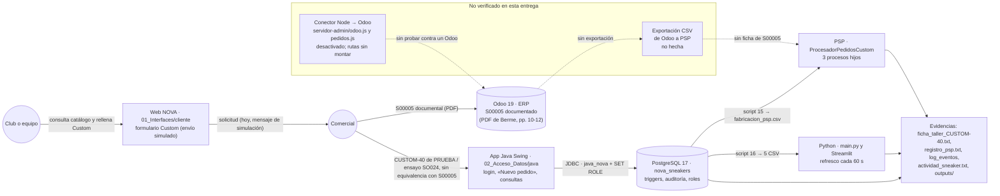
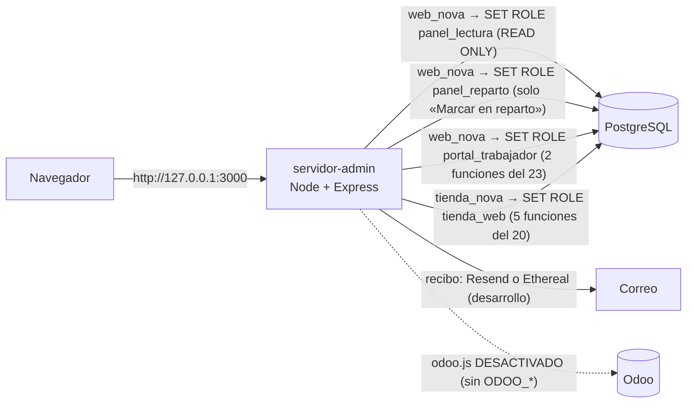

# NOVA Sneakers · Memoria técnica común

Proyecto Intermodular de 2.º DAM (enunciado «Sneaker Factory», versión 0.3).

| Dato | Valor |
|---|---|
| Equipo | Omar, Álvaro y Berme (en Git: `omar1676`, `Alvarobaz` e `Ivan Bermejo`) |
| Versión que se documenta | Rama `main`, commit **`372f811`** (fusión de la PR #3, 13/11/2026). El código es el del commit **`4f09742`**, el que se probó en la regresión de cierre (`06_Intermodular/evidencias/cierre-entrega-20261113/`). De `4f09742` a `372f811` solo cambian documentos y evidencias (`git diff --stat 4f09742 372f811`) |
| Fecha | 13/11/2026 |
| Estado | Versión de entrega. Los campos marcados **[EQUIPO: …]**, **[OMAR: …]**, **[ÁLVARO: …]** o **[BERME: …]** los completan los tres antes de entregar: son datos personales o decisiones que no constan en el repositorio y no se han inventado |

**Marcas que se usan en este documento:**

| Marca | Significa |
|---|---|
| **Límite declarado** | Algo que no está hecho o no está probado en esta entrega. Se dice así y no se presenta como resultado |
| **[EQUIPO: …]**, **[OMAR: …]**, **[ÁLVARO: …]**, **[BERME: …]** | Un dato o una decisión que solo puede dar esa persona o el equipo. Hay que completarlo antes de entregar |
| Dudas D1 a D12 | Las preguntas que solo puede contestar el profesor están en `06_Intermodular/rubricas/MATRIZ_RUBRICAS.md` §5. Aquí solo se citan por su número |

## Cómo leer este documento

- **Rutas.** Todas son relativas a la raíz del repositorio. Por ejemplo, `02_Acceso_Datos/sql/06_consultas.sql`.
- **Evidencias.** Cada asignatura guarda las suyas en su carpeta `evidencias/` (`01_Interfaces/evidencias/`, `02_Acceso_Datos/evidencias/`, `03_PSP/evidencias/` y `04_Python/evidencias/`). La **regresión del código entregado** (`4f09742`, en un clon nuevo) está en `06_Intermodular/evidencias/cierre-entrega-20261113/` (su `README.md` es el índice). Las regresiones anteriores del 13/11, `06_Intermodular/evidencias/regresion-final/` y `06_Intermodular/evidencias/regresion-limpieza/`, son **históricas**: se hicieron sobre árboles anteriores, con la estructura de carpetas antigua (`acceso-datos/`, `psp/`…), y se citan solo para las baterías que no se repitieron en el cierre (§7.2). Las evidencias no se han modificado y citan los identificadores de commit anteriores a la reescritura del 13/11; su equivalente publicado está en `06_Intermodular/EQUIVALENCIAS_COMMITS.md`. Las capturas de la tienda, del portal, del reparto y de Ethereal de ese día están en `01_Interfaces/evidencias/tienda/capturas-2026-11-13/`, `01_Interfaces/evidencias/portal-trabajador/`, `01_Interfaces/evidencias/reparto-y-correo/` y `01_Interfaces/evidencias/correo-ethereal/`.
- **Detalle por requisito.** El estado de cada requisito de las rúbricas, con su evidencia, está en `06_Intermodular/rubricas/MATRIZ_RUBRICAS.md`. Aquí se cita por su ID (IM-INT-04, AD-19, PY-40…).
- **Documentos que acompañan a esta memoria** (cada uno en la carpeta de su asignatura):

| Documento | Qué contiene |
|---|---|
| `02_Acceso_Datos/memoria/MEMORIA_ACCESO_DATOS.md` | El apartado de Acceso a Datos que pide su rúbrica (entregable 05) |
| `04_Python/memoria/INFORME_TECNICO_PYTHON.md` | El informe técnico de Python (método, pruebas, métricas, sesgos y limitaciones) |
| `03_PSP/memoria/DOCUMENTACION_PSP.md` | El diseño completo del subsistema PSP (punto 5 ampliado) |
| `01_Interfaces/memoria/ESTRATEGIA_PRUEBAS_INTERFACES.md` | La estrategia de pruebas de Interfaces y sus resultados (RA8) |
| `01_Interfaces/memoria/PROCEDIMIENTO_USABILIDAD.md` | El procedimiento para la prueba con 3 a 5 personas (RA4), con plantillas vacías |
| `06_Intermodular/manuales/MANUAL_INSTALACION.md` | Cómo instalar, montar la base, arrancar cada parte y pasar las pruebas. Probado el 13/11 sobre un clon nuevo |
| `06_Intermodular/manuales/MANUAL_DEMOSTRACION.md` | El guion de módulos ejecutables y S00005 documental para la defensa |
| `06_Intermodular/rubricas/MATRIZ_EVIDENCIAS.md` | Qué archivo demuestra cada bloque y cómo enseñarlo |
| `06_Intermodular/rubricas/MATRIZ_RUBRICAS.md` | El estado de cada requisito de cada rúbrica, con su evidencia y su riesgo |
| `05_Odoo/CHECKLIST_ODOO_BERME.md` | Plan histórico de SO024, sustituido para esta entrega; no es una obligación actual |
| `06_Intermodular/SO024/SO024_DATOS_PENDIENTES.md` | Archivo del plan anterior de SO024 y sus pruebas provisionales; no es una obligación actual |
| `06_Intermodular/defensa/` | Guía, simulación y guion `.md` actualizados con S00005. El `.pptx` todavía tiene el contenido anterior a S00005 y no coincide con el guion. **[EQUIPO: corregirlo con el guion `.md` o retirarlo antes de entregar]** |

---

## 1. Empresa, problema y alcance de la versión entregada

### 1.1 La empresa

El enunciado plantea una fábrica de zapatillas, **Sneaker Factory**, que vende un catálogo propio y hace **pedidos personalizados (Custom) para clubes y equipos** (IM p. 2). El equipo actúa como una pequeña consultora que le prepara una primera solución digital.

En todos los bloques el equipo usa la marca comercial **NOVA Sneakers**: la web, la base de datos, la aplicación Java, PSP, Python, el panel y el portal. En Odoo, la compañía figura como «Nova Sneaker» (PDF de Berme, p. 6). Si el nombre «NOVA Sneakers» vale en lugar de «Sneaker Factory» es la duda D2 de la matriz.

Lo que tiene hoy la empresa en el proyecto:

- **Catálogo de la web:** 100 modelos en seis colecciones (Street, Luxe, Casual, Hombre, Mujer y Unisex), con nombre comercial, imagen, precio orientativo, descripción y tallas (`01_Interfaces/cliente/js/modelos.js`).
- **Datos de demostración de la base:** 7 modelos (6 normales y el personalizable X-NOVA), 12 colores, 60 SKU, una nave (NOVA Central, Madrid), 6 clientes y 11 pedidos (`02_Acceso_Datos/documentacion/README.md` §4). El script 21 añade a la base los mismos 100 modelos de la web, que es una ampliación (anexo A).
- **Caso de entrega elegido:** S00005 del Club Atlético NOVA, documentado por Berme en Odoo. **SO024** del Club Halcones (IM p. 5) es el «EJEMPLO DE PEDIDO CUSTOM» según la revisión del v0.3 comunicada por el equipo; no es una venta realizada en Odoo ni un identificador expresamente obligatorio. No hay pruebas de S00005 en PostgreSQL, PSP o Python. Ver `06_Intermodular/CASO_COMUN_S00005.md`.

### 1.2 El problema

El enunciado pide conectar tres necesidades de negocio con un solo caso de uso (IM-ITG-03 y 04):

1. **Presencia digital:** enseñar la empresa y su catálogo, y permitir iniciar una solicitud Custom (Desarrollo de Interfaces).
2. **Gestión empresarial:** registrar al cliente, la venta, la fabricación, el inventario y la factura en Odoo, que es el núcleo del flujo (Sistemas de Gestión Empresarial).
3. **Automatización técnica:** procesar una copia del pedido con varios procesos coordinados, sin sustituir al ERP (Programación de Servicios y Procesos).

El equipo incluye además dos módulos que trabajan sobre sus datos académicos de PRUEBA, sin trazabilidad acreditada de S00005: **Acceso a Datos** (PostgreSQL y Java) y **Ampliación de Python** (análisis y dashboard). Los dos tienen su enunciado y su calificación propios; con el intermodular solo comparten la nota de la defensa ante el tribunal (enunciado de AD, p. 8; enunciado de Python, p. 11). Aportan al caso con sus CSV.

### 1.3 Alcance de la versión entregada

| Bloque | Qué se entrega | Estado el 13/11/2026 | Evidencia principal |
|---|---|---|---|
| Desarrollo de Interfaces | Web responsive con inicio, catálogo, ficha, servicio Custom con formulario (envío simulado), «Nuestra visión» y contacto | Hecho y probado: en el cierre, 9 controles en Edge a 1440 y 390 px; antes, en 4 anchos y en 11 anchos de 320 a 1440 px, con axe sin violaciones. **Límite declarado:** no se ha hecho la prueba de usabilidad con personas | Cierre: `06_Intermodular/evidencias/cierre-entrega-20261113/web-navegador.json`, `web-1440.png` y `web-390.png`. Históricas: `06_Intermodular/evidencias/regresion-final/05_web/02_interfaces.txt` (136/136), `03_web.txt` (114/114) y `01_mejoras.txt` (81/81) |
| Sistemas de Gestión Empresarial (Odoo) | Flujo empresarial documental | Evidencia documental: el PDF original de Berme documenta la instalación, la empresa, los usuarios, el producto, la lista de materiales, las variantes y el flujo S00005 con venta, fabricación, entrega y factura (pp. 3-12 y 16-17). También documenta pruebas del conector en el entorno de Berme (pp. 13-15), que no se han verificado desde esta entrega. **Límite declarado:** no hay copia de seguridad registrada | `odoo/documentacion/Odoo-NOVA-Sneakers.pdf`; §4 |
| PSP | Aplicación Java de consola con un proceso coordinador y tres procesos hijos | Hecho y probado | `06_Intermodular/evidencias/cierre-entrega-20261113/psp_pruebas.txt` (27/27), `psp_analizador.txt` (8/8) y `psp_comprobador.txt` (correcto) |
| Acceso a Datos | Base PostgreSQL 17 reconstruible con 23 scripts, triggers, auditoría, roles y aplicación Java Swing con JDBC | Hecho y probado. **Límite declarado:** el E-R no está exportado a imagen (hay un diagrama en la memoria de AD, §2.1, y los archivos `.dbm` y `.drawio`) | Cierre: `06_Intermodular/evidencias/cierre-entrega-20261113/sql_09_pruebas.txt` (123 PASS, 0 FAIL y 1 ERROR previsto) y `java_rubrica.txt` (47/47). Histórica: `06_Intermodular/evidencias/regresion-final/07_ventanas_swing/` (76/76) |
| Python | Pipeline de calidad, DataFrames con sus metadatos, KPIs, estadística, RFM, KMeans, predicción, informe ejecutivo priorizado y dashboard Streamlit con 6 filtros y refresco cada 60 s | Hecho y probado con datos de PRUEBA y SINTÉTICOS. **Límite declarado:** la entrada de ACC se entrega como PRUEBA; no hay exportación REAL de la base del equipo | Cierre: `06_Intermodular/evidencias/cierre-entrega-20261113/python-unittest.txt` (265 OK). Histórica: `06_Intermodular/evidencias/regresion-final/04_python/` (las 93 salidas comparadas) |
| Ensayo histórico (SO024) | Cadena Java → PostgreSQL → PSP → Python, sin Odoo | **PROVISIONAL:** probado con un reparto inventado; no acredita S00005 ni una integración completa con Odoo | `06_Intermodular/evidencias/regresion-final/06_so024_provisional/00_cadena.txt` (histórica) |

**Lo que esta versión no hace, a propósito** (frases de alcance del IM p. 2-3 y de AD p. 7):

- No es un ERP ni una tienda completa hechos desde cero.
- No hay sincronización automática con Odoo: la integración es por archivos CSV y procedimientos documentados, como permite el IM (IM-ITG-07). El conector de Odoo de Berme está en el repositorio, pero **desactivado** (anexo B).
- PSP no escribe en Odoo ni en PostgreSQL, no mueve stock y no crea la orden de fabricación (`03_PSP/README.md`, «Lo que no hace»).
- No se cobra nada: los pagos de la tienda son una simulación.

Las **ampliaciones** que ninguna rúbrica pide (tienda online, panel de administración, reparto, recibos por correo, probador, 100 modelos a la venta y el portal del trabajador con su login único) se describen aparte, en los **anexos A y B**, para no mezclarlas con lo obligatorio.

---

## 2. Arquitectura de la solución y relación entre módulos

### 2.1 Diagrama

En el diagrama, las flechas continuas son lo que funciona y está probado; las discontinuas, dentro del recuadro «No verificado en esta entrega», son lo que no se ha hecho o no se ha comprobado. El PDF de Berme documenta pruebas de una versión anterior del conector en su entorno (pp. 13-15); no se han repetido desde esta entrega (§4.6).

Las ampliaciones (tienda, panel y portal del trabajador) se conectan a la misma base a través de un servidor Node; su diagrama está en el anexo A.

### 2.2 Qué viaja entre los módulos

| De → a | Qué viaja | Formato | Cómo | Estado |
|---|---|---|---|---|
| Web → comercial | La solicitud Custom: club, contacto, email, modelo, colores, personalización y pares por talla | Formulario HTML | A mano: el envío es una simulación y no sale ningún dato (`01_Interfaces/cliente/js/custom.js`) | Hecho |
| Comercial → Odoo | Venta S00005 del Club Atlético NOVA | PDF de Berme pp. 10–12 | Documental | Evidencia disponible; sin enlace probado con PostgreSQL/PSP |
| Comercial → Java → PostgreSQL | Pedidos de PRUEBA (por ejemplo, CUSTOM-40) y el ensayo SO024 PROVISIONAL, sin equivalencia con S00005: referencia, cliente, «Pedido Custom», personalización y una línea por talla | JDBC con `PreparedStatement` | `PedidoDAO.crearPedido` llama a `realizar_compra` y `anadir_linea_pedido` | Hecho; SO024 solo con datos provisionales |
| PostgreSQL → PSP | La orden de fabricación de un pedido confirmado | CSV UTF-8, coma, 8 columnas: `referencia,sku,cliente,modelo,color,personalizacion,talla,cantidad` | `psql -f 15_exportar_fabricacion.sql` (exporta CUSTOM-40 si no se indica otra referencia con `-v referencia=…`, `15_exportar_fabricacion.sql:86-89`) → `fabricacion_psp.csv` | Hecho |
| Odoo → PSP | No hay exportación acreditada de S00005 | Contrato CSV disponible para los ensayos | Sin ejecución verificada de esa venta | No demostrado; no es una tarea nueva de esta entrega |
| PostgreSQL → Python | Clientes, modelos, pedidos, líneas y stock | 5 CSV UTF-8, coma, punto decimal, fechas `AAAA-MM-DD HH:MM:SS` | `16_exportar_csv_dashboard.sql`, en una transacción `REPEATABLE READ` | Hecho con una base de PRUEBA (`04_Python/entrada_acc/ORIGEN.txt`: «Tipo: PRUEBA»). **Límite declarado:** se entrega así; no hay exportación REAL de la base del equipo (`06_Intermodular/ESTADO_ENTREGA_FINAL.md`) |
| PostgreSQL → Python (contraste) | Los resultados de las consultas P-A, P-B y P-C y del caso N (N-1, N-2 y N-3) | CSV de `psql --csv` en `entrada_acc/conciliacion_sql/` | `12_consultas_panel.sql`; Python los compara con sus propias cifras | Hecho: 21 de 21 (P) y 17 de 17 (N) cifras coinciden |
| Java → disco | Actividad, usuarios y consulta filtrada | `actividad_sneaker.txt`, `usuarios_sneaker.json` y `consulta_pedidos.csv` | Clase `Archivos` | Hecho |

### 2.3 Frontera entre el ERP y el subsistema auxiliar (IM-ITG-06)

| Sistema | De qué es responsable | De qué no |
|---|---|---|
| **Odoo** | Es el **núcleo**: cliente, presupuesto, pedido de venta, fabricación (lista de materiales y orden), inventario, entrega y factura (IM-SGE-07 y 17) | — |
| **PostgreSQL + Java** | El caso académico de Acceso a Datos: guarda los pedidos académicos de PRUEBA, sin equivalencia acreditada con S00005, calcula importes, mueve el stock **de su propia base** y audita (AD-22) | No sustituye a Odoo ni se sincroniza con él: son dos sistemas con responsabilidades distintas (`05_Odoo/recorrido-manual-odoo.md` §4) |
| **PSP** | Tareas **auxiliares** sobre una copia del pedido: validar, agrupar por talla y variante, preparar una ficha para el taller y registrar el resultado de cada proceso | No crea la orden de fabricación, no toca el stock ni escribe en ninguna base. La ficha lo dice: «No sustituye a la orden de fabricación de Odoo» |
| **Python** | Analiza los CSV exportados: calidad, KPIs, estadística, segmentación, predicción y dashboard | No se conecta a ninguna base y nunca escribe en la carpeta de entrada |
| **Web** | Enseña la empresa y el catálogo e inicia la solicitud Custom | No registra pedidos (el envío Custom es una simulación) |

### 2.4 Qué haría falta para una integración productiva (IM-ITG-06)

Hoy la integración se hace con archivos y pasos documentados, que es lo que permite el enunciado en el primer trimestre. Para usarla en una empresa real faltarían estas ampliaciones:

1. **Exportación automática desde Odoo.** Leer el pedido confirmado por la API de Odoo con un usuario de solo lectura, y generar el CSV de PSP sin pasar por PostgreSQL. El repositorio ya trae un primer conector de Berme que crea y confirma pedidos en Odoo (`servidor-admin/odoo.js`, anexo B), pero está **desactivado** sin `ODOO_URL`, `ODOO_DB` y `ODOO_API_KEY` y sus rutas (`servidor-admin/pedidos.js`) **no se montan**. No se ha verificado desde esta entrega; el PDF documenta pruebas de Berme en su entorno (pp. 13-15).
2. **Identificadores estables y compartidos.** Hoy el SKU se forma con el número interno de la variante (`NOVA-<id_variante>-<talla>`, script 18), y ese número depende de todo lo que se cargó antes. Según el orden de montaje, la variante de Runner X ha salido la 14 (Fase 0, solo con los scripts 1–17), la 26 (candidata del 12/11) y la **114** con el orden final del manual, que carga antes los 100 modelos del 21 (`06_Intermodular/evidencias/regresion-final/06_so024_provisional/SO024_PROVISIONAL_fabricacion.csv`: `NOVA-114-38` … `NOVA-114-46`). En producción haría falta un código fijo (por ejemplo, `RUNNERX-<color>-<talla>`) que sea también la «Referencia interna» de la variante en Odoo.
3. **Una sola fuente del stock.** Ahora Odoo y PostgreSQL tienen cada uno su stock y no se igualan solos. Habría que decidir cuál manda y sincronizar el otro.
4. **Formulario Custom con servidor.** Que la solicitud llegue a Odoo como oportunidad o presupuesto (CRM), en vez de quedarse en un mensaje de simulación.
5. **PSP como servicio.** Una cola de pedidos, varios pedidos a la vez y un registro compartido protegido, que es la «ampliación posterior» del IM (IM-PSP-30). Hoy procesa un pedido por archivo y solo CSV (`03_PSP/README.md`, «Límites conocidos»).
6. **Exportación programada para Python.** Que Acceso a Datos exporte los 5 CSV de forma periódica y rotulada como REAL. Hoy un pedido nuevo en PostgreSQL no llega al dashboard hasta que se vuelve a lanzar el 16 (`04_Python/dashboard.md`).
7. **Seguridad de despliegue.** Credenciales en un gestor de secretos, HTTPS, sesiones que no se pierdan al reiniciar (hoy están en memoria, `servidor-admin/README.md`), una pasarela de pago real e impuestos confirmados (hoy el IVA está «pendiente de confirmar», `04_Python/config.py`).

---

## 3. Diseño de la interfaz y criterios responsive

Archivos: `01_Interfaces/cliente/index.html`, `css/inicio.css`, `css/tienda.css`, `js/modelos.js`, `js/inicio.js` y `js/custom.js`. La explicación de cada archivo está en `01_Interfaces/cliente/README.md`.

### 3.1 Estructura (IM-INT-04)

| Parte que pide el IM | Dónde está | Qué enseña |
|---|---|---|
| Inicio | Cabecera con el logo y el menú, y la «estantería» con un máximo de ocho zapatillas filtradas | La marca y una entrada rápida al catálogo |
| Catálogo | `#catalogo-completo` | Las 100 tarjetas con nombre, foto y precio orientativo; filtros por colección y buscador, con aviso si no hay resultados |
| Ficha de producto | Se abre al pulsar una tarjeta | Precio orientativo, descripción, tallas y acceso al probador; se cierra con Escape |
| Servicio Custom | `#custom` | Los cuatro pasos del proceso (solicitud, presupuesto, fabricación y entrega), el ejemplo SO024 y el formulario |
| Sección corporativa y contacto | `#historia` («Nuestra visión») y `#contacto` | La historia de la marca y el correo de contacto (ficticio) |

### 3.2 Decisiones de diseño

- **Un solo sitio para los datos del catálogo.** Los nombres, las colecciones y las rutas de imagen están solo en `js/modelos.js`, y el precio, las tallas y la descripción de cada colección en su objeto `datosColeccion`. El **nombre** es lo que une un modelo de la web con PostgreSQL (`01_Interfaces/cliente/README.md`).
- **Identidad por colección.** Cada tarjeta lleva la clase BEM `catalogo__tarjeta--<colección>` (por ejemplo, `catalogo__tarjeta--street`; la pone `js/inicio.js:132`), y cada colección define los colores de Álvaro en las variables `--col-claro` y `--col-oscuro` (`css/inicio.css:1472-1500`; el filtro de la colección usa el mismo modificador, `catalogo__filtro--street`…). El rediseño es de Álvaro (`202c1d0`); la adaptación para cumplir WCAG AA está en un commit posterior de `omar1676` (`1121a1a`): la etiqueta va en una pastilla oscura, la banda del precio es opaca y el foco suma un contorno oscuro al claro (`01_Interfaces/cliente/README.md`, «Colores por colección»). En el repositorio no consta que Álvaro haya revisado esa adaptación. **[ÁLVARO: confirmar si da por buena la adaptación de su paleta y de su rediseño, y cuándo lo revisó]**
- **Componentes que hacen una sola cosa:** tarjetas que son botones con un nombre accesible que incluye el precio, una ficha, un probador, un formulario con sus etiquetas y un `fieldset` para las tallas.
- **JavaScript** (IM-INT-09, opcional): filtros, buscador, total de pares en vivo y envío simulado, y además **pinta la estantería y el catálogo** a partir de `js/modelos.js`. Sin JavaScript se leen el inicio, el servicio Custom, «Nuestra visión» y el contacto, pero la estantería y el catálogo salen vacíos (`#estanterias` y `#catalogo-grid` son contenedores vacíos en `index.html:140` y `:240`) y solo aparece el aviso «Activa JavaScript para explorar los modelos» (`index.html:145`).
- **Formulario Custom.** Pide club, contacto, email, modelo, personalización y pares de la talla 38 a la 46. El teléfono y los colores son opcionales y lo dicen. Antes de rellenarlo, avisa de que es un prototipo. Los errores salen con `role="status"` y, si faltan pares, el foco va a la primera talla.

### 3.3 Criterios responsive (IM-INT-05)

Técnicas CSS que usa `css/inicio.css`:

| Técnica | Dónde y para qué |
|---|---|
| `<meta name="viewport" content="width=device-width, initial-scale=1">` | En `index.html`, para que el móvil no simule un escritorio |
| Media queries con un punto de corte en **760/761 px** (móvil frente a escritorio) y otro en **370 px** (pantallas muy estrechas) | En `inicio.css`, 12 con `max-width` (10 de 760 px y 2 de 370 px) y 5 con `min-width: 761px`, además de 2 con `prefers-reduced-motion`; en `tienda.css`, 2 (760 y 370 px) |
| CSS Grid con `repeat(4, minmax(0, 1fr))` en escritorio, que pasa a `repeat(2, minmax(0, 1fr))` en el móvil, y columnas `1fr 1fr` | El catálogo (`.catalogo__grid`, `inicio.css:619` y `:661`) y la estantería (`.escaparate__estanterias`, `inicio.css:1033` y `:1066`); `1fr 1fr` en «Nuestra visión», el probador, el formulario Custom y el contacto (`inicio.css:305`, `:753`, `:888`, `:1263` y `:1336`) |
| Flexbox | Cabecera, menú, botones y bloques internos |
| `clamp()` | Títulos y alturas de imagen que crecen con el ancho sin pasarse (por ejemplo, `clamp(2.4rem, 4.5vw, 5rem)`) |
| `aspect-ratio` y `object-fit: contain/cover` | Fotos que no se deforman |
| Unidades relativas (`rem`, `vw`, `vh`) y `max-width: 1500px` | Texto escalable y líneas que no se hacen eternas en pantallas grandes |
| Propiedades personalizadas (`--col-claro`, `--col-oscuro`…) | Colores por colección sin repetir valores |
| `@media (prefers-reduced-motion: reduce)` | Quita la animación de entrada a quien lo pide |

Resultado: en la regresión histórica del 13/11 (árbol anterior al cierre), sin desplazamiento horizontal ni cabecera partida en 1440, 820, 390 y 360 px, ni en 11 anchos de 320 a 1440 px (`06_Intermodular/evidencias/regresion-final/05_web/02_interfaces.txt` y `01_mejoras.txt`). En el cierre, sobre `4f09742`, se comprobaron de nuevo el catálogo y el ancho de página a 1440 y 390 px (`06_Intermodular/evidencias/cierre-entrega-20261113/web-navegador.json`, `web-1440.png` y `web-390.png`). Zonas táctiles del menú de 36 px o más (`01_Interfaces/evidencias/web/README.md`).

Qué técnicas CSS espera el profesor es la duda D7 de la matriz; aquí se listan las que se usan.

### 3.4 Usabilidad y accesibilidad (RA4)

- **Estándar elegido: WCAG 2.1 nivel AA.** Es el que comprueban axe-core 4.12.1 y Lighthouse 12.8.2, y el que exige la normativa europea de accesibilidad para webs públicas. Se valora porque una web de una marca la usan personas con distintas capacidades y dispositivos.
- **Resultados:** axe sin violaciones en todos los estados probados, también en la página de acceso del personal y en el portal del trabajador (13/11, regresión histórica: `06_Intermodular/evidencias/regresion-final/05_web/02_interfaces.txt`, `01_mejoras.txt` y `06_edge_portal.txt`); 212 de 212 medidas de contraste AA en Edge (12/11; el resultado no está en el repositorio, solo en el informe de integración); Lighthouse 100 en accesibilidad y 100 en buenas prácticas, en escritorio y en móvil, el 11/11, antes del cambio a BEM (`01_Interfaces/evidencias/web/lighthouse/`).
- **Prueba de usabilidad con personas.** **Límite declarado:** no se ha hecho. El procedimiento y las plantillas están preparados en `01_Interfaces/memoria/PROCEDIMIENTO_USABILIDAD.md`; no hay resultados y no se inventan. **[EQUIPO: si se hace antes de entregar, resumir aquí participantes, tareas, SUS y cambios]**
- **Estrategia de pruebas:** `01_Interfaces/memoria/ESTRATEGIA_PRUEBAS_INTERFACES.md`.

---

## 4. Configuración de Odoo y flujo comercial y operativo

La evidencia es el PDF original de Berme, `odoo/documentacion/Odoo-NOVA-Sneakers.pdf` (19 páginas y 28 capturas, fechado el 13/11/2026), que no se ha modificado. Es trabajo hecho y documentado en el entorno de Berme; no se ha reproducido ni conectado desde el entorno de esta entrega. Cada dato lleva su página. Cuando un dato solo aparece en el texto del PDF y no en sus capturas, se dice.

S00005 se adopta como caso documentado de Odoo sin renombrarlo ni recrearlo (`06_Intermodular/CASO_COMUN_S00005.md`). El detalle técnico anterior se conserva como histórico en `06_Intermodular/SO024/INTEGRACION_ODOO_SO024.md`.

### 4.1 Entorno

Ubuntu 24.04.5 LTS (arm64) en una máquina de OrbStack, en el Mac de Berme (p. 3). Odoo 19.0 Community instalado con el paquete `.deb` del repositorio oficial de Odoo 19, como servicio `odoo.service`, en el puerto 8069, con la configuración en `/etc/odoo/odoo.conf` y el registro en `/var/log/odoo/odoo-server.log` (pp. 1 y 4-5). Las contraseñas no están en el documento (p. 5).

### 4.2 Base, empresa y aplicaciones

Base `nova_sneaker` y empresa «Nova Sneaker» con su logotipo, en español, en euros y con IVA del 21 % (p. 6). Es una base distinta de la del proyecto (`nova_sneakers`), aunque estén en el mismo servidor PostgreSQL de Berme (p. 6). Aplicaciones instaladas: Contactos, Ventas, Inventario, Fabricación y Facturación (p. 6). CRM no se instaló.

### 4.3 Usuarios y perfiles

Además del administrador de la base (p. 5), dos usuarios internos (p. 17): **Vendedor NOVA** (Ventas: usuario), para el comercial, y **Almacén NOVA** (Inventario: usuario y Fabricación: usuario), para almacén y producción. La captura 28 muestra los dos usuarios; sus permisos por aplicación solo los dice el texto. No hay un usuario aparte para producción ni para administración. **[EQUIPO: confirmar que se presenta así el reparto de perfiles]**

### 4.4 Producto, variantes y fabricación

- **Runner X:** producto con inventario, coste de 35 € y stock inicial de 50 unidades (p. 7).
- **Precio:** las capturas muestran 89 €. El texto dice que después se subió a 99,90 € «para igualarlo con el de PostgreSQL» (pp. 7 y 17); ninguna captura lo muestra. En PostgreSQL, 99,90 € fue el precio provisional del ensayo SO024 (`03_PSP/evidencias/so024_provisional/README.md:18`); NOVA Velocity, que representa a Runner X en la base (`10_caso_custom.sql:3-4`), cuesta 119,90 € (`05_datos_prueba.sql:18`). No hay un precio común acordado.
- **Lista de materiales:** una suela, una tela y unos cordones por par (pp. 7-8). Por las pruebas había cinco listas repetidas; se archivaron cuatro (p. 8).
- **Variantes:** atributo Talla de la 38 a la 46, que genera 9 variantes, con la referencia interna `NOVA-4-38` … `NOVA-4-46` (p. 16).
- **Orden de prueba:** WH/MO/00001, que consume un componente de cada y sube Runner X de 50 a 51 unidades (pp. 8-9).

### 4.5 Flujo documentado: S00005

| Paso | Documento | Resultado | Página |
|---|---|---|---|
| Venta | S00005 | Club Atletico NOVA (así, sin tilde, en Odoo), 40 Runner X en una sola línea, sin talla, a 89,00 €: 3.560,00 € + 747,60 € de IVA = 4.307,60 € | 10 |
| Fabricación | WH/MO/00002 | 40 de 40; consume 40 suelas, 40 telas y 40 cordones. Se creó a mano con el pedido como origen | 10-11 |
| Entrega | WH/OUT/00005 | 40 Runner X entregadas, con origen S00005; validada el 13/11 | 11 |
| Factura | INV/2026/00001 | 3.560,00 € más IVA, pagada | 12 |
| Stock | Movimientos de Runner X | +50, +1 (WH/MO/00001), +40 (WH/MO/00002) y −40 (WH/OUT/00005) = 51 | 17 |

### 4.6 Integración que documenta el PDF, no verificada en esta entrega

El PDF describe un conector por la API JSON-2 de Odoo en una versión anterior del servidor (rutas `servidor/odoo.js` y `servidor/pedidos.js`, pp. 14-15) y cuatro pedidos creados desde el proyecto: S00001 (referencia `NOVA-0011`, 4.796,00 € sin IVA), S00002 (prueba del conector), S00003 (`NOVA-0012`, 119,90 €) y S00004 (`NOVA-0013`, 599,50 €) (p. 13), con un reintento tras un error 401 (p. 15). La p. 13 no tiene capturas. En el código entregado, `servidor-admin/odoo.js` está desactivado mientras falten las variables `ODOO_*` y las rutas de `servidor-admin/pedidos.js` no se montan (§8.3). No se ha verificado desde esta entrega; el PDF documenta pruebas de Berme en su entorno (pp. 13-15). Nada de esto se atribuye a S00005.

### 4.7 Incidencias y adaptación a la empresa

| Qué pasó | Cómo se resolvió | Página |
|---|---|---|
| Odoo ya estaba instalado en la 19.0.20261005 | Se actualizó a la 19.0.20261105 con `apt` | 4 |
| Había cinco listas de materiales de Runner X por las pruebas | Se archivaron cuatro y se dejó una, para que todas las órdenes usen la misma | 8 |
| Node 18 resuelve `localhost` a IPv6 y Odoo escucha en IPv4 | Se usa `127.0.0.1` en `ODOO_URL` | 14 |
| Con la clave de API rechazada (401), el pedido se quedaba pendiente | Al reintentar se creó S00003 | 15 |
| Con una línea por talla, Odoo no generaba variantes | Una sola línea Talla con los 9 valores | 16 |

Adaptación a la empresa: el atributo Talla y sus 9 variantes, con la referencia interna igual al SKU del proyecto (p. 16); la lista de materiales de Runner X (pp. 7-8); usuarios con los permisos de su función (p. 17); y la empresa con logotipo, idioma, moneda e IVA (p. 6).

### 4.8 Límites declarados

- No hay exportación de S00005 hacia PostgreSQL, PSP ni Python, ni conciliación con ellos (§6.1).
- Los SKU no coinciden: en Odoo, `NOVA-4-38` … `NOVA-4-46` son variantes de Runner X; en PostgreSQL, `NOVA-4-40` … `NOVA-4-44` son de NOVA Velocity Rojo (`04_Python/entrada_acc/stock.csv:17-21`). No se han cambiado SKU, pedidos ni precios para forzar la igualdad.
- No hay una venta con una línea por variante de talla: S00005 lleva una sola línea de 40 pares.
- CRM no está instalado.
- La venta no genera sola la orden de fabricación (no se configuró MTO, que es opcional en el IM); se creó a mano (p. 11).
- **Copia de seguridad:** el PDF da el procedimiento (`/web/database/manager`, p. 19), pero no consta ninguna copia hecha ni restaurada. **[BERME: ubicación, fecha, tamaño, SHA-256 y si se probó la restauración, o confirmar que no hay copia]**

## 5. Diseño del subsistema auxiliar PSP

Resumen. El diseño completo (procesos, protocolo, códigos, tiempos de espera, errores, relación con Odoo y pruebas) está en `03_PSP/memoria/DOCUMENTACION_PSP.md`.

- **Qué es:** una aplicación Java de consola, `ProcesadorPedidosCustom`, que recibe la exportación CSV de un pedido Custom y lanza tres procesos hijos con `ProcessBuilder` (`03_PSP/README.md`).
- **Procesos:** `ValidadorPedidoCustom` (valida y normaliza), `Psp.AnalizadorTallas` (de Álvaro: agrupa por modelo, color y talla, y por talla) y `GeneradorFichaTaller` (comprueba que las cuentas cuadran y escribe la ficha).
- **Comunicación:** todo por stdin y stdout a través del padre. Cada hijo contesta `OK;…` por stdout o `ERROR;motivo` por stderr con código 2.
- **Control:** `GestorProcesos` lee stdout y stderr por separado con un hilo para cada tubería, espera con `waitFor(10 s)` y, si el hijo no termina, lo cancela con `destroy()` y después `destroyForcibly()`.
- **Relación con Odoo:** por la **referencia** del pedido, que aparece en el CSV, en cada respuesta `OK;`, en el nombre de la ficha y en `registro_psp.txt`. Hoy el CSV sale de PostgreSQL (script 15). **Límite declarado:** no hay exportación de S00005 desde Odoo; la referencia que llevan la ficha y `registro_psp.txt` es la del pedido de PostgreSQL (por ejemplo, `CUSTOM-40`).
- **Pruebas del cierre (`4f09742`):** `PruebasPsp` **27 de 27**, el analizador de Álvaro **8 de 8** y la comprobación rápida de Berme correcta (`06_Intermodular/evidencias/cierre-entrega-20261113/psp_pruebas.txt`, `psp_analizador.txt` y `psp_comprobador.txt`). Entre las 27: CUSTOM-40 con código 0 (prueba 01), un archivo que no existe con código 1 (11), una cantidad 0 con código 2 (12d) y un hijo que no termina, cancelado a los 2 s (10).
- **Pruebas históricas (rama anterior):** la ficha de CUSTOM-40 igual a la guardada en `03_PSP/evidencias/` (`06_Intermodular/evidencias/regresion-final/02_java_psp/`) y el ensayo SO024 con datos provisionales, con los tres hijos y el padre en código 0 (`06_Intermodular/evidencias/regresion-final/06_so024_provisional/03_psp.txt`).

---

## 6. Modelo de datos común del pedido e integración CSV/JSON

### 6.1 Los datos comunes (IM-ITG-09 a 14)

**a) Correspondencia documentada del caso.** Es una correspondencia entre documentos, **no una integración verificada**: muestra qué coincide entre sistemas y qué no. No se han cambiado datos para forzar coincidencias.

| Dato común | Odoo · S00005 (PDF, pp. 10-12) | PostgreSQL / Java · CUSTOM-40 | PSP · ficha CUSTOM-40 | Python (PRUEBA) | ¿Coincide? |
|---|---|---|---|---|---|
| Identificador | S00005 (numeración de Odoo) | `CUSTOM-40` (`14_caso_custom_persistente.sql`) | `OK;CUSTOM-40` y `03_PSP/evidencias/ficha_taller_CUSTOM-40.txt` | `referencia` = CUSTOM-40 (`04_Python/entrada_acc/pedidos.csv:13`) | **No** |
| Cliente | Club Atletico NOVA | Club Atletico NOVA, `club.atletico@example.com` (`05_datos_prueba.sql:91`) | Club Atletico NOVA | `id_cliente` 6 | Mismo nombre, sin una clave común |
| Producto | Runner X; variantes con referencia interna `NOVA-4-38` … `NOVA-4-46` (p. 16) | NOVA Velocity Rojo, que representa a Runner X (`10_caso_custom.sql:3-4`); SKU `NOVA-4-40` … `NOVA-4-43` | NOVA Velocity Rojo, tallas 40-43 | `sku` | **Parcial:** los códigos `NOVA-4-40` … `NOVA-4-43` existen en los dos sistemas, pero para modelos distintos |
| Cantidad | 40 en una sola línea, sin talla | 40 (4 tallas × 10) | `TOTAL: 40 pares` | `cantidad_total` 40 | Mismo total; Odoo no tiene el reparto por tallas |
| Precio | 89,00 €/par | 119,90 €/par (4.796,00 €) | — | `importe_total` 4.796,00 | **No** |
| Estado | Confirmada, fabricada, entregada y facturada (pagada) | `confirmado` | Código 0 | `confirmado` | Flujos distintos |

**Otra coincidencia documental, por comprobar.** Solo el texto de la p. 13 del PDF (sin captura) registra S00001 con la «Referencia del cliente» `NOVA-0011`, «Script Python con un pedido de prueba de la BD de Omar», por 4.796,00 €. En PostgreSQL, `NOVA-0011` es del Club Atletico NOVA: 40 pares de NOVA Velocity Rojo, tallas 40-43, que suman 4.796,00 €, en estado `pendiente` (`05_datos_prueba.sql:214-262`; `04_Python/entrada_acc/pedidos.csv:12`). Coinciden la referencia y el importe. **[BERME: comprobarlo en su Odoo (S00001, «Referencia del cliente» y líneas)]**. Aunque se confirme, es un pedido creado por un script en el entorno de Berme, no una integración de la versión entregada.

**b) Diseño del ensayo SO024 PROVISIONAL (histórico).** La tabla siguiente conserva el diseño del ensayo, no el recorrido de S00005. La columna Odoo describe la preparación anterior, no una venta realizada ni una tarea para esta entrega:

| Dato común | Web Custom | Odoo | PostgreSQL / Java | PSP | Python |
|---|---|---|---|---|---|
| Identificador | No se muestra: el envío es una simulación (el IM lo deja como opcional, IM-ITG-10) | Pedido de venta; «Referencia del cliente» = SO024 (plan anterior, no realizado) | `pedidos.referencia` = `SO024` (única) | `referencia` del CSV, `OK;SO024`, `ficha_taller_SO024_PROVISIONAL.txt` (`03_PSP/evidencias/so024_provisional/`) | `referencia` en `pedidos.csv` |
| Cliente | «Club o equipo» y contacto | Contacto Club Halcones (plan anterior, no realizado) | `clientes`: Club Halcones, con un correo ficticio `@example.com` (script 18) | `cliente` | `id_cliente` (los nombres no se usan en los análisis) |
| Producto y variante | Modelo, colores y personalización | Runner X con variantes de talla (plan anterior, no realizado) | `modelos` Runner X → `variantes` (color) → `producto_sku` (talla, SKU `NOVA-<variante>-<talla>`) | `sku`, `modelo`, `color`, `personalizacion`, `talla` | `id_modelo`, `sku`, `talla` |
| Cantidad | Pares por talla y total | Cantidades de las líneas (plan anterior, no realizado) | `linea_pedido.cantidad`; `pedidos.cantidad_total` (trigger) | `cantidad` por fila; `TOTAL;40` | `cantidad`; `pares` en `pedidos_unicos` |
| Estado | Mensaje «SIMULACIÓN» | Estados de venta, fabricación, entrega y factura (plan anterior, no realizado) | `pendiente` → `confirmado` (y `cancelado`) | Código de salida (0 correcto) y `Resultado: …` | `estado_pedido` |

Los siete acuerdos del plan SO024 se conservan como preparación histórica en `06_Intermodular/SO024/`; ya no condicionan la entrega. El caso elegido es S00005, pero su trazabilidad con PostgreSQL/PSP/Python sigue sin demostrarse.

### 6.2 Los archivos de intercambio

| Archivo | Productor | Consumidor | Contenido |
|---|---|---|---|
| `fabricacion_psp.csv` | `02_Acceso_Datos/sql/15_exportar_fabricacion.sql` | PSP | 8 columnas, una fila por línea, UTF-8 y coma. Comprueba antes de escribir que el pedido existe, está confirmado y suma 40 pares |
| `clientes.csv`, `modelos.csv`, `pedidos.csv`, `lineas_pedido.csv`, `stock.csv` | `16_exportar_csv_dashboard.sql` | Python | Diccionario en `02_Acceso_Datos/documentacion/README.md` («Exportación de los cinco CSV del dashboard») y en `04_Python/diccionario_datos.md` |
| `P-A.csv`, `P-B.csv`, `P-C.csv`, `N-1.csv`, `N-2.csv`, `N-3.csv` | Consultas de `12_consultas_panel.sql` con `psql --csv` | Python (conciliación) | Las cifras que Python tiene que reproducir (`04_Python/conciliacion_sql.md`) |
| `consulta_pedidos.csv` | Java (`Archivos.exportarCsv`) | Personas | La tabla filtrada que se ve en pantalla |
| `usuarios_sneaker.json` | Java (`UsuarioDAO`) | Personas | `id_usuario`, `username`, `rol` y `activo`, sin contraseñas ni hashes |
| `actividad_sneaker.txt` | Java (`Archivos.registrar`) | Personas | `fecha | usuario | rol | acción | resultado | detalle` |
| `03_PSP/pruebas/custom40.csv` | Berme (a mano) | Pruebas de PSP | Muestra sintética con coma, comillas y salto de línea dentro de un campo |

**Ejemplos que se entregan en el repositorio** (IM-COM-17): `03_PSP/datos/custom40_fabricacion_psp.csv` y `03_PSP/datos/prueba_cantidad_cero.csv` (entrada de PSP), `03_PSP/pruebas/custom40.csv`, los cinco CSV de `04_Python/entrada_acc/` (de PRUEBA, según su `ORIGEN.txt`) y los de contraste en `04_Python/entrada_acc/conciliacion_sql/`, las salidas de Java en `02_Acceso_Datos/evidencias/java-pruebas-rubrica/` (`consulta_pedidos.csv`, `usuarios_sneaker.json` y `actividad_sneaker.txt`) y, del ensayo, `03_PSP/evidencias/so024_provisional/SO024_PROVISIONAL_fabricacion.csv`. No hay ninguna exportación de Odoo.

**¿Por qué CSV y no JSON para PSP?** PostgreSQL lo exporta sin programas intermedios con `\copy`, se abre con cualquier hoja de cálculo y el IM admite los dos (IM-PSP-02). El script 15 usa `\copy` y no `\o` porque, en Windows, `\o` cambia los saltos de línea de dentro de un campo (`\n` → `\r\n`); se midió byte a byte (`02_Acceso_Datos/documentacion/README.md`, «Por qué el nombre del archivo es fijo»). PSP rechaza un `.json` con código 1: es un límite conocido.

### 6.3 Estado de la integración

- **Probado de principio a fin con datos PROVISIONALES el 13/11**, en la regresión histórica sobre el árbol anterior al cierre; no se repitió sobre `4f09742` (`06_Intermodular/evidencias/regresion-final/06_so024_provisional/00_cadena.txt`; la evidencia de PSP, también en `03_PSP/evidencias/so024_provisional/`): base 01–23 → script 18 (precio 99,90, color «PROVISIONAL», stock 10 por talla) → alta y confirmación de SO024 con los métodos de «Nuevo pedido» (`PedidoDAO.crearPedido` y `confirmarPedido`, con la sesión de `admin.demo`; reparto 2/3/5/6/7/6/5/4/2) → **40 pares, 9 líneas y 3.996,00 €** → cada talla baja una sola vez (8, 7, 5, 4, 3, 4, 5, 6 y 8) → auditoría a nombre de `admin.demo` → script 15 (9 filas, 40 pares) → **PSP con código 0** → script 16 → Python con **un solo pedido** SO024 de 9 líneas, 40 pares y 3.996 €. El 18 sin sus `-v` no inserta nada.
- En esa cadena no se generaron las consultas P-A, P-B y P-C de su exportación, así que Python dice «PENDIENTE» en la conciliación de esa ejecución: no da por buena ninguna cifra sin compararla. Es un ensayo histórico: no se hará una conciliación de SO024 en esta entrega (`06_Intermodular/SO024/SO024_DATOS_PENDIENTES.md` §4.5 explica cómo se haría).
- **Límite de entrega:** S00005 está documentado en Odoo, pero no hay evidencia de su recorrido en PostgreSQL/Java, PSP ni Python. El ensayo SO024 se mantiene como PRUEBA independiente y no se convierte en una venta oficial.

---

## 7. Pruebas realizadas y resultados

Todas las pruebas se pasaron sobre bases PostgreSQL **desechables** (un clúster de pruebas aparte), nunca sobre la base del equipo. La estrategia de Interfaces está en `01_Interfaces/memoria/ESTRATEGIA_PRUEBAS_INTERFACES.md`, y el detalle de AD, PSP y Python, en sus documentos.

### 7.1 Regresión del código entregado (`4f09742`, 13/11)

Es la prueba de referencia de esta entrega: el código del commit `4f09742`, en un clon local nuevo, con PostgreSQL 17.11 en un clúster nuevo, JDK 17.0.12, el driver JDBC 42.7.14 descargado de la web oficial, Python 3.13.5 en un entorno virtual nuevo, Node 24.15.0 y Edge (`06_Intermodular/evidencias/cierre-entrega-20261113/README.md`). No se llamó a Odoo.

| Bloque | Qué se probó | Resultado | Archivo (en `06_Intermodular/evidencias/cierre-entrega-20261113/`) |
|---|---|---|---|
| Instalación | Entorno virtual de Python nuevo con `requirements.txt`; `npm ci` | Correcta; 80 paquetes de Node | `instalacion-python.txt`, `instalacion-node.txt` |
| SQL | Montaje del esquema y de los scripts 02-23 en el orden del manual (el 18, sin datos de SO024) y batería 09-16 | **123 PASS, 0 FAIL y 1 ERROR previsto** (S4b: PostgreSQL deniega `descontar_stock` al cliente a propósito) | `sql_09_pruebas.txt` y `sql_10_caso_custom.txt` … `sql_18_sin_parametros.txt` |
| Java | `PruebasRubrica`: login de los tres roles, pruebas A-J y permisos P | **47 PASS, 0 FAIL** | `java_rubrica.txt` |
| PSP | `PruebasPsp`, el analizador de Álvaro y la comprobación rápida de Berme | **27 de 27**, **8 de 8** y correcta | `psp_pruebas.txt`, `psp_analizador.txt` y `psp_comprobador.txt` |
| Python | `unittest` completo | **Ran 265 tests · OK** | `python-unittest.txt` |
| Node | `npm test`, `test:tienda` y `test:portal` | **23/23, 39/39 y 24/24**, sin saltos | `node_api.txt`, `node_tienda.txt` y `node_portal.txt` |
| Web | Recursos locales de la web | 21 páginas HTML y 155 recursos locales | `web_recursos.txt` |
| Edge | 9 controles: catálogo de 100 modelos, BEM y ancho de página, login del administrador y dashboard dentro del panel a 1440 y 390 px, y login y datos del portal del trabajador | **9 de 9** | `web-navegador.json`; capturas `web-1440.png`, `web-390.png`, `dashboard-integrado-1440.png`, `dashboard-integrado-390.png` y `portal-trabajador.png` |

Notas del cierre: dos incidencias del entorno de prueba (Node heredó `PGUSER=postgres` y la primera ejecución de PSP impuso UTF-8 solo al padre) se corrigieron sin tocar el código y se repitieron; las salidas del primer intento se conservan (`node_api-primer-intento-entorno.txt` y `psp_primer-intento-codificacion.txt`). En `regresion-resultados.json`, `java_rubrica` figura con «PASS 48, FAIL 1» porque cuenta también la línea del resumen; el resultado real es 47/0 (`java_rubrica.txt`). Los recibos se probaron con un transporte de correo simulado y el pago es simulado.

### 7.2 Pruebas anteriores, no repetidas sobre `4f09742` (históricas)

Se ejecutaron el 13/11 sobre árboles anteriores al cierre, con la estructura de carpetas antigua: de madrugada sobre el commit `1bcbb10` (antes `8cdc08c`), exportado con `git archive` (`06_Intermodular/evidencias/regresion-final/`), y por la tarde sobre la rama local de la limpieza, que no se publicó con ese nombre (`06_Intermodular/evidencias/regresion-limpieza/`). Los resultados se conservan sin cambios y citan los identificadores antiguos (`06_Intermodular/EQUIVALENCIAS_COMMITS.md`).

**No se repitieron en el cierre:** las ventanas Swing (76/76), las baterías de la web en Edge (136/136, 114/114 y 81/81), la compra (139/139), el reparto (29/29), el login único y el portal en Edge (82/82), Ethereal (16/16, 5/5 y 5/5), los SQL de la tienda, del reparto y del portal (55, 37 y 50), las 93 salidas de `main.py`, el caso K, la cadena SO024 PROVISIONAL, Lighthouse (11/11) y el contraste (12/11). El manual de instalación se siguió paso a paso en la regresión histórica (`08_manual_instalacion/`); en el cierre se hizo una instalación limpia en el orden del manual (7.1), sin registrar cada paso. Las filas de SQL, `PruebasRubrica`, `PruebasPsp` y `unittest` de la tabla siguiente sí se repitieron (7.1).

| Bloque | Qué se probó | Cómo | Fecha | Resultado | Archivo |
|---|---|---|---|---|---|
| SQL | Montaje desde cero de los scripts 01–23 (el 23, dos veces) y batería 09–16 | `psql` en una base vacía, en el orden del manual | 13/11 (00:58) | Todos con salida 0. **123 PASS, 0 FAIL y 1 ERROR previsto** (S4b: PostgreSQL deniega `descontar_stock` al cliente a propósito). Igual en una segunda base y en una sin el 23 | `06_Intermodular/evidencias/regresion-final/01_sql/00_resumen.txt`, `01_montaje_01_23.txt` y `logs_nova_rf_base/` |
| SQL | Las 8 consultas | `06_consultas.sql` | 13/11 | Las 8 se ejecutan; la HAVING devuelve **1 fila** (`NOVA-4-43`: 20 en stock y 11 pendientes → 9) | `06_Intermodular/evidencias/regresion-final/01_sql/04_06_consultas.txt` |
| Java | `PruebasRubrica`: login de los tres roles, pruebas A–J y permisos P | `nova.PruebasRubrica` (lo que lanza `pruebas.bat`) | 13/11 (01:01) | **47 PASS, 0 FAIL**, y el TXT, el JSON y el CSV que escribe | `06_Intermodular/evidencias/regresion-final/02_java_psp/02_pruebas_rubrica.txt` y `02_salidas_java/` |
| Java | Ventanas Swing con los tres roles, comparadas con SQL | `ProbarVentanas`, que pulsa los botones | 13/11 (01:08) | **76 PASS, 0 FAIL** y 1/1 sin conexión | `06_Intermodular/evidencias/regresion-final/07_ventanas_swing/`; capturas en `02_Acceso_Datos/evidencias/java-swing/` (19, también del 13/11) |
| PSP | `PruebasPsp`, con el analizador de Álvaro dentro del árbol, y los errores controlados | `java -cp clases PruebasPsp` | 13/11 (01:02) | **27 de 27**; CUSTOM-40 código 0; archivo inexistente código 1; cantidad 0 código 2 | `06_Intermodular/evidencias/regresion-final/02_java_psp/04_psp_pruebas.txt`, `05_*.txt` y `06_*.txt` |
| PSP | Comprobación rápida de Berme | `scripts/comprobar_psp.py` | 13/11 | Falla en la primera comprobación (fallo histórico: esperaba la respuesta antigua del validador). Corregido con el cambio de Berme incorporado en `4f09742` y correcto en el cierre (`06_Intermodular/evidencias/cierre-entrega-20261113/psp_comprobador.txt`) | `06_Intermodular/evidencias/regresion-final/02_java_psp/07_comprobar_psp.txt` (el fallo) |
| Python | Pruebas automáticas, incluidas las de Streamlit con `AppTest` (filtro de cliente, refresco que conserva filtros y pestaña, R6, casos A y N, metadatos y prioridad del informe) | `python -m unittest discover -s tests -v` | 13/11 (00:59–01:12) | **Ran 265 tests · OK** (712 s) | `06_Intermodular/evidencias/regresion-final/04_python/02_unittest.txt` |
| Python | `main.py` en modo real, sintético y sintético con errores, y el generador, frente a la referencia | Comparación de las 93 salidas | 13/11 (01:12) | **91 idénticas**; 2 con 4 columnas nuevas a propósito (`informe_ejecutivo.csv`: prioridad, urgencia, impacto esperado y sustento; las 10 de antes, iguales); 4 archivos nuevos a propósito (`contraste_sql_caso_n.csv` y tres `metadatos_dataframes.csv`). «Caso N: 17 de 17 cifras coinciden con SQL» | `06_Intermodular/evidencias/regresion-final/04_python/03_salidas_93.txt` |
| Python | Dashboard en Edge durante tres ciclos de 60 s sin tocarlo (caso K) | Playwright + Edge contra `streamlit run` | 13/11 (00:44–00:47, mismo código) | 4 capturas con cuatro horas de comprobación distintas y las cifras iguales | `04_Python/evidencias/dashboard/caso_k_*` |
| Python | Dashboard en Edge: 6 pestañas, filtros, R1, R4, R5 y recuperación | Navegador | 9 y 10/11 | Capturas y README | `04_Python/evidencias/dashboard/` |
| Interfaces | Requisitos de Interfaces en 4 anchos: menú, fichas, Custom, contacto y axe | Playwright + Edge | 13/11 (01:16) | **136 de 136** | `06_Intermodular/evidencias/regresion-final/05_web/02_interfaces.txt` |
| Interfaces | Toda la web | Ídem | 13/11 (01:18) | **114 de 114** | `06_Intermodular/evidencias/regresion-final/05_web/03_web.txt` |
| Interfaces | 100 fichas, teclado, 11 anchos de 320 a 1440 px, probador y axe | Ídem | 13/11 (01:14) | **81 de 81** | `06_Intermodular/evidencias/regresion-final/05_web/01_mejoras.txt` |
| Interfaces | Contraste WCAG AA en Edge | Medida de cada texto | 12/11 | **212 de 212** | En el informe de integración (fuera del repositorio) |
| Interfaces | Lighthouse | Escritorio y móvil | 11/11 | Accesibilidad 100 y buenas prácticas 100 | `01_Interfaces/evidencias/web/lighthouse/` |
| Integración | Cadena SO024 PROVISIONAL: 18 → Java → 15 → PSP → 16 → Python | Script de la regresión | 13/11 (01:06) | 40 pares, 9 líneas, 3.996 €; PSP código 0; un solo pedido en Python | `06_Intermodular/evidencias/regresion-final/06_so024_provisional/` |
| Instalación | El manual de instalación seguido al pie de la letra | Clon nuevo y base nueva | 13/11 | Reproducible. Encontró dos errores del propio manual, ya corregidos (§8.1) | `06_Intermodular/evidencias/regresion-final/08_manual_instalacion/` |
| Seguridad | Que no hay contraseñas en los resultados, las evidencias ni la documentación | Búsqueda de las claves usadas en las pruebas | 13/11 | 0 coincidencias | `06_Intermodular/evidencias/regresion-final/README.md` |
| Usabilidad | Prueba con 3 a 5 personas | `01_Interfaces/memoria/PROCEDIMIENTO_USABILIDAD.md` | — | **Límite declarado:** no se ha hecho (§3.4) | — |
| Odoo | Flujo documentado de S00005 y pruebas del conector de una versión anterior | Berme, en su entorno (documentación original) | 13/11 (fecha del PDF) | Evidencia documental; no se ha repetido ni verificado desde esta entrega y no hay cadena con PSP | `odoo/documentacion/Odoo-NOVA-Sneakers.pdf`, pp. 10-12 (S00005) y 13-15 (conector) |

Las pruebas de las ampliaciones (tienda, panel, reparto, correos y portal del trabajador) están en los anexos A y B.

**Lo que todavía no está probado o está a medias** (detalle en `06_Intermodular/rubricas/MATRIZ_RUBRICAS.md`):

- El conector Odoo desde el entorno de esta entrega y la relación de una ficha PSP con S00005 (IM-PSP-10 y 29). El PDF sí acredita el flujo documental de Odoo y documenta pruebas del conector en el entorno de Berme (pp. 13-15).
- La copia de seguridad de Odoo y su restauración (IM-COM-16): solo está el procedimiento (PDF, p. 19).
- La trazabilidad de S00005 entre sistemas no está demostrada. La exportación **REAL** para Python (PY-40, 130 y 138) sigue sin aportarse; los datos de PRUEBA no se cambian.
- La prueba de dos sesiones (COMMIT y ROLLBACK vistos desde otra conexión) es del 8/11 y se hizo a mano (AD-35). Que el JSON de usuarios no publique cambios tras un ROLLBACK está implementado (se exporta después del COMMIT), pero ninguna prueba lo fuerza (AD-96).
- Las capturas de las pruebas A, B, C, D, G e I hechas en la ventana se toman a mano en la demostración (AD-81); `ProbarVentanas` y `PruebasRubrica` las cubren por código.
- Lighthouse y la medida de contraste no se han repetido sobre el código entregado. Lighthouse (11/11) es anterior a los 100 modelos, a los colores por colección y al cambio de las clases a BEM. La medida de contraste (12/11) ya incluye los colores, pero su resultado no está en el repositorio. Las fechas de los commits no sirven para saber qué cambió después (se reescribieron el 13/11).
- Los scripts de navegador (Playwright y axe) no están en el repositorio: solo sus resultados y capturas. Los SQL de prueba de la tienda, del reparto y del portal sí: `06_Intermodular/evidencias/regresion-final/01_sql/pruebas_usadas/`.

---

## 8. Dificultades encontradas, decisiones tomadas y mejoras futuras

### 8.1 Dificultades y cómo se resolvieron

| Dificultad | Qué pasaba | Decisión | Dónde está |
|---|---|---|---|
| El stock se descontaba dos veces | Al principio se descontaba al crear la línea, y el enunciado pide no descontarlo en cada edición y otra vez al confirmar | El stock solo se mueve al **confirmar** (y vuelve al cancelar), con la marca `stock_descontado` en cada línea | `02_Acceso_Datos/documentacion/README.md` §7b |
| La identidad de la auditoría se podía falsificar | Cualquier rol podía escribir `nova.id_usuario` con `set_config` y firmar como administrador | El valor va **firmado con HMAC-SHA256**, usando como clave el hash bcrypt del usuario, que ningún rol puede leer. Pruebas F1–F4 | README §9, «Un fallo que encontramos» |
| Nadie podía cancelar un pedido | El `SELECT … FOR UPDATE` del trigger de cancelación exige permiso de UPDATE sobre `linea_pedido` | El trigger es `SECURITY DEFINER` con `search_path` fijo, en vez de abrir el permiso | README §9 |
| El CSV salía alterado en Windows | `\o` y la redirección cambiaban los saltos de línea de dentro de un campo | Se exporta con `\copy`, y por eso el nombre del archivo es fijo | README §14 |
| La consulta HAVING no devolvía nada | Con los datos de prueba daba 0 filas, y una consulta vacía no demuestra nada | Ahora responde a una pregunta de negocio: «¿qué referencias se quedarán con menos de 10 pares cuando se sirvan los pedidos pendientes?». Con los datos de prueba, 1 fila | `06_consultas.sql` (consulta 3); README §10 |
| Un proceso hijo podía colgar al padre | Si una tubería se llena, quien escribe se bloquea | `GestorProcesos` usa un hilo por tubería y `waitFor` con límite | `03_PSP/README.md`, «Por qué `GestorProcesos` usa tres hilos» |
| Pocos datos reales para la ciencia de datos | La exportación de prueba tiene 12 pedidos de un día y 1 cliente con compras | RFM, KMeans y predicción salen como **NO CALCULABLE** con su motivo, y se demuestran con un histórico **SINTÉTICO** separado y rotulado | `04_Python/segmentacion_y_prediccion.md` |
| La regresión no mejoraba al método ingenuo | MAE 26,28 frente a 25,03 del baseline | Se dice tal cual: no se cambiaron datos ni variables después de ver el resultado | Ídem, «Resultado» |
| El restyle bajaba el contraste | Con los degradados con texto blanco, el precio bajaba a 1,0–1,8:1 y el foco a 1,3:1 | Se adaptó la paleta de Álvaro hasta cumplir AA (212/212) | `01_Interfaces/cliente/README.md` |
| Integrar las ramas de los tres y publicar la historia | En GitHub había copias de la historia con commits distintos, y el 13/11 a las 18:17 la historia publicada se reescribió con *force-push* (desde la cuenta `ivanberme-crypto`, según el registro de GitHub) | Se conservaron los archivos, los autores y los mensajes de cada commit; cambiaron las fechas y los identificadores (hashes). Las equivalencias entre los identificadores antiguos y los publicados están en `06_Intermodular/EQUIVALENCIAS_COMMITS.md`. El motivo de la reescritura: **[EQUIPO: explicar]** | §9.1; `06_Intermodular/EQUIVALENCIAS_COMMITS.md` |
| El portal del trabajador no tenía login ni roles | En la rama de Berme, cualquiera que llegara al servidor podía cambiar estados y stock con `UPDATE` directos | Se integró con su diseño, sus rutas y sus páginas, pero detrás del **login único** y con un rol mínimo de PostgreSQL (`portal_trabajador`, script 23) que solo cambia algo con dos funciones que dejan la auditoría a nombre del trabajador | Anexo B |
| El manual de instalación tenía fallos que no se veían leyéndolo | Al seguirlo en un clon nuevo: el recuento con `Select-String` salía 142 PASS y 5 ERROR (no distingue mayúsculas) y la carpeta `02_Acceso_Datos/java/lib` no existe en un clon | Se corrigió el manual (`-CaseSensitive` y crear `lib` antes del driver). Repitiéndolo: 123 / 0 / 1 y Java 47/47 | `06_Intermodular/manuales/MANUAL_INSTALACION.md`; `06_Intermodular/evidencias/regresion-final/08_manual_instalacion/` |

### 8.2 Decisiones que hay que saber defender

- **Los cálculos los hace la base, no Java ni Node.** Importes, stock y auditoría son triggers de PostgreSQL. Java solo llama a funciones y cambia el estado (AD-43).
- **Dos barreras de permisos:** la comprobación de Java (`Sesion.comprobarPermiso`) y el rol de PostgreSQL con el que se conecta (`java_nova` es `NOINHERIT` y hace `SET ROLE`). En el servidor web, lo mismo: `web_nova` es `NOINHERIT` y pasa con `SET LOCAL ROLE` a un rol mínimo distinto para cada cosa (`panel_lectura`, `panel_reparto`, `portal_trabajador`); la tienda usa su propio usuario, `tienda_nova`.
- **Un solo login para el personal,** que manda a cada rol a su panel y vuelve a mirar el rol en la base en cada petición. El comercial no tiene panel web: trabaja con la aplicación Java.
- **Python separa siempre lo real, lo de prueba y lo sintético**, y nunca presenta predicciones sintéticas como conclusiones de negocio (PY-29). Cada CSV lleva sus metadatos (fecha de corte, reglas, filtros, filas de origen y función que lo genera) y el informe ejecutivo prioriza sus cinco decisiones con un criterio escrito.
- **Las ampliaciones van aparte** y no sustituyen a nada obligatorio. AD-136 recuerda que se valora la coherencia con el proyecto más que las funciones no pedidas.

### 8.3 Problemas conocidos que siguen abiertos

- Hay dos pedidos de 40 pares del Club Atlético NOVA, `NOVA-0011` (pendiente) y `CUSTOM-40` (confirmado), que podrían ser el mismo encargo. Son 80 de los 90 pares de la exportación (`04_Python/calidad_datos.md`, caso A). Python lo avisa como advertencia y no los junta. **Límite declarado:** se entregan como dos pedidos distintos, sin cambiar los datos de PRUEBA (`06_Intermodular/ESTADO_ENTREGA_FINAL.md`). **[EQUIPO: decir si son el mismo encargo]**
- **Límite declarado:** `nave.capacidad` no se comprueba: la nave tiene capacidad 2.000 y, con los 100 modelos del 21, guarda 17.170 pares. Comprobarla queda como mejora.
- El criterio de «venta» no es el mismo en AD (todo lo que no está cancelado, P-A) y en el apartado 6.5 de Python (confirmados en adelante). **Límite declarado:** Python calcula los tres criterios y cada documento dice cuál usa. **[EQUIPO: elegir uno para la memoria y el dashboard, si se quiere unificar]**
- El IVA: Odoo trabaja con el 21 % (PDF, p. 6), y PostgreSQL y Python dan los importes sin IVA (`04_Python/config.py:155-156`: «pendiente de confirmar»). **Límite declarado:** los importes de los módulos auxiliares no llevan IVA y no se comparan con los de Odoo con IVA. **[EQUIPO: decidir si se quiere unificar]**
- El fallo histórico de `scripts/comprobar_psp.py` se corrigió con el cambio de Berme `0baf61f` (en `origin/feature/berme`), incorporado en `main` como `4f09742` con su autoría y probado en el clon limpio. No se cambió el protocolo de producción.
- Las rutas de `servidor-admin/pedidos.js` (crear pedidos y enviarlos a Odoo) no se montan: escriben directamente en `pedidos` y en `log_eventos`, y en esta base ningún rol de la web puede hacerlo fuera de las funciones y los triggers. Para activarlas habría que pasarlas a funciones `SECURITY DEFINER` como las del 22 y el 23.
- La prueba SQL del reparto (`prueba_reparto.sql`, P7) depende del clúster: los roles y sus pertenencias son de todo el clúster, así que en uno donde alguna base tenga el 23 da `FAIL` también en una base sin él. No es un fallo del código (`06_Intermodular/evidencias/regresion-final/01_sql/06b_causa_P7.txt`).
- El 20 da un error técnico con un correo de más de 150 caracteres (H53), aunque la web lo corta antes.
- Las fechas de los commits publicados no sirven para reconstruir la planificación: se reescribieron el 13/11 (§9.1).

### 8.4 Mejoras futuras

1. Las ampliaciones para una integración productiva del apartado 2.4.
2. Dar a cada error de negocio su propio código SQLSTATE, para que Java no tenga que leer el texto (`02_Acceso_Datos/documentacion/README.md` §13).
3. Una máquina de estados en la base: hoy solo está bloqueado salir de `cancelado` (§12, problema 3). El portal ya solo deja avanzar un paso, pero lo comprueba su función, no la tabla.
4. Python: partir la regla 12 de calidad y las pestañas del dashboard en funciones más pequeñas (propuestas de la limpieza del 13/11 que no se aplicaron; `main.ejecutar` ya está dividido en pasos).
5. PSP con varios pedidos a la vez y un registro compartido sincronizado (IM-PSP-30).
6. Las ampliaciones voluntarias de AD que no están hechas: vistas, índices con `EXPLAIN`, paginación, importación CSV, auditoría con JSONB o `LISTEN/NOTIFY` (AD-139 a 145).
7. Activar el conector de Odoo con un usuario de permisos mínimos y las rutas de pedidos pasadas a funciones de la base, solo en una integración futura con una instancia accesible y pruebas propias; queda fuera de esta entrega.

---

## 9. Reparto real del trabajo y contribuciones

**Este apartado lo completan los tres** (IM-COM-29). Aquí está lo que se puede comprobar en el historial de Git y, para el resto, un hueco para cada persona. No se da por bueno nada que no conste: en la defensa puede haber preguntas individuales (IM-COM-09).

### 9.1 Lo que dice Git (rama `main`, commit `372f811`)

Comandos de solo lectura, ejecutados el 13/11 sobre `main`: `git shortlog -sn HEAD` y, por asignatura, `git log --full-history --no-merges --format=%an HEAD -- <carpeta nueva> <carpeta antigua>`. Se cuentan también las rutas de antes de la reorganización por asignaturas (`interfaces/`, `acceso-datos/`, `psp/`, `python-analisis/`, `odoo/`, `servidor/`, `docs/` e `integracion/`). Con `git log` sin `--full-history`, Git simplifica la historia y algunas cifras salen más bajas.

| Autor en Git | Commits | De ellos, fusiones |
|---|---|---|
| `omar1676` | 113 | 7 (`9cde323`, `b3d5680`, `492c4e8`, `8c3d874`, `5fe83f5`, `4a25d5a` y `372f811`) |
| `Alvarobaz` | 25 | 0 |
| `Ivan Bermejo` | 9 | 0 |
| `t` (`t@t`) | 1 (`a6151db`, que sube el PDF de Odoo a `main`) | 0 |

Quién es el autor «t»: **[EQUIPO: indicarlo]**.

Commits sin fusiones que tocan cada carpeta, por autor:

| Asignatura o carpeta (nombre anterior) | omar1676 | Alvarobaz | Ivan Bermejo | t |
|---|---|---|---|---|
| **Interfaces:** `01_Interfaces` (`interfaces`) | 23 | 20 | 1 | — |
| · `01_Interfaces/cliente` | 15 | 3 | — | — |
| · `01_Interfaces/admin` | 8 | 17 | — | — |
| · `01_Interfaces/trabajador` | 3 | — | 1 | — |
| **Acceso a Datos:** `02_Acceso_Datos` (`acceso-datos` y `docs/modelo-er`) | 52 | 4 | — | — |
| · `sql` | 37 | — | — | — |
| · `java` | 6 | — | — | — |
| · `documentacion` | 17 | — | — | — |
| · `modelo` (pgModeler) | 4 | — | — | — |
| · `modelo-er` (draw.io) | 1 | 2 | — | — |
| · `acceso-datos/jdbc` (subido y quitado) | — | 2 | — | — |
| **PSP:** `03_PSP` (`psp`) | 16 | 1 | — | — |
| **Python:** `04_Python` (`python-analisis`) | 16 | — | — | — |
| **Odoo:** `05_Odoo` (`odoo`) | 6 | — | — | 1 |
| **Servidor compartido:** `servidor-admin` (`servidor`) | 17 | — | 2 | — |
| **Intermodular:** `06_Intermodular` (`integracion` y `docs`, salvo `docs/modelo-er`) | 21 | — | 2 | — |
| `pruebas` (antigua; su contenido se repartió por asignaturas) | 13 | — | 1 | — |
| `scripts` | 1 | — | 3 | — |
| Raíz del repositorio (`README.md`, `.gitignore`…) | 18 | — | 1 | 1 |

Los 9 commits de Ivan Bermejo en `main`:

- `8cd8aeb` (README), `0f7d27d` (hoy `06_Intermodular/SO024/contrato-fabricacion.md`), `70bfc8d` (hoy `03_PSP/pruebas/custom40.csv`), `f1983d2` (`scripts/comprobar_psp.py`), `e352e0d` (`scripts/comprobar_web.py`) y `9ff33b0` (hoy `06_Intermodular/manuales/PRUEBAS_MANUALES.md`);
- `b8e5fe1` (el portal: las páginas de `01_Interfaces/trabajador/` y `rutas-trabajador.js`) y `a52341e` (`odoo.js` y `pedidos.js`), traídos con *cherry-pick* `-x` de sus commits `b5a02ce` y `c24a27e`, que siguen en `origin/feature/berme`. Conservan su autoría y llevan la línea «cherry picked from commit …». Después, Omar movió esos tres módulos a `servidor-admin/` (`1582689`) y los conectó al servidor (`12af0b4`). Con `git blame -C`, `rutas-trabajador.js` tiene 129 líneas de Ivan Bermejo y 72 de omar1676; `01_Interfaces/trabajador/script.js`, 300 y 29; y `odoo.js`, 79 y 22;
- `4f09742`, el arreglo de `scripts/comprobar_psp.py`, equivalente a su commit `0baf61f` de `origin/feature/berme`.

**Sobre la historia publicada.** El 13/11 a las 18:17 (hora peninsular) la historia publicada en GitHub se reescribió con un *force-push* a todas las ramas, desde la cuenta `ivanberme-crypto` según el registro de actividad de GitHub. Se conservaron los archivos, los autores y los mensajes de cada commit; cambiaron las fechas y, con ellas, los identificadores (hashes). Las equivalencias entre los identificadores antiguos, que citan las evidencias, y los publicados están en `06_Intermodular/EQUIVALENCIAS_COMMITS.md`. El motivo de la reescritura: **[EQUIPO: explicar]**. Ese mismo día, entre las 20:49 y las 20:50, se borraron de GitHub las ramas `integracion/nova-candidata-2026-11-12`, `noviembre-2026/*`, `refactor/ultima-limpieza`, `revision/incorporar-limpieza-main-20261113` y `docs/caso-odoo-s00005-20261113`, y `feature/AlvaroBaz` pasó a llamarse `feature/alvaro`. `integracion/candidata-2` y `refactor/limpieza-final-nova`, que citan las evidencias históricas, fueron ramas locales que nunca se publicaron con ese nombre. Hoy en GitHub están `main`, `feature/alvaro`, `feature/berme` y `feature/omar`.

**Cuidado al leer estas cifras:**

- **El autor de un commit no prueba quién hizo el trabajo.** Las fusiones de las ramas de Álvaro y de Berme las hizo `omar1676`; `03_PSP/README.md` («Autoría») dice que `ProcesadorPedidosCustom` y `GeneradorFichaTaller` eran tareas de Berme en el reparto y las subió Omar; y los commits de `omar1676` incluyen código y documentación escritos con ayuda de IA (§9.4). Contar commits tampoco mide el trabajo: hay revisión, pruebas y trabajo fuera del repositorio (Odoo).
- **Las fechas de los commits no sirven para la planificación:** se reescribieron el 13/11. Por ejemplo, `b8e5fe1` tiene fecha de autor del 09/11 y su original `b5a02ce`, del 04/11; `4f09742` tiene fecha de autor del 04/11 y fecha de commit del 13/11 a las 19:46.
- Por ejemplo, los 100 modelos y los colores (`1121a1a`), el reparto (`334cbc6`) y los recibos por correo (`db8f9f6`) figuran como commits de `omar1676`. Si alguien más hizo parte de ese trabajo, tiene que decirse en el §9.2.
- **Las ramas por persona de GitHub tienen commits que no están en `main`:** `feature/alvaro`, 38 de `Alvarobaz`; `feature/berme`, 37 de `Ivan Bermejo` y 1 de `t`; y `feature/omar`, 41 de `omar1676` (`git log --format=%an main..origin/feature/<nombre>`). De los de `feature/berme`, dos son los originales del portal y del conector, uno es el arreglo `0baf61f` y, según el informe de integración (que no está en el repositorio), los 34 restantes añaden archivos idénticos a los que ya estaban en `main`. Los de `feature/alvaro` y `feature/omar` no se han comparado. **[EQUIPO: explicar qué contienen esos commits y si su trabajo está en `main`]**
- El plan de reparto del equipo (`Sneaker_Factory_Reparto_Tareas_Git_Worktrees.pdf`, de octubre) es una propuesta interna, no el reparto real.

### 9.2 Lo que hizo cada uno

La columna «Evidencia en Git» solo recoge datos objetivos del §9.1. Las demás las rellena cada persona; si alguien no confirma su parte, se escribe «No verificable: [persona] no ha confirmado su aportación», sin inventarla.

| Persona | Evidencia en Git | Qué hizo | Qué revisó o probó | Qué sabe explicar en la defensa |
|---|---|---|---|---|
| Omar (`omar1676`) | 113 commits (7 son fusiones). Es el autor de casi todos los de SQL (37), Java (6), documentación de AD (17), PSP (16 de 17), Python (16), servidor (17 de 19), web de cliente (15 de 18) e Intermodular (21 de 23). En sus sesiones se usó IA (§9.4) | **[OMAR]** | **[OMAR]** | **[OMAR]** |
| Álvaro (`Alvarobaz`) | 25 commits: panel de administración (17 en `admin/`), web de cliente (3, entre ellos el diálogo de acceso `74da21a` y el rediseño de las tarjetas `202c1d0`), el analizador de tallas de PSP (`e71947e`), el modelo E-R de draw.io (`5ac049e` y `0aa059f`) y un proyecto JDBC que subió y quitó (`187e9ff` y `13c89a6`). Además, 38 commits en `origin/feature/alvaro` que no están en `main` | **[ÁLVARO]** | **[ÁLVARO]** | **[ÁLVARO]** |
| Berme (`Ivan Bermejo`) | 9 commits: el portal del trabajador (`b8e5fe1`), el conector de Odoo (`a52341e`), las comprobaciones `scripts/comprobar_psp.py` y `comprobar_web.py` y su arreglo (`4f09742`), el contrato CSV, el CSV de prueba de PSP, el README y la guía de pruebas manuales. El PDF de Odoo (subido con `a6151db`, autor «t»; en su portada figuran como autores Ivan Bermejo, Omar y Álvaro, p. 1) documenta un entorno con el usuario `ivanbermejo` (p. 3). Además, 37 commits en `origin/feature/berme` que no están en `main` | **[BERME]** | **[BERME]** | **[BERME]** |

| Asignatura o bloque | Evidencia en Git (autores de los commits) | Quién empezó | Quién revisó | Quién lo defiende en el tribunal |
|---|---|---|---|---|
| Interfaces: web de cliente | `omar1676` 15, `Alvarobaz` 3 | **[EQUIPO]** | **[EQUIPO]** | **[EQUIPO]** |
| Interfaces: panel de administración | `Alvarobaz` 17, `omar1676` 8 | **[EQUIPO]** | **[EQUIPO]** | **[EQUIPO]** |
| Interfaces: portal del trabajador | `omar1676` 3, `Ivan Bermejo` 1 (el portal, `b8e5fe1`) | **[EQUIPO]** | **[EQUIPO]** | **[EQUIPO]** |
| Odoo | PDF subido por «t» (`a6151db`); `omar1676` 6 en `05_Odoo` | **[EQUIPO]** | **[EQUIPO]** | **[EQUIPO]** |
| PSP | `omar1676` 16, `Alvarobaz` 1 (el analizador); `Ivan Bermejo`, el comprobador (`scripts/`) | **[EQUIPO]** | **[EQUIPO]** | **[EQUIPO]** |
| Acceso a Datos (SQL) | `omar1676` 37 | **[EQUIPO]** | **[EQUIPO]** | **[EQUIPO]** |
| Acceso a Datos (Java) | `omar1676` 6; `Alvarobaz`, el proyecto JDBC quitado (2) | **[EQUIPO]** | **[EQUIPO]** | **[EQUIPO]** |
| Acceso a Datos (modelo E-R) | `omar1676` 5, `Alvarobaz` 2 | **[EQUIPO]** | **[EQUIPO]** | **[EQUIPO]** |
| Python | `omar1676` 16 | **[EQUIPO]** | **[EQUIPO]** | **[EQUIPO]** |
| Integración y documentación | `omar1676` 21, `Ivan Bermejo` 2 | **[EQUIPO]** | **[EQUIPO]** | **[EQUIPO]** |

### 9.3 Herramientas utilizadas

Versiones que constan en la documentación del proyecto y en las regresiones del 13/11:

| Herramienta | Versión | Para qué | Fuente |
|---|---|---|---|
| PostgreSQL | 17.11 | Base de datos | `README.md` |
| JDK y driver JDBC | 17.0.12 y `postgresql-42.7.14.jar` | Java Swing y PSP | `README.md` |
| Python | 3.13.5 (requisito: 3.12 o superior) | Análisis y dashboard | `04_Python/README.md` |
| pandas, NumPy, Matplotlib, scikit-learn, Streamlit | 3.1.1, 2.5.4, 3.11.2, 1.9.1 y 1.67.0 | Ídem | `04_Python/requirements.txt` |
| Node, npm, Express, pg, Nodemailer | 24.15 (requisito: 20.6 o superior), 11.12, 5.3.0, 8.23.1 y 10.5.0 | Servidor del panel, del portal y de la tienda (ampliación) | `servidor-admin/package.json` |
| Microsoft Edge, Playwright, axe-core, Lighthouse | 157, 1.65, 4.12.1 y 12.8.2 | Pruebas de navegador y de accesibilidad | `06_Intermodular/evidencias/regresion-final/README.md`, `01_Interfaces/evidencias/web/README.md` |
| pgModeler y draw.io (app.diagrams.net) | 0.9.4 y 29.2.9 | Diagramas del modelo | Cabeceras de `02_Acceso_Datos/modelo/sneaker-factory.dbm` (`pgmodeler-ver="0.9.4"`) y `02_Acceso_Datos/modelo-er/Modelo-Er-Intermodular.drawio` (`version="29.2.9"`) |
| Odoo | 19.0 Community sobre Ubuntu 24.04.5, según el PDF | ERP documental; no verificado en vivo aquí | PDF de Berme, pp. 1 y 3-5 |
| Git y GitHub | — | Versionado, ramas y pull requests | §9.1 |
| Claude Code (Anthropic) y Codex (OpenAI) | **[OMAR: versiones, si se quieren dar]** | Asistentes de IA, en el ordenador de Omar | §9.4 |

### 9.4 Uso de inteligencia artificial

**Declaración.** En el ordenador de Omar se usaron dos asistentes de IA, **Claude Code** (Anthropic) y **Codex** (OpenAI), para escribir, revisar y probar código y documentación. Los commits de `omar1676` incluyen código y documentación escritos con esa ayuda: que un commit sea de `omar1676` no quiere decir que lo escribiera sin IA. Las pruebas del §7 comprueban cómo funciona el código, no quién lo escribió. Ya lo decían en parte `03_PSP/README.md` («Autoría»: el coordinador, `GestorProcesos`, `GeneradorFichaTaller`, las pruebas y los cambios del validador «se prepararon en la sesión de Omar con ayuda de Claude») y `06_Intermodular/ESTADO_ENTREGA_FINAL.md` (la revisión y la documentación final, con Codex). Esta tabla reúne esas menciones.

| Persona | Herramienta | Para qué la usó | Qué revisó o cambió después | Confirmado |
|---|---|---|---|---|
| Omar | Claude Code (Anthropic) | En sus sesiones de noviembre: la integración de las ramas y las regresiones; partes del código de Python (análisis y dashboard), de PSP (el coordinador y los hijos), del servidor Node y de la tienda; la limpieza y la reorganización por asignaturas; la documentación de entrega (esta memoria incluida); auditorías y pruebas automáticas | **[OMAR: confirmar y completar]** | **[OMAR: confirmar y completar]** |
| Omar | Codex (OpenAI) | Revisiones y auditorías, y la preparación del cierre del 13/11 (PR #2 y #3): instalación aislada, regresión de cierre y documentación | **[OMAR: confirmar y completar]** | **[OMAR: confirmar y completar]** |
| Álvaro | **[ÁLVARO: herramienta, o «ninguna»]** | **[ÁLVARO: …]** | **[ÁLVARO: …]** | **[ÁLVARO: …]** |
| Berme | **[BERME: herramienta, o «ninguna»]** | **[BERME: …]** | **[BERME: …]** | **[BERME: …]** |

---

## 10. Conclusiones

El IM no pide este apartado; lo añadimos para cerrar la memoria con los hechos.

- **Qué se entrega:**
  - una web responsive y accesible con las cinco partes que pide el IM (§3);
  - una base PostgreSQL que se reconstruye desde los scripts, donde importes, stock y auditoría los decide la propia base (§8.2);
  - una aplicación Java con roles y doble barrera de permisos;
  - un subsistema PSP con un padre y tres hijos, que controla los códigos de salida y los tiempos (§5);
  - un análisis en Python que separa los datos REALES, de PRUEBA y SINTÉTICOS, con un dashboard que se recalcula cada 60 s;
  - el flujo de Odoo documentado por Berme con S00005: venta, fabricación, entrega y factura (§4).
- **Cómo se ha comprobado:** con una regresión sobre el código entregado (`4f09742`, clon nuevo): SQL 123/0/1, Java 47/47, PSP 27/27 y 8/8, Python 265 y Node 23/39/24, además de 9 controles en Edge (§7.1). Las pruebas anteriores se conservan con su fecha y su árbol (§7.2).
- **Decisiones principales:** integrar con CSV y procedimientos documentados, como permite el IM (IM-ITG-07); que la lógica crítica viva en la base; y no presentar los datos de PRUEBA como REALES ni lo sintético como resultado de negocio.
- **Límites:** no hay trazabilidad del mismo pedido entre Odoo y los módulos auxiliares (solo la correspondencia parcial del §6.1); la exportación para Python es de PRUEBA; no se ha hecho la prueba de usabilidad con personas; no hay copia de seguridad de Odoo registrada; el `.pptx` no está actualizado; y el reparto real y el uso de la IA de cada persona están por completar (§9).
- **Qué haríamos después:** las ampliaciones del §2.4 (exportación desde Odoo, identificadores estables, una sola fuente del stock y PSP como servicio).
- **Lo que hemos aprendido** (cada uno, en una o dos frases):
  - Omar: **[OMAR]**
  - Álvaro: **[ÁLVARO]**
  - Berme: **[BERME]**

---

## Anexo A. Ampliaciones (no las pide ninguna rúbrica)

Funcionan y están probadas, pero **no sustituyen a ningún requisito obligatorio**. Sus pruebas completas son de la regresión histórica del 13/11 (§7.2); en el cierre, sobre `4f09742`, se repitieron las de Node (23/23, 39/39 y 24/24) y los controles en Edge del panel y del portal (§7.1). Si cuentan como ampliación o pueden restar (AD-136) es la duda D6 de la matriz.

| Ampliación | Qué hace | Archivos | Pruebas (13/11; las de `regresion-final/`, históricas) | Avisos |
|---|---|---|---|---|
| Tienda online | Cuentas de cliente, carrito, pedido en tres pasos con pago **simulado** y «Mis pedidos». El stock lo descuenta PostgreSQL al confirmar | `02_Acceso_Datos/sql/20_tienda_web.sql`, `servidor-admin/tienda.js`, `01_Interfaces/cliente/js/tienda.js` | Compra en Edge, escritorio y móvil, contrastada con PostgreSQL y con el panel: **139/139** (`06_Intermodular/evidencias/regresion-final/05_web/04_compra_edge.txt`; capturas en `01_Interfaces/evidencias/tienda/capturas-2026-11-13/`); SQL **55/55** (`01_sql/05_sql_tienda.txt`); `npm run test:tienda` **39/39** (`03_node/03_test_tienda.txt`) | Un correo de más de 150 caracteres da un error técnico en el 20 (H53) |
| 100 modelos a la venta | El 21 da de alta en la base los 100 modelos de la web, con su nombre comercial | `21_catalogo_web.sql`, `js/modelos.js` | 100 fichas en Edge (81/81) y la prueba T12 del SQL de la tienda (880 SKU) | Precios, colores y stock provisionales |
| Bloque de compra y colores por colección | Precio, colores, tallas, cantidad y botón en la ficha; paleta de Álvaro adaptada a AA | `css/inicio.css`, `css/tienda.css`, `js/tienda.js` | 81/81 (`05_web/01_mejoras.txt`); contraste 212/212 (12/11, resultado fuera del repositorio) | La adaptación de la paleta de Álvaro no tiene revisión suya registrada (§3.2). **[ÁLVARO: confirmar si la da por buena]** |
| Probador virtual | Tres figuras y elección de la más parecida por peso y estatura | `js/inicio.js`, `images/probador/` | Dentro de las 81/81; 618 combinaciones el 12/11 (informe de integración) | Es una aproximación visual: no recomienda tallas |
| Panel de administración (Álvaro) | Dashboard, pedidos, productos, inventario, clientes, trabajadores, auditoría y estadísticas, leídos de PostgreSQL | `01_Interfaces/admin/`, `servidor-admin/`, `19_usuario_web.sql` | `npm test` **23/23** (`03_node/02_npm_test_desechable.txt`); el panel con las compras web en `01_Interfaces/evidencias/tienda/capturas-2026-11-13/panel_*.png`; baterías largas el 11/11 (`01_Interfaces/evidencias/panel-admin/`) | Necesita internet para Lucide y Chart.js |
| Reparto | Botón «Marcar en reparto» en el panel: un pedido confirmado pasa a `enviado`, y el cliente lo ve «En reparto» | `22_reparto_panel.sql`, `servidor-admin/` | SQL **37/37** (`01_sql/07_sql_reparto_con23.txt`) y recorrido en Edge **29/29** (`05_web/05_recorrido_reparto.txt`; capturas en `01_Interfaces/evidencias/reparto-y-correo/`) | La P7 de su prueba SQL depende del clúster (§8.3) |
| Recibo por correo | Al aceptar el pago, el servidor manda el recibo con Resend, o con Ethereal solo en desarrollo (`CORREO_PROVEEDOR=ethereal`) | `servidor-admin/correo.js`, `.env.example` | 7 pruebas con un Resend simulado y 7 con Ethereal simulado (dentro de las 39 de la tienda); 4 recibos en el Resend simulado durante la compra en Edge; Ethereal sin red **5/5** y sin respuesta **5/5**; compra **real** contra Ethereal con datos ficticios **16/16** (`05_web/07_*` a `09_*`; capturas en `01_Interfaces/evidencias/correo-ethereal/`) | Nunca se ha enviado por el Resend real (no hay clave). Las vistas previas de Ethereal son públicas: solo con datos ficticios |
| Portal del trabajador y login único | Ver el anexo B | | | |

## Anexo B. Portal del trabajador (Berme) y login único

**Integrado en `main`.** Probado en la regresión histórica del 13/11 y, en el cierre, con `npm run test:portal` (24/24) y un control en Edge (`06_Intermodular/evidencias/cierre-entrega-20261113/node_portal.txt` y `portal-trabajador.png`). Es una ampliación: ninguna rúbrica lo pide.

**De dónde viene.** Berme lo subió a `feature/berme` (commits `b5a02ce` y `c24a27e`, que siguen en `origin/feature/berme`). Se trajeron a `main` con *cherry-pick* `-x`, conservando su autoría: son `b8e5fe1` y `a52341e`, con la línea «cherry picked from commit …». Las fechas que se ven hoy son las reescritas el 13/11 (§9.1). Sus archivos: las cuatro páginas de `01_Interfaces/trabajador/` (`trabajador.html`, `pedidosTrabajador.html`, `inventarioTrabajador.html` y `personalizadosTrabajador.html`), su `script.js`, `styles.css` y el logo (estos dos, copias de los del panel de Álvaro), y `rutas-trabajador.js`, `odoo.js` y `pedidos.js`, que ahora están en `servidor-admin/`.

**Qué hace:**

- **Resumen:** pedidos por preparar y en preparación, SKU con menos de 5 pares y pedidos de hoy.
- **Pedidos:** los confirmados, en preparación, enviados y entregados, con buscador, filtro por estado y «Avanzar estado» (`confirmado` → `en_preparacion` → `enviado` → `entregado`, un paso cada vez).
- **Inventario:** existencias por nave, modelo, color, talla y SKU, con «Guardar» la cantidad (0 a 99999).
- **Personalizados:** los pedidos personalizados y las configuraciones X-Nova.

**Login único** (`/login.html`, «Acceso del personal»): PostgreSQL comprueba la contraseña con `iniciar_sesion` y el servidor manda a cada rol a su sitio. `admin.demo` (administrador) → panel; `taller.demo` (trabajador) → portal; `tienda.demo` (comercial) → 403 «sin ningún panel web», sin sesión, porque trabaja con la aplicación Java. En cada petición se vuelve a mirar en la base si la cuenta sigue activa y con ese rol. El trabajador no entra en el panel, ni el administrador en el portal.

**Con qué se conecta a la base** (script `23_portal_trabajador.sql`, después del 22; se puede repetir):

- El servidor entra como `web_nova` y, para el portal, pasa con `SET LOCAL ROLE` al rol **`portal_trabajador`** (sin login). Ese rol solo **lee las columnas que enseña el portal** (nada de hashes, DNI, correos, teléfonos, direcciones ni auditoría) y no puede escribir en ninguna tabla.
- Solo cambia algo con dos funciones `SECURITY DEFINER` con `search_path` fijo: `avanzar_pedido_trabajador` y `ajustar_existencias_trabajador`. Comprueban que el usuario existe, está activo y es trabajador, y dejan el `CAMBIO_ESTADO` o el `CAMBIO_STOCK` en `log_eventos` **a su nombre**, con el mismo mecanismo firmado del 22.

**Qué se cambió de su código, y por qué** (commit `12af0b4` de Omar): las rutas, las consultas, los mensajes, el paso de estados y las páginas son los suyos. Cambia la seguridad: sin login ni rol, y con `UPDATE` directos, no se podía conectar al servidor sin abrir un agujero. Además: «Cerrar sesión», Lucide fijado en la 1.62.0 con `integrity`, nombres accesibles en el buscador, los desplegables y los campos de cantidad, y que el portal siga funcionando si la CDN de los iconos no carga. En el repositorio no consta que Berme haya revisado estos cambios. **[BERME: revisar los cambios en sus archivos y decir si los da por buenos]**

**Lo que de Berme no está activo:** el conector de Odoo (`servidor-admin/odoo.js`) está **desactivado** mientras falte alguna de `ODOO_URL`, `ODOO_DB` y `ODOO_API_KEY`, y las rutas de `servidor-admin/pedidos.js` **no se montan** (§8.3). **Límite declarado:** no se ha verificado desde esta entrega; el PDF documenta pruebas de Berme en su entorno (pp. 13-15), con una versión anterior del servidor (§4.6).

**Pruebas (13/11):**

| Prueba | Resultado | Archivo |
|---|---|---|
| `npm run test:portal`: login de cada rol, contraseña mal, cuenta desactivada, cierre de sesión, caducidad, el trabajador contra el panel y su API, funciones autorizadas, manipulación, auditoría y clientes separados del personal | **24 de 24**, en el cierre y en la regresión histórica | `06_Intermodular/evidencias/cierre-entrega-20261113/node_portal.txt`; `06_Intermodular/evidencias/regresion-final/03_node/04_test_portal.txt` |
| SQL del 23 (`prueba_portal.sql`): quién puede llamar a las funciones, qué no puede hacer `portal_trabajador`, reglas y recorrido con su auditoría | **50 PASS, 0 FAIL** | `06_Intermodular/evidencias/regresion-final/01_sql/08_sql_portal.txt` |
| Login único, roles y portal en Edge, en escritorio y en móvil, con axe | **82 PASS, 0 FAIL**; axe sin violaciones en la página de acceso y en las 4 del portal | `06_Intermodular/evidencias/regresion-final/05_web/06_edge_portal.txt`; capturas en `01_Interfaces/evidencias/portal-trabajador/capturas/` |
