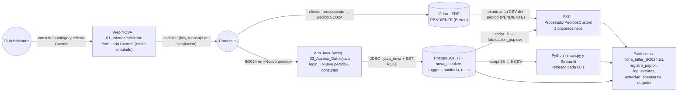
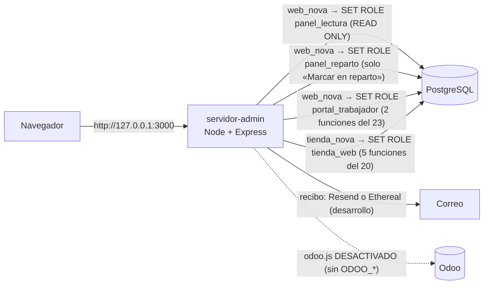

# NOVA Sneakers · Memoria técnica común

Proyecto Intermodular de 2.º DAM (enunciado «Sneaker Factory», versión 0.3).

| Dato | Valor |
|---|---|
| Equipo | Omar, Álvaro y Berme (en Git: `omar1676`, `Alvarobaz` e `Ivan Bermejo`) |
| Versión que se documenta | Rama `integracion/candidata-2`. El código probado es el commit **`8cdc08c`** (21 commits sobre la candidata publicada `4203fe7`); los commits posteriores solo añaden documentación y evidencias |
| Fecha | 13/11/2026 |
| Estado | Borrador para que lo revisen y completen los tres |

**Marcas que se usan en este documento:**

| Marca | Significa |
|---|---|
| **[PENDIENTE (quién): …]** | Falta de verdad y hay que hacerlo: Odoo, los 7 datos y el SO024 oficial, la exportación REAL, la prueba de usabilidad con personas, el reparto real y el uso de la IA (punto 9) y el E-R en PNG |
| **[DUDA PARA EL PROFESOR (Dn): …]** | Una pregunta que solo puede contestar el profesor (la lista completa está en `06_Intermodular/rubricas/MATRIZ_RUBRICAS.md` §5) |
| **[POR DECIDIR (los tres): …]** | Una decisión del equipo que todavía no se ha tomado |
| **[REVISIÓN (Álvaro o Berme) en la PR: …]** | Algo que tiene que revisar el compañero que lo hizo, en la pull request a `main` |

## Cómo leer este documento

- **Rutas.** Todas son relativas a la raíz del repositorio. Por ejemplo, `02_Acceso_Datos/sql/06_consultas.sql`.
- **Evidencias.** Cada asignatura guarda las suyas en su carpeta `evidencias/` (`01_Interfaces/evidencias/`, `02_Acceso_Datos/evidencias/`, `03_PSP/evidencias/` y `04_Python/evidencias/`). La **regresión completa del 13/11** sobre el árbol final, con la fecha, el entorno y el resultado de cada batería, está en `06_Intermodular/evidencias/regresion-final/` (su `README.md` es el índice). Las capturas de la tienda, del portal, del reparto y de Ethereal de ese día están en `01_Interfaces/evidencias/tienda/capturas-2026-11-13/`, `01_Interfaces/evidencias/portal-trabajador/`, `01_Interfaces/evidencias/reparto-y-correo/` y `01_Interfaces/evidencias/correo-ethereal/`.
- **Detalle por requisito.** El estado de cada requisito de las rúbricas, con su evidencia, está en `06_Intermodular/rubricas/MATRIZ_RUBRICAS.md`. Aquí se cita por su ID (IM-INT-04, AD-19, PY-40…).
- **Documentos que acompañan a esta memoria** (cada uno en la carpeta de su asignatura):

| Documento | Qué contiene |
|---|---|
| `02_Acceso_Datos/memoria/MEMORIA_ACCESO_DATOS.md` | El apartado de Acceso a Datos que pide su rúbrica (entregable 05) |
| `04_Python/memoria/INFORME_TECNICO_PYTHON.md` | El informe técnico de Python (método, pruebas, métricas, sesgos y limitaciones) |
| `03_PSP/memoria/DOCUMENTACION_PSP.md` | El diseño completo del subsistema PSP (punto 5 ampliado) |
| `01_Interfaces/memoria/ESTRATEGIA_PRUEBAS_INTERFACES.md` | La estrategia de pruebas de Interfaces y sus resultados (RA8) |
| `01_Interfaces/memoria/PROCEDIMIENTO_USABILIDAD.md` | El procedimiento para la prueba con 3 a 5 personas (RA4), con plantillas vacías |
| `06_Intermodular/manuales/MANUAL_INSTALACION.md` | Cómo instalar, montar la base, arrancar cada parte y pasar las pruebas. Probado el 13/11 sobre un clon nuevo |
| `06_Intermodular/manuales/MANUAL_DEMOSTRACION.md` | El guion paso a paso del caso SO024 para la defensa |
| `06_Intermodular/rubricas/MATRIZ_EVIDENCIAS.md` | Qué archivo demuestra cada bloque y cómo enseñarlo |
| `06_Intermodular/rubricas/MATRIZ_RUBRICAS.md` | El estado de cada requisito de cada rúbrica, con su evidencia y su riesgo |
| `05_Odoo/CHECKLIST_ODOO_BERME.md` | Lo que falta en Odoo, con casillas |
| `06_Intermodular/SO024/SO024_DATOS_PENDIENTES.md` | Los 7 datos de SO024 que hay que acordar y la prueba completa preparada |
| `06_Intermodular/defensa/` | Guía y simulación de la defensa, y la presentación (`.md` y `.pptx`) |

---

## 1. Empresa, problema y alcance de la versión entregada

### 1.1 La empresa

El enunciado plantea una fábrica de zapatillas, **Sneaker Factory**, que vende un catálogo propio y hace **pedidos personalizados (Custom) para clubes y equipos** (IM p. 2). El equipo actúa como una pequeña consultora que le prepara una primera solución digital.

En todos los bloques el equipo usa la marca comercial **NOVA Sneakers**: la web, la base de datos, la aplicación Java, PSP, Python, el panel y el portal. **[DUDA PARA EL PROFESOR (D2): ¿se acepta «NOVA Sneakers» en lugar de «Sneaker Factory»? Si no, hay que decidir el nombre en Odoo antes de configurar la compañía.]**

Lo que tiene hoy la empresa en el proyecto:

- **Catálogo de la web:** 100 modelos en seis colecciones (Street, Luxe, Casual, Hombre, Mujer y Unisex), con nombre comercial, imagen, precio orientativo, descripción y tallas (`01_Interfaces/cliente/js/modelos.js`).
- **Datos de demostración de la base:** 7 modelos (6 normales y el personalizable X-NOVA), 12 colores, 60 SKU, una nave (NOVA Central, Madrid), 6 clientes y 11 pedidos (`02_Acceso_Datos/documentacion/README.md` §4). El script 21 añade a la base los mismos 100 modelos de la web, que es una ampliación (anexo A).
- **Caso común del enunciado:** el pedido **SO024** del Club Halcones, 40 pares de **Runner X** en las tallas 38 a 46 con diseño personalizado (IM p. 5).

### 1.2 El problema

El enunciado pide conectar tres necesidades de negocio con un solo caso de uso (IM-ITG-03 y 04):

1. **Presencia digital:** enseñar la empresa y su catálogo, y permitir iniciar una solicitud Custom (Desarrollo de Interfaces).
2. **Gestión empresarial:** registrar al cliente, la venta, la fabricación, el inventario y la factura en Odoo, que es el núcleo del flujo (Sistemas de Gestión Empresarial).
3. **Automatización técnica:** procesar una copia del pedido con varios procesos coordinados, sin sustituir al ERP (Programación de Servicios y Procesos).

El equipo incluye además dos módulos que trabajan sobre el mismo caso: **Acceso a Datos** (PostgreSQL y Java) y **Ampliación de Python** (análisis y dashboard). **[DUDA PARA EL PROFESOR (D3): ¿Acceso a Datos y Python cuentan dentro del intermodular? ¿Con qué peso?]**

### 1.3 Alcance de la versión entregada

| Bloque | Qué se entrega | Estado el 13/11/2026 | Evidencia principal |
|---|---|---|---|
| Desarrollo de Interfaces | Web responsive con inicio, catálogo, ficha, servicio Custom con formulario (envío simulado), «Nuestra visión» y contacto | Hecho y probado en Edge en 4 anchos y en 11 anchos de 320 a 1440 px, con axe sin violaciones. Falta la prueba de usabilidad con personas | `06_Intermodular/evidencias/regresion-final/05_web/02_interfaces.txt` (136/136), `03_web.txt` (114/114) y `01_mejoras.txt` (81/81) |
| Sistemas de Gestión Empresarial (Odoo) | Flujo empresarial documental | PDF real de Berme conservado: instalación, venta y fabricación documentadas. API no verificada aquí; SO024 no definitivo | `odoo/documentacion/Odoo-NOVA-Sneakers.pdf`; §4 y estado final |
| PSP | Aplicación Java de consola con un proceso coordinador y tres procesos hijos | Hecho y probado | `06_Intermodular/evidencias/regresion-final/02_java_psp/04_psp_pruebas.txt` (27/27) |
| Acceso a Datos | Base PostgreSQL 17 reconstruible con 23 scripts, triggers, auditoría, roles y aplicación Java Swing con JDBC | Hecho y probado. Falta el E-R en PNG | `06_Intermodular/evidencias/regresion-final/01_sql/` (123 PASS, 0 FAIL y 1 ERROR previsto), `02_java_psp/02_pruebas_rubrica.txt` (47/47) y `07_ventanas_swing/` (76/76) |
| Python | Pipeline de calidad, DataFrames con sus metadatos, KPIs, estadística, RFM, KMeans, predicción, informe ejecutivo priorizado y dashboard Streamlit con 6 filtros y refresco cada 60 s | Hecho y probado con datos de PRUEBA y SINTÉTICOS. Falta la exportación REAL | `06_Intermodular/evidencias/regresion-final/04_python/` (265 pruebas OK y las 93 salidas comparadas) |
| Integración (SO024) | El mismo pedido recorre Java → PostgreSQL → PSP → Python | **PROVISIONAL:** probado de principio a fin con un reparto inventado. Faltan Odoo y los 7 datos acordados | `06_Intermodular/evidencias/regresion-final/06_so024_provisional/00_cadena.txt` |

**Lo que esta versión no hace, a propósito** (frases de alcance del IM p. 2-3 y de AD p. 7):

- No es un ERP ni una tienda completa hechos desde cero.
- No hay sincronización automática con Odoo: la integración es por archivos CSV y procedimientos documentados, como permite el IM (IM-ITG-07). El conector de Odoo de Berme está en el repositorio, pero **desactivado** (anexo B).
- PSP no escribe en Odoo ni en PostgreSQL, no mueve stock y no crea la orden de fabricación (`03_PSP/README.md`, «Lo que no hace»).
- No se cobra nada: los pagos de la tienda son una simulación.

Las **ampliaciones** que ninguna rúbrica pide (tienda online, panel de administración, reparto, recibos por correo, probador, 100 modelos a la venta y el portal del trabajador con su login único) se describen aparte, en los **anexos A y B**, para no mezclarlas con lo obligatorio.

---

## 2. Arquitectura de la solución y relación entre módulos

### 2.1 Diagrama

Las ampliaciones (tienda, panel y portal del trabajador) se conectan a la misma base a través de un servidor Node; su diagrama está en el anexo A.

### 2.2 Qué viaja entre los módulos

| De → a | Qué viaja | Formato | Cómo | Estado |
|---|---|---|---|---|
| Web → comercial | La solicitud Custom: club, contacto, email, modelo, colores, personalización y pares por talla | Formulario HTML | A mano: el envío es una simulación y no sale ningún dato (`01_Interfaces/cliente/js/custom.js`) | Hecho |
| Comercial → Odoo | Cliente, presupuesto y pedido de venta SO024 | Pantallas de Odoo | A mano | **[PENDIENTE (Berme)]** |
| Comercial → Java → PostgreSQL | El mismo SO024: referencia, cliente, «Pedido Custom», personalización y una línea por talla | JDBC con `PreparedStatement` | `PedidoDAO.crearPedido` llama a `realizar_compra` y `anadir_linea_pedido` | Hecho; SO024 solo con datos provisionales |
| PostgreSQL → PSP | La orden de fabricación de un pedido confirmado | CSV UTF-8, coma, 8 columnas: `referencia,sku,cliente,modelo,color,personalizacion,talla,cantidad` | `psql -v referencia=SO024 -f 15_exportar_fabricacion.sql` → `fabricacion_psp.csv` | Hecho |
| Odoo → PSP | Las líneas del pedido de venta | CSV con las mismas 8 columnas (propuesta de `03_PSP/README.md`) | Exportación de Odoo | **[PENDIENTE (Berme)]** |
| PostgreSQL → Python | Clientes, modelos, pedidos, líneas y stock | 5 CSV UTF-8, coma, punto decimal, fechas `AAAA-MM-DD HH:MM:SS` | `16_exportar_csv_dashboard.sql`, en una transacción `REPEATABLE READ` | Hecho; hoy son de una base de PRUEBA. **[PENDIENTE (los tres): la exportación REAL de la base del equipo.]** |
| PostgreSQL → Python (contraste) | Los resultados de las consultas P-A, P-B y P-C y del caso N (N-1, N-2 y N-3) | CSV de `psql --csv` en `entrada_acc/conciliacion_sql/` | `12_consultas_panel.sql`; Python los compara con sus propias cifras | Hecho: 21 de 21 (P) y 17 de 17 (N) cifras coinciden |
| Java → disco | Actividad, usuarios y consulta filtrada | `actividad_sneaker.txt`, `usuarios_sneaker.json` y `consulta_pedidos.csv` | Clase `Archivos` | Hecho |

### 2.3 Frontera entre el ERP y el subsistema auxiliar (IM-ITG-06)

| Sistema | De qué es responsable | De qué no |
|---|---|---|
| **Odoo** | Es el **núcleo**: cliente, presupuesto, pedido de venta, fabricación (lista de materiales y orden), inventario, entrega y factura (IM-SGE-07 y 17) | — |
| **PostgreSQL + Java** | El caso académico de Acceso a Datos: guarda el mismo pedido con los mismos identificadores, calcula importes, mueve el stock **de su propia base** y audita (AD-22) | No sustituye a Odoo ni se sincroniza con él: son dos sistemas con responsabilidades distintas (`05_Odoo/recorrido-manual-odoo.md` §4) |
| **PSP** | Tareas **auxiliares** sobre una copia del pedido: validar, agrupar por talla y variante, preparar una ficha para el taller y registrar el resultado de cada proceso | No crea la orden de fabricación, no toca el stock ni escribe en ninguna base. La ficha lo dice: «No sustituye a la orden de fabricación de Odoo» |
| **Python** | Analiza los CSV exportados: calidad, KPIs, estadística, segmentación, predicción y dashboard | No se conecta a ninguna base y nunca escribe en la carpeta de entrada |
| **Web** | Enseña la empresa y el catálogo e inicia la solicitud Custom | No registra pedidos (el envío Custom es una simulación) |

### 2.4 Qué haría falta para una integración productiva (IM-ITG-06)

Hoy la integración se hace con archivos y pasos documentados, que es lo que permite el enunciado en el primer trimestre. Para usarla en una empresa real faltarían estas ampliaciones:

1. **Exportación automática desde Odoo.** Leer el pedido confirmado por la API de Odoo con un usuario de solo lectura, y generar el CSV de PSP sin pasar por PostgreSQL. El repositorio ya trae un primer conector de Berme que crea y confirma pedidos en Odoo (`servidor-admin/odoo.js`, anexo B), pero está **desactivado** sin `ODOO_URL`, `ODOO_DB` y `ODOO_API_KEY`, sus rutas (`servidor-admin/pedidos.js`) **no se montan** y **no se ha probado contra ningún Odoo**.
2. **Identificadores estables y compartidos.** Hoy el SKU se forma con el número interno de la variante (`NOVA-<id_variante>-<talla>`, script 18), y ese número depende de todo lo que se cargó antes. Según el orden de montaje, la variante de Runner X ha salido la 14 (Fase 0, solo con los scripts 1–17), la 26 (candidata del 12/11) y la **114** con el orden final del manual, que carga antes los 100 modelos del 21 (`06_Intermodular/evidencias/regresion-final/06_so024_provisional/SO024_PROVISIONAL_fabricacion.csv`: `NOVA-114-38` … `NOVA-114-46`). En producción haría falta un código fijo (por ejemplo, `RUNNERX-<color>-<talla>`) que sea también la «Referencia interna» de la variante en Odoo.
3. **Una sola fuente del stock.** Ahora Odoo y PostgreSQL tienen cada uno su stock y no se igualan solos. Habría que decidir cuál manda y sincronizar el otro.
4. **Formulario Custom con servidor.** Que la solicitud llegue a Odoo como oportunidad o presupuesto (CRM), en vez de quedarse en un mensaje de simulación.
5. **PSP como servicio.** Una cola de pedidos, varios pedidos a la vez y un registro compartido protegido, que es la «ampliación posterior» del IM (IM-PSP-30). Hoy procesa un pedido por archivo y solo CSV (`03_PSP/README.md`, «Límites conocidos»).
6. **Exportación programada para Python.** Que Acceso a Datos exporte los 5 CSV de forma periódica y rotulada como REAL. Hoy un pedido nuevo en PostgreSQL no llega al dashboard hasta que se vuelve a lanzar el 16 (`04_Python/dashboard.md`).
7. **Seguridad de despliegue.** Credenciales en un gestor de secretos, HTTPS, sesiones que no se pierdan al reiniciar (hoy están en memoria, `servidor-admin/README.md`), una pasarela de pago real e impuestos confirmados (hoy el IVA está «pendiente de confirmar», `04_Python/config.py`).

---

## 3. Diseño de la interfaz y criterios responsive

Archivos: `01_Interfaces/cliente/index.html`, `css/inicio.css`, `css/tienda.css`, `js/modelos.js`, `js/inicio.js` y `js/custom.js`. La explicación de cada archivo está en `01_Interfaces/cliente/README.md`.

### 3.1 Estructura (IM-INT-04)

| Parte que pide el IM | Dónde está | Qué enseña |
|---|---|---|
| Inicio | Cabecera con el logo y el menú, y la «estantería» con un máximo de ocho zapatillas filtradas | La marca y una entrada rápida al catálogo |
| Catálogo | `#catalogo-completo` | Las 100 tarjetas con nombre, foto y precio orientativo; filtros por colección y buscador, con aviso si no hay resultados |
| Ficha de producto | Se abre al pulsar una tarjeta | Precio orientativo, descripción, tallas y acceso al probador; se cierra con Escape |
| Servicio Custom | `#custom` | Los cuatro pasos del proceso (solicitud, presupuesto, fabricación y entrega), el ejemplo SO024 y el formulario |
| Sección corporativa y contacto | `#historia` («Nuestra visión») y `#contacto` | La historia de la marca y el correo de contacto (ficticio) |

### 3.2 Decisiones de diseño

- **Un solo sitio para los datos del catálogo.** Los nombres, las colecciones y las rutas de imagen están solo en `js/modelos.js`, y el precio, las tallas y la descripción de cada colección en su objeto `datosColeccion`. El **nombre** es lo que une un modelo de la web con PostgreSQL (`01_Interfaces/cliente/README.md`).
- **Identidad por colección.** Cada tarjeta lleva la clase `c-<colección>` y los colores de Álvaro (variables `--col-claro` y `--col-oscuro` al final de `inicio.css`). Se adaptaron para cumplir WCAG AA: la etiqueta va en una pastilla oscura, la banda del precio es opaca y el foco suma un contorno oscuro al claro (`01_Interfaces/cliente/README.md`, «Colores por colección»). **[REVISIÓN (Álvaro) en la PR: que dé por buena la adaptación de su paleta y de su restyle.]**
- **Componentes que hacen una sola cosa:** tarjetas que son botones con un nombre accesible que incluye el precio, una ficha, un probador, un formulario con sus etiquetas y un `fieldset` para las tallas.
- **JavaScript como mejora** (IM-INT-09, opcional): filtros, buscador, total de pares en vivo y envío simulado. Sin JavaScript la página se lee entera.
- **Formulario Custom.** Pide club, contacto, email, modelo, personalización y pares de la talla 38 a la 46. El teléfono y los colores son opcionales y lo dicen. Antes de rellenarlo, avisa de que es un prototipo. Los errores salen con `role="status"` y, si faltan pares, el foco va a la primera talla.

### 3.3 Criterios responsive (IM-INT-05)

Técnicas CSS que usa `css/inicio.css`:

| Técnica | Dónde y para qué |
|---|---|
| `<meta name="viewport" content="width=device-width, initial-scale=1">` | En `index.html`, para que el móvil no simule un escritorio |
| Media queries con un punto de corte en **760/761 px** (móvil frente a escritorio) y otro en **370 px** (pantallas muy estrechas) | 12 con `max-width` y 8 con `min-width` en `inicio.css`, y 2 en `tienda.css` |
| CSS Grid con `repeat(5, minmax(0, 1fr))` y columnas `1fr 1fr` | La estantería y las secciones de dos columnas, que se apilan en el móvil |
| Flexbox | Cabecera, menú, botones y bloques internos |
| `clamp()` | Títulos y alturas de imagen que crecen con el ancho sin pasarse (por ejemplo, `clamp(2.4rem, 4.5vw, 5rem)`) |
| `aspect-ratio` y `object-fit: contain/cover` | Fotos que no se deforman |
| Unidades relativas (`rem`, `vw`, `vh`) y `max-width: 1500px` | Texto escalable y líneas que no se hacen eternas en pantallas grandes |
| Propiedades personalizadas (`--col-claro`, `--col-oscuro`…) | Colores por colección sin repetir valores |
| `@media (prefers-reduced-motion: reduce)` | Quita la animación de entrada a quien lo pide |

Resultado comprobado el 13/11 sobre el árbol final: sin desplazamiento horizontal ni cabecera partida en 1440, 820, 390 y 360 px, ni en 11 anchos de 320 a 1440 px (`06_Intermodular/evidencias/regresion-final/05_web/02_interfaces.txt` y `01_mejoras.txt`). Zonas táctiles del menú de 36 px o más (`01_Interfaces/evidencias/web/README.md`).

**[DUDA PARA EL PROFESOR (D7): ¿qué «técnicas CSS vistas en clase» espera?]**

### 3.4 Usabilidad y accesibilidad (RA4)

- **Estándar elegido: WCAG 2.1 nivel AA.** Es el que comprueban axe-core 4.12.1 y Lighthouse 12.8.2, y el que exige la normativa europea de accesibilidad para webs públicas. Se valora porque una web de una marca la usan personas con distintas capacidades y dispositivos.
- **Resultados:** axe sin violaciones en todos los estados probados, también en la página de acceso del personal y en el portal del trabajador (13/11: `06_Intermodular/evidencias/regresion-final/05_web/02_interfaces.txt`, `01_mejoras.txt` y `06_edge_portal.txt`); 212 de 212 medidas de contraste AA en Edge (12/11, en el informe de integración); Lighthouse 100 en accesibilidad y 100 en buenas prácticas, en escritorio y en móvil, el 11/11 (`01_Interfaces/evidencias/web/lighthouse/`).
- **Prueba de usabilidad con personas:** **[PENDIENTE (los tres): hacerla con 3 a 5 personas y escribir el informe.]** El procedimiento y las plantillas están en `01_Interfaces/memoria/PROCEDIMIENTO_USABILIDAD.md`. No hay resultados todavía.
- **Estrategia de pruebas:** `01_Interfaces/memoria/ESTRATEGIA_PRUEBAS_INTERFACES.md`.

---

## 4. Configuración de Odoo y flujo comercial y operativo

La evidencia entregada es `odoo/documentacion/Odoo-NOVA-Sneakers.pdf`, de Berme y el equipo. No se ha modificado. Sus páginas 3–6 documentan Ubuntu 24.04 en OrbStack, Odoo 19 Community, servicio y módulos; las 7–9, producto y fabricación; las 10–12, venta S00005, orden WH/MO/00002, entrega WH/OUT/00005 y factura INV/2026/00001; las 16–17, variantes y usuarios. Este es trabajo documentado, no una ejecución actual de la candidata.

El pedido mostrado es del Club Atletico NOVA, con 40 pares a 89 €/par antes del cambio de precio documentado a 99,90 €. No se identifica con el SO024 del Club Halcones. El PDF usa NOVA-4-* para Runner X, mientras parte de esos códigos corresponde a NOVA Velocity en los datos del proyecto. No se han cambiado SKU, pedidos ni precios para forzar igualdad.

La adaptación documentada incluye variantes 38–46, referencias internas, usuarios y lista de materiales. La compañía, módulos y documentos constan en el PDF. No hay una exportación del SO024 oficial ni backup/restauración de Odoo verificables en esta entrega; CRM y algunos perfiles requieren evidencia adicional. Se declaran como límites, no como resultados positivos.

El conector NOVA → Odoo no se ha verificado contra una instalación real accesible desde este entorno. `servidor-admin/pedidos.js` sigue sin montarse y no se amplían permisos. Las pruebas que el PDF describe pertenecen al entorno de Berme; no se trasladan como si fueran pruebas de esta candidata. No se rehace la integración: se entrega el flujo documental y se muestran los módulos disponibles.

El detalle de conciliación y los siete datos no acordados permanece en `06_Intermodular/SO024/INTEGRACION_ODOO_SO024.md`; el guion de cierre usa CUSTOM-40 de PRUEBA, no SO024 definitivo.

## 5. Diseño del subsistema auxiliar PSP

Resumen. El diseño completo (procesos, protocolo, códigos, tiempos de espera, errores, relación con Odoo y pruebas) está en `03_PSP/memoria/DOCUMENTACION_PSP.md`.

- **Qué es:** una aplicación Java de consola, `ProcesadorPedidosCustom`, que recibe la exportación CSV de un pedido Custom y lanza tres procesos hijos con `ProcessBuilder` (`03_PSP/README.md`).
- **Procesos:** `ValidadorPedidoCustom` (valida y normaliza), `Psp.AnalizadorTallas` (de Álvaro: agrupa por modelo, color y talla, y por talla) y `GeneradorFichaTaller` (comprueba que las cuentas cuadran y escribe la ficha).
- **Comunicación:** todo por stdin y stdout a través del padre. Cada hijo contesta `OK;…` por stdout o `ERROR;motivo` por stderr con código 2.
- **Control:** `GestorProcesos` lee stdout y stderr por separado con un hilo para cada tubería, espera con `waitFor(10 s)` y, si el hijo no termina, lo cancela con `destroy()` y después `destroyForcibly()`.
- **Relación con Odoo:** por la **referencia** del pedido, que aparece en el CSV, en cada respuesta `OK;`, en el nombre de la ficha y en `registro_psp.txt`. Hoy el CSV sale de PostgreSQL (script 15). **[PENDIENTE (Berme): la exportación del pedido desde Odoo y la equivalencia con su número de pedido.]**
- **Pruebas (13/11):** `PruebasPsp` **27 de 27**; CUSTOM-40 con código 0 y la misma ficha que la guardada en `03_PSP/evidencias/`; un archivo que no existe, código 1, y una cantidad 0, código 2 (`06_Intermodular/evidencias/regresion-final/02_java_psp/`). SO024 con datos provisionales: los tres hijos y el padre con código 0 (`06_Intermodular/evidencias/regresion-final/06_so024_provisional/03_psp.txt`).

---

## 6. Modelo de datos común del pedido e integración CSV/JSON

### 6.1 Los datos comunes (IM-ITG-09 a 14)

Para SO024, cada dato aparece así en cada bloque:

| Dato común | Web Custom | Odoo | PostgreSQL / Java | PSP | Python |
|---|---|---|---|---|---|
| Identificador | No se muestra: el envío es una simulación (el IM lo deja como opcional, IM-ITG-10) | Pedido de venta; «Referencia del cliente» = SO024 **[PENDIENTE (Berme)]** | `pedidos.referencia` = `SO024` (única) | `referencia` del CSV, `OK;SO024`, `ficha_taller_SO024.txt` | `referencia` en `pedidos.csv` |
| Cliente | «Club o equipo» y contacto | Contacto Club Halcones **[PENDIENTE (Berme)]** | `clientes`: Club Halcones, con un correo ficticio `@example.com` (script 18) | `cliente` | `id_cliente` (los nombres no se usan en los análisis) |
| Producto y variante | Modelo, colores y personalización | Runner X con variantes de talla **[PENDIENTE (Berme)]** | `modelos` Runner X → `variantes` (color) → `producto_sku` (talla, SKU `NOVA-<variante>-<talla>`) | `sku`, `modelo`, `color`, `personalizacion`, `talla` | `id_modelo`, `sku`, `talla` |
| Cantidad | Pares por talla y total | Cantidades de las líneas **[PENDIENTE (Berme)]** | `linea_pedido.cantidad`; `pedidos.cantidad_total` (trigger) | `cantidad` por fila; `TOTAL;40` | `cantidad`; `pares` en `pedidos_unicos` |
| Estado | Mensaje «SIMULACIÓN» | Estados de venta, fabricación, entrega y factura **[PENDIENTE (Berme)]** | `pendiente` → `confirmado` (y `cancelado`) | Código de salida (0 correcto) y `Resultado: …` | `estado_pedido` |

**[PENDIENTE (los tres): acordar los 7 datos de SO024]** (reparto por talla, color, precio, stock, texto de la personalización, SKU en Odoo y número de pedido en Odoo). Están en `06_Intermodular/SO024/caso-comun-SO024.md` §1. La propuesta de cómo cerrarlos y la prueba completa, en `06_Intermodular/SO024/SO024_DATOS_PENDIENTES.md`.

### 6.2 Los archivos de intercambio

| Archivo | Productor | Consumidor | Contenido |
|---|---|---|---|
| `fabricacion_psp.csv` | `02_Acceso_Datos/sql/15_exportar_fabricacion.sql` | PSP | 8 columnas, una fila por línea, UTF-8 y coma. Comprueba antes de escribir que el pedido existe, está confirmado y suma 40 pares |
| `clientes.csv`, `modelos.csv`, `pedidos.csv`, `lineas_pedido.csv`, `stock.csv` | `16_exportar_csv_dashboard.sql` | Python | Diccionario en `02_Acceso_Datos/documentacion/README.md` («Exportación de los cinco CSV del dashboard») y en `04_Python/diccionario_datos.md` |
| `P-A.csv`, `P-B.csv`, `P-C.csv`, `N-1.csv`, `N-2.csv`, `N-3.csv` | Consultas de `12_consultas_panel.sql` con `psql --csv` | Python (conciliación) | Las cifras que Python tiene que reproducir (`04_Python/conciliacion_sql.md`) |
| `consulta_pedidos.csv` | Java (`Archivos.exportarCsv`) | Personas | La tabla filtrada que se ve en pantalla |
| `usuarios_sneaker.json` | Java (`UsuarioDAO`) | Personas | `id_usuario`, `username`, `rol` y `activo`, sin contraseñas ni hashes |
| `actividad_sneaker.txt` | Java (`Archivos.registrar`) | Personas | `fecha | usuario | rol | acción | resultado | detalle` |
| `03_PSP/pruebas/custom40.csv` | Berme (a mano) | Pruebas de PSP | Muestra sintética con coma, comillas y salto de línea dentro de un campo |

**¿Por qué CSV y no JSON para PSP?** PostgreSQL lo exporta sin programas intermedios con `\copy`, se abre con cualquier hoja de cálculo y el IM admite los dos (IM-PSP-02). El script 15 usa `\copy` y no `\o` porque, en Windows, `\o` cambia los saltos de línea de dentro de un campo (`\n` → `\r\n`); se midió byte a byte (`02_Acceso_Datos/documentacion/README.md`, «Por qué el nombre del archivo es fijo»). PSP rechaza un `.json` con código 1: es un límite conocido.

### 6.3 Estado de la integración

- **Probado de principio a fin con datos PROVISIONALES el 13/11** sobre el árbol final (`06_Intermodular/evidencias/regresion-final/06_so024_provisional/00_cadena.txt`; la evidencia de PSP, también en `03_PSP/evidencias/so024_provisional/`): base 01–23 → script 18 (precio 99,90, color «PROVISIONAL», stock 10 por talla) → alta y confirmación de SO024 con los métodos de «Nuevo pedido» (`PedidoDAO.crearPedido` y `confirmarPedido`, con la sesión de `admin.demo`; reparto 2/3/5/6/7/6/5/4/2) → **40 pares, 9 líneas y 3.996,00 €** → cada talla baja una sola vez (8, 7, 5, 4, 3, 4, 5, 6 y 8) → auditoría a nombre de `admin.demo` → script 15 (9 filas, 40 pares) → **PSP con código 0** → script 16 → Python con **un solo pedido** SO024 de 9 líneas, 40 pares y 3.996 €. El 18 sin sus `-v` no inserta nada.
- En esa cadena no se generaron las consultas P-A, P-B y P-C de su exportación, así que Python dice «PENDIENTE» en la conciliación de esa ejecución: no da por buena ninguna cifra sin compararla. Con el pedido oficial hay que exportarlas en el mismo momento que los cinco CSV (`06_Intermodular/SO024/SO024_DATOS_PENDIENTES.md` §4.5).
- **Lo que falta:** **[PENDIENTE (los tres): los 7 datos acordados y el SO024 oficial, desde la ventana de Java y en la base del equipo]** y **[PENDIENTE (Berme): el mismo pedido en Odoo]**.

---

## 7. Pruebas realizadas y resultados

**Cierre nuevo:** SQL desde cero, Java 47/47, PSP 27/27, analizador 8/8, comprobador PSP correcto, Python 265, Node 23/39/24 sin saltos y 9 controles Edge. Dependencias instaladas en clon nuevo. Logs y límites en `06_Intermodular/evidencias/cierre-entrega-20261113/`. Las tablas anteriores al cierre conservan su fecha y contexto histórico.

Todas se pasaron sobre bases PostgreSQL **desechables** (un clúster de pruebas aparte), nunca sobre la base del equipo. El **13/11** se repitió todo sobre el **árbol final** (`8cdc08c`, exportado con `git archive`), con la fecha, la hora y el entorno de cada batería en `06_Intermodular/evidencias/regresion-final/README.md`. La estrategia de Interfaces está en `01_Interfaces/memoria/ESTRATEGIA_PRUEBAS_INTERFACES.md`, y el detalle de AD, PSP y Python, en sus documentos.

| Bloque | Qué se probó | Cómo | Fecha | Resultado | Archivo |
|---|---|---|---|---|---|
| SQL | Montaje desde cero de los scripts 01–23 (el 23, dos veces) y batería 09–16 | `psql` en una base vacía, en el orden del manual | 13/11 (00:58) | Todos con salida 0. **123 PASS, 0 FAIL y 1 ERROR previsto** (S4b: PostgreSQL deniega `descontar_stock` al cliente a propósito). Igual en una segunda base y en una sin el 23 | `06_Intermodular/evidencias/regresion-final/01_sql/00_resumen.txt`, `01_montaje_01_23.txt` y `logs_nova_rf_base/` |
| SQL | Las 8 consultas | `06_consultas.sql` | 13/11 | Las 8 se ejecutan; la HAVING devuelve **1 fila** (`NOVA-4-43`: 20 en stock y 11 pendientes → 9) | `06_Intermodular/evidencias/regresion-final/01_sql/04_06_consultas.txt` |
| Java | `PruebasRubrica`: login de los tres roles, pruebas A–J y permisos P | `nova.PruebasRubrica` (lo que lanza `pruebas.bat`) | 13/11 (01:01) | **47 PASS, 0 FAIL**, y el TXT, el JSON y el CSV que escribe | `06_Intermodular/evidencias/regresion-final/02_java_psp/02_pruebas_rubrica.txt` y `02_salidas_java/` |
| Java | Ventanas Swing con los tres roles, comparadas con SQL | `ProbarVentanas`, que pulsa los botones | 13/11 (01:08) | **76 PASS, 0 FAIL** y 1/1 sin conexión | `06_Intermodular/evidencias/regresion-final/07_ventanas_swing/`; capturas en `02_Acceso_Datos/evidencias/java-swing/` (19, también del 13/11) |
| PSP | `PruebasPsp`, con el analizador de Álvaro dentro del árbol, y los errores controlados | `java -cp clases PruebasPsp` | 13/11 (01:02) | **27 de 27**; CUSTOM-40 código 0; archivo inexistente código 1; cantidad 0 código 2 | `06_Intermodular/evidencias/regresion-final/02_java_psp/04_psp_pruebas.txt`, `05_*.txt` y `06_*.txt` |
| PSP | Comprobación rápida de Berme | `scripts/comprobar_psp.py` | 13/11 | Fallo histórico; corregido en el cierre (`4f09742`) y comprobado de nuevo con salida 0 | `06_Intermodular/evidencias/regresion-final/02_java_psp/07_comprobar_psp.txt` |
| Python | Pruebas automáticas, incluidas las de Streamlit con `AppTest` (filtro de cliente, refresco que conserva filtros y pestaña, R6, casos A y N, metadatos y prioridad del informe) | `python -m unittest discover -s tests -v` | 13/11 (00:59–01:12) | **Ran 265 tests · OK** (712 s) | `06_Intermodular/evidencias/regresion-final/04_python/02_unittest.txt` |
| Python | `main.py` en modo real, sintético y sintético con errores, y el generador, frente a la referencia | Comparación de las 93 salidas | 13/11 (01:12) | **91 idénticas**; 2 con 4 columnas nuevas a propósito (`informe_ejecutivo.csv`: prioridad, urgencia, impacto esperado y sustento; las 10 de antes, iguales); 4 archivos nuevos a propósito (`contraste_sql_caso_n.csv` y tres `metadatos_dataframes.csv`). «Caso N: 17 de 17 cifras coinciden con SQL» | `06_Intermodular/evidencias/regresion-final/04_python/03_salidas_93.txt` |
| Python | Dashboard en Edge durante tres ciclos de 60 s sin tocarlo (caso K) | Playwright + Edge contra `streamlit run` | 13/11 (00:44–00:47, mismo código) | 4 capturas con cuatro horas de comprobación distintas y las cifras iguales | `04_Python/evidencias/dashboard/caso_k_*` |
| Python | Dashboard en Edge: 6 pestañas, filtros, R1, R4, R5 y recuperación | Navegador | 9 y 10/11 | Capturas y README | `04_Python/evidencias/dashboard/` |
| Interfaces | Requisitos de Interfaces en 4 anchos: menú, fichas, Custom, contacto y axe | Playwright + Edge | 13/11 (01:16) | **136 de 136** | `06_Intermodular/evidencias/regresion-final/05_web/02_interfaces.txt` |
| Interfaces | Toda la web | Ídem | 13/11 (01:18) | **114 de 114** | `06_Intermodular/evidencias/regresion-final/05_web/03_web.txt` |
| Interfaces | 100 fichas, teclado, 11 anchos de 320 a 1440 px, probador y axe | Ídem | 13/11 (01:14) | **81 de 81** | `06_Intermodular/evidencias/regresion-final/05_web/01_mejoras.txt` |
| Interfaces | Contraste WCAG AA en Edge | Medida de cada texto | 12/11 | **212 de 212** | En el informe de integración (fuera del repositorio) |
| Interfaces | Lighthouse | Escritorio y móvil | 11/11 | Accesibilidad 100 y buenas prácticas 100 | `01_Interfaces/evidencias/web/lighthouse/` |
| Integración | Cadena SO024 PROVISIONAL: 18 → Java → 15 → PSP → 16 → Python | Script de la regresión | 13/11 (01:06) | 40 pares, 9 líneas, 3.996 €; PSP código 0; un solo pedido en Python | `06_Intermodular/evidencias/regresion-final/06_so024_provisional/` |
| Instalación | El manual de instalación seguido al pie de la letra | Clon nuevo y base nueva | 13/11 | Reproducible. Encontró dos errores del propio manual, ya corregidos (§8.1) | `06_Intermodular/evidencias/regresion-final/08_manual_instalacion/` |
| Seguridad | Que no hay contraseñas en los resultados, las evidencias ni la documentación | Búsqueda de las claves usadas en las pruebas | 13/11 | 0 coincidencias | `06_Intermodular/evidencias/regresion-final/README.md` |
| Usabilidad | Prueba con 3 a 5 personas | `01_Interfaces/memoria/PROCEDIMIENTO_USABILIDAD.md` | — | **[PENDIENTE (los tres)]** | — |
| Odoo | Flujo de SO024 | — | — | **[PENDIENTE (Berme)]** | — |

Las pruebas de las ampliaciones (tienda, panel, reparto, correos y portal del trabajador) están en los anexos A y B.

**Lo que todavía no está probado o está a medias** (detalle en `06_Intermodular/rubricas/MATRIZ_RUBRICAS.md`):

- Odoo entero y la relación de la ficha de PSP con el pedido real de Odoo (IM-PSP-10 y 29).
- El SO024 oficial, desde la ventana de Java y en la base del equipo, y la exportación **REAL** para Python (PY-40, 130 y 138).
- La prueba de dos sesiones (COMMIT y ROLLBACK vistos desde otra conexión) es del 8/11 y se hizo a mano (AD-35). Que el JSON de usuarios no publique cambios tras un ROLLBACK está implementado (se exporta después del COMMIT), pero ninguna prueba lo fuerza (AD-96).
- Las capturas de las pruebas A, B, C, D, G e I hechas en la ventana se toman a mano en la demostración (AD-81); `ProbarVentanas` y `PruebasRubrica` las cubren por código.
- Lighthouse y la medida de contraste no se han repetido sobre el árbol final. Lighthouse (11/11) es anterior a los 100 modelos y a los colores por colección. La medida de contraste (12/11) ya los incluye, y desde entonces la web de clientes solo ha cambiado en `js/tienda.js` (el estado «En reparto» y el enlace del recibo), no en el CSS.
- Los scripts de navegador (Playwright y axe) no están en el repositorio: solo sus resultados y capturas. Los SQL de prueba de la tienda, del reparto y del portal sí: `06_Intermodular/evidencias/regresion-final/01_sql/pruebas_usadas/`.

---

## 8. Dificultades encontradas, decisiones tomadas y mejoras futuras

### 8.1 Dificultades y cómo se resolvieron

| Dificultad | Qué pasaba | Decisión | Dónde está |
|---|---|---|---|
| El stock se descontaba dos veces | Al principio se descontaba al crear la línea, y el enunciado pide no descontarlo en cada edición y otra vez al confirmar | El stock solo se mueve al **confirmar** (y vuelve al cancelar), con la marca `stock_descontado` en cada línea | `02_Acceso_Datos/documentacion/README.md` §7b |
| La identidad de la auditoría se podía falsificar | Cualquier rol podía escribir `nova.id_usuario` con `set_config` y firmar como administrador | El valor va **firmado con HMAC-SHA256**, usando como clave el hash bcrypt del usuario, que ningún rol puede leer. Pruebas F1–F4 | README §9, «Un fallo que encontramos» |
| Nadie podía cancelar un pedido | El `SELECT … FOR UPDATE` del trigger de cancelación exige permiso de UPDATE sobre `linea_pedido` | El trigger es `SECURITY DEFINER` con `search_path` fijo, en vez de abrir el permiso | README §9 |
| El CSV salía alterado en Windows | `\o` y la redirección cambiaban los saltos de línea de dentro de un campo | Se exporta con `\copy`, y por eso el nombre del archivo es fijo | README §14 |
| La consulta HAVING no devolvía nada | Con los datos de prueba daba 0 filas, y una consulta vacía no demuestra nada | Ahora responde a una pregunta de negocio: «¿qué referencias se quedarán con menos de 10 pares cuando se sirvan los pedidos pendientes?». Con los datos de prueba, 1 fila | `06_consultas.sql` (consulta 3); README §10 |
| Un proceso hijo podía colgar al padre | Si una tubería se llena, quien escribe se bloquea | `GestorProcesos` usa un hilo por tubería y `waitFor` con límite | `03_PSP/README.md`, «Por qué `GestorProcesos` usa tres hilos» |
| Pocos datos reales para la ciencia de datos | La exportación de prueba tiene 12 pedidos de un día y 1 cliente con compras | RFM, KMeans y predicción salen como **NO CALCULABLE** con su motivo, y se demuestran con un histórico **SINTÉTICO** separado y rotulado | `04_Python/segmentacion_y_prediccion.md` |
| La regresión no mejoraba al método ingenuo | MAE 26,28 frente a 25,03 del baseline | Se dice tal cual: no se cambiaron datos ni variables después de ver el resultado | Ídem, «Resultado» |
| El restyle bajaba el contraste | Con los degradados con texto blanco, el precio bajaba a 1,0–1,8:1 y el foco a 1,3:1 | Se adaptó la paleta de Álvaro hasta cumplir AA (212/212) | `01_Interfaces/cliente/README.md` |
| Integrar ramas con historia reescrita | En GitHub había copias con la historia cambiada | Se integró la historia real de los tres, sin reescribir commits, y se comprobó que no se perdía ningún archivo | En el informe de integración |
| El portal del trabajador no tenía login ni roles | En la rama de Berme, cualquiera que llegara al servidor podía cambiar estados y stock con `UPDATE` directos | Se integró con su diseño, sus rutas y sus páginas, pero detrás del **login único** y con un rol mínimo de PostgreSQL (`portal_trabajador`, script 23) que solo cambia algo con dos funciones que dejan la auditoría a nombre del trabajador | Anexo B |
| El manual de instalación tenía fallos que no se veían leyéndolo | Al seguirlo en un clon nuevo: el recuento con `Select-String` salía 142 PASS y 5 ERROR (no distingue mayúsculas) y la carpeta `02_Acceso_Datos/java/lib` no existe en un clon | Se corrigió el manual (`-CaseSensitive` y crear `lib` antes del driver). Repitiéndolo: 123 / 0 / 1 y Java 47/47 | `06_Intermodular/manuales/MANUAL_INSTALACION.md`; `06_Intermodular/evidencias/regresion-final/08_manual_instalacion/` |

### 8.2 Decisiones que hay que saber defender

- **Los cálculos los hace la base, no Java ni Node.** Importes, stock y auditoría son triggers de PostgreSQL. Java solo llama a funciones y cambia el estado (AD-43).
- **Dos barreras de permisos:** la comprobación de Java (`Sesion.comprobarPermiso`) y el rol de PostgreSQL con el que se conecta (`java_nova` es `NOINHERIT` y hace `SET ROLE`). En el servidor web, lo mismo: `web_nova` es `NOINHERIT` y pasa con `SET LOCAL ROLE` a un rol mínimo distinto para cada cosa (`panel_lectura`, `panel_reparto`, `portal_trabajador`); la tienda usa su propio usuario, `tienda_nova`.
- **Un solo login para el personal,** que manda a cada rol a su panel y vuelve a mirar el rol en la base en cada petición. El comercial no tiene panel web: trabaja con la aplicación Java.
- **Python separa siempre lo real, lo de prueba y lo sintético**, y nunca presenta predicciones sintéticas como conclusiones de negocio (PY-29). Cada CSV lleva sus metadatos (fecha de corte, reglas, filtros, filas de origen y función que lo genera) y el informe ejecutivo prioriza sus cinco decisiones con un criterio escrito.
- **Las ampliaciones van aparte** y no sustituyen a nada obligatorio. AD-136 recuerda que se valora la coherencia con el proyecto más que las funciones no pedidas.

### 8.3 Problemas conocidos que siguen abiertos

- Hay dos pedidos de 40 pares del Club Atlético NOVA, `NOVA-0011` (pendiente) y `CUSTOM-40` (confirmado), que podrían ser el mismo encargo. Son 80 de los 90 pares de la exportación (`04_Python/calidad_datos.md`, caso A). Python lo avisa como advertencia y no los junta. **[POR DECIDIR (los tres): si son el mismo encargo.]**
- `nave.capacidad` no se comprueba: la nave tiene capacidad 2.000 y, con los 100 modelos del 21, guarda 17.170 pares. **[POR DECIDIR (los tres): qué hacer con la capacidad de la nave.]**
- El criterio de «venta» no es el mismo en AD (todo lo que no está cancelado, P-A) y en el apartado 6.5 de Python (confirmados en adelante). Python calcula los tres. **[POR DECIDIR (los tres): cuál se usa en la memoria y en el dashboard.]**
- El IVA no está decidido (`config.py`: «pendiente de confirmar»). **[POR DECIDIR (los tres): si los importes son con o sin IVA, igual en Odoo, AD y Python.]**
- El fallo histórico de `scripts/comprobar_psp.py` se corrigió con el cambio original de Berme `0baf61f`, incorporado como `4f09742` y probado en el clon limpio. No se cambió el protocolo de producción.
- Las rutas de `servidor-admin/pedidos.js` (crear pedidos y enviarlos a Odoo) no se montan: escriben directamente en `pedidos` y en `log_eventos`, y en esta base ningún rol de la web puede hacerlo fuera de las funciones y los triggers. Para activarlas habría que pasarlas a funciones `SECURITY DEFINER` como las del 22 y el 23.
- La prueba SQL del reparto (`prueba_reparto.sql`, P7) depende del clúster: los roles y sus pertenencias son de todo el clúster, así que en uno donde alguna base tenga el 23 da `FAIL` también en una base sin él. No es un fallo del código (`06_Intermodular/evidencias/regresion-final/01_sql/06b_causa_P7.txt`).
- El 20 da un error técnico con un correo de más de 150 caracteres (H53), aunque la web lo corta antes.

### 8.4 Mejoras futuras

1. Las ampliaciones para una integración productiva del apartado 2.4.
2. Dar a cada error de negocio su propio código SQLSTATE, para que Java no tenga que leer el texto (`02_Acceso_Datos/documentacion/README.md` §13).
3. Una máquina de estados en la base: hoy solo está bloqueado salir de `cancelado` (§12, problema 3). El portal ya solo deja avanzar un paso, pero lo comprueba su función, no la tabla.
4. Python: partir la regla 12 de calidad y las pestañas del dashboard en funciones más pequeñas (propuestas de la limpieza del 13/11 que no se aplicaron; `main.ejecutar` ya está dividido en pasos).
5. PSP con varios pedidos a la vez y un registro compartido sincronizado (IM-PSP-30).
6. Las ampliaciones voluntarias de AD que no están hechas: vistas, índices con `EXPLAIN`, paginación, importación CSV, auditoría con JSONB o `LISTEN/NOTIFY` (AD-139 a 145).
7. Activar el conector de Odoo con un usuario de permisos mínimos y las rutas de pedidos pasadas a funciones de la base, cuando haya un Odoo de verdad con el que probarlo.

---

## 9. Reparto real del trabajo y contribuciones

**Declaración de cierre:** las cifras siguientes describen un corte anterior y no son un reparto personal confirmado. El historial actual se conserva íntegro. No se completan nombres, revisiones personales o responsabilidades con suposiciones. La asistencia de Codex en este cierre incluyó revisión, instalación aislada, regresión y documentación; las decisiones sobre límites de entrega las dio el usuario. Las afirmaciones personales no confirmadas quedan como NO VERIFICABLES, no como trabajo inventado.

**Este apartado lo completan los tres** (IM-COM-29). Aquí solo hay lo que se puede comprobar en el historial de Git, y huecos para el resto. **No se debe dar por bueno nada que no sea verdad**: en la defensa puede haber preguntas individuales (IM-COM-09).

### 9.1 Lo que dice Git (rama `integracion/candidata-2`)

Comandos de solo lectura, ejecutados el 13/11: `git shortlog -sn integracion/candidata-2` y `git log --format=%an integracion/candidata-2 -- <carpeta>`. No se ha reescrito ningún commit ni ningún autor.

| Autor en Git | Commits |
|---|---|
| `omar1676` | 74 |
| `Alvarobaz` | 25 |
| `Ivan Bermejo` | 8 |

Commits que tocan cada carpeta, por autor (sin `--follow`):

| Carpeta | omar1676 | Alvarobaz | Ivan Bermejo |
|---|---|---|---|
| `02_Acceso_Datos/sql` | 33 | — | — |
| `02_Acceso_Datos/java` | 3 | — | — |
| `02_Acceso_Datos/documentacion` | 14 | — | — |
| `02_Acceso_Datos/modelo` (pgModeler) | 3 | — | — |
| `02_Acceso_Datos/modelo-er` (draw.io) | — | 1 | — |
| `03_PSP` | 6 | 1 | — |
| `03_PSP/src` (analizador) | — | 1 | — |
| `01_Interfaces/cliente` | 11 | 3 | — |
| `01_Interfaces/admin` | 3 | 17 | — |
| `01_Interfaces/trabajador` | 1 | — | 1 |
| `servidor-admin` | 10 | — | — (ver abajo) |
| `04_Python` | 9 | — | — |
| `06_Intermodular` | 3 | — | 1 |
| `pruebas` | 10 | — | 1 |
| `scripts` | — | — | 2 |
| `docs` | 2 | — | 1 |

Los 8 commits de Ivan Bermejo en la rama:

- `39b8b7c` (README), `f3dda07` (`06_Intermodular/SO024/contrato-fabricacion.md`), `21df8da` (`03_PSP/pruebas/custom40.csv`), `b3b0d45` (`scripts/comprobar_psp.py`), `f2ea8bd` (`scripts/comprobar_web.py`) y `43605eb` (`06_Intermodular/manuales/PRUEBAS_MANUALES.md`);
- `7341001` (el portal: las páginas de `01_Interfaces/trabajador/` y `servidor/rutas-trabajador.js`) y `654ad8b` (`servidor/odoo.js` y `servidor/pedidos.js`). Son *cherry-pick* con `-x` de sus commits `67d6cf0` y `9cb42c7`, y conservan su autoría y su fecha del 11/11. Después, Omar movió esos tres módulos a `servidor-admin/` (`e5a1da7`) y los conectó al servidor (`90c57e0`). Por eso la fila de `servidor-admin` no le cuenta commits. Con `git blame -C`, `rutas-trabajador.js` tiene 129 líneas de Ivan Bermejo y 72 de omar1676; `01_Interfaces/trabajador/script.js`, 300 y 29; y `odoo.js`, 79 y 22.

**Cuidado al leer estas cifras:**

- **Autor del commit no es lo mismo que autor del trabajo.** Las fusiones de las ramas de Álvaro y de Berme las hizo `omar1676`, y `03_PSP/README.md` («Autoría») dice que `ProcesadorPedidosCustom` y `GeneradorFichaTaller` eran tareas de Berme en el reparto y las subió Omar.
- Los cambios de los 100 modelos, los colores, el bloque de compra, el probador, el reparto, los recibos y Nodemailer 10.5.0 están en los commits `3bdc385`, `324b3cd` y `347d7f6`, de `omar1676`. Si alguien más hizo parte de ese trabajo, tiene que decirse en el §9.2.
- **La rama `feature/berme` de GitHub** tiene, además del portal y del conector, 34 commits que copian archivos que ya estaban en la rama (idénticos byte a byte, con su autor real) y `862e37d`, el arreglo histórico de `comprobar_psp.py`. En el cierre se incorporó la corrección equivalente de Berme `0baf61f` como `4f09742` (§8.3).
- El plan de reparto del equipo (`Sneaker_Factory_Reparto_Tareas_Git_Worktrees.pdf`) es una propuesta interna, no el reparto real.

### 9.2 Lo que hizo cada uno

**[PENDIENTE (los tres): rellenar estas dos tablas con la verdad.]**

| Persona | Qué hizo (empezó o escribió) | Qué revisó o probó de otro | Qué cambió en el trabajo de otro | Evidencia (commit, archivo o captura) |
|---|---|---|---|---|
| Omar | | | | |
| Álvaro | | | | |
| Berme | | | | |

| Asignatura o bloque | Quién empezó | Quién revisó | Quién lo defiende en el tribunal |
|---|---|---|---|
| Interfaces | | | |
| Odoo | | | |
| PSP | | | |
| Acceso a Datos (SQL) | | | |
| Acceso a Datos (Java) | | | |
| Python | | | |
| Integración y documentación | | | |

### 9.3 Herramientas utilizadas

Versiones que constan en la documentación del proyecto y en la regresión del 13/11:

| Herramienta | Versión | Para qué | Fuente |
|---|---|---|---|
| PostgreSQL | 17.11 | Base de datos | `README.md` |
| JDK y driver JDBC | 17.0.12 y `postgresql-42.7.14.jar` | Java Swing y PSP | `README.md` |
| Python | 3.13.5 (requisito: 3.12 o superior) | Análisis y dashboard | `04_Python/README.md` |
| pandas, NumPy, Matplotlib, scikit-learn, Streamlit | 3.1.1, 2.5.4, 3.11.2, 1.9.1 y 1.67.0 | Ídem | `04_Python/requirements.txt` |
| Node, npm, Express, pg, Nodemailer | 24.15 (requisito: 20.6 o superior), 11.12, 5.3.0, 8.23.1 y 10.5.0 | Servidor del panel, del portal y de la tienda (ampliación) | `servidor-admin/package.json` |
| Microsoft Edge, Playwright, axe-core, Lighthouse | 157, 1.65, 4.12.1 y 12.8.2 | Pruebas de navegador y de accesibilidad | `06_Intermodular/evidencias/regresion-final/README.md`, `01_Interfaces/evidencias/web/README.md` |
| pgModeler y draw.io | **[PENDIENTE (Álvaro): las versiones, al exportar el E-R elegido a PNG]** | Diagramas del modelo | `02_Acceso_Datos/modelo/`, `02_Acceso_Datos/modelo-er/` |
| Odoo | 19 Community sobre Ubuntu 24.04, según el PDF | ERP documental; no verificado en vivo aquí | PDF de Berme |
| Git y GitHub | — | Versionado, ramas y pull requests | — |

### 9.4 Uso de inteligencia artificial

**[PENDIENTE (los tres): declararlo con la verdad: qué herramienta, para qué parte y qué revisó cada uno.]**

Lo que ya consta por escrito:

- `03_PSP/README.md` («Autoría»): `ProcesadorPedidosCustom`, `GestorProcesos`, `GeneradorFichaTaller`, las pruebas y los cambios del validador del 10/11 «se prepararon en la sesión de Omar con ayuda de Claude».
- Esta documentación de entrega (las carpetas `memoria/` de cada asignatura, `05_Odoo/`, `06_Intermodular/` y `06_Intermodular/defensa/`) se redactó con ayuda de Claude a partir del código, la documentación y los resultados de pruebas que se citan. **El equipo la revisa, la corrige y completa los huecos.**

| Persona | Herramienta | Para qué la usó | Qué comprobó o cambió después |
|---|---|---|---|
| Omar | | | |
| Álvaro | | | |
| Berme | | | |

---

## Anexo A. Ampliaciones (no las pide ninguna rúbrica)

Funcionan y están probadas sobre el árbol final, pero **no sustituyen a ningún requisito obligatorio**. **[DUDA PARA EL PROFESOR (D6): ¿cuentan como ampliación o pueden restar (AD-136)?]**

| Ampliación | Qué hace | Archivos | Pruebas (13/11, árbol final) | Avisos |
|---|---|---|---|---|
| Tienda online | Cuentas de cliente, carrito, pedido en tres pasos con pago **simulado** y «Mis pedidos». El stock lo descuenta PostgreSQL al confirmar | `02_Acceso_Datos/sql/20_tienda_web.sql`, `servidor-admin/tienda.js`, `01_Interfaces/cliente/js/tienda.js` | Compra en Edge, escritorio y móvil, contrastada con PostgreSQL y con el panel: **139/139** (`06_Intermodular/evidencias/regresion-final/05_web/04_compra_edge.txt`; capturas en `01_Interfaces/evidencias/tienda/capturas-2026-11-13/`); SQL **55/55** (`01_sql/05_sql_tienda.txt`); `npm run test:tienda` **39/39** (`03_node/03_test_tienda.txt`) | Un correo de más de 150 caracteres da un error técnico en el 20 (H53) |
| 100 modelos a la venta | El 21 da de alta en la base los 100 modelos de la web, con su nombre comercial | `21_catalogo_web.sql`, `js/modelos.js` | 100 fichas en Edge (81/81) y la prueba T12 del SQL de la tienda (880 SKU) | Precios, colores y stock provisionales |
| Bloque de compra y colores por colección | Precio, colores, tallas, cantidad y botón en la ficha; paleta de Álvaro adaptada a AA | `css/inicio.css`, `css/tienda.css`, `js/tienda.js` | 81/81 (`05_web/01_mejoras.txt`); contraste 212/212 (12/11) | **[REVISIÓN (Álvaro) en la PR: que dé por buena la adaptación.]** |
| Probador virtual | Tres figuras y elección de la más parecida por peso y estatura | `js/inicio.js`, `images/probador/` | Dentro de las 81/81; 618 combinaciones el 12/11 (informe de integración) | Es una aproximación visual: no recomienda tallas |
| Panel de administración (Álvaro) | Dashboard, pedidos, productos, inventario, clientes, trabajadores, auditoría y estadísticas, leídos de PostgreSQL | `01_Interfaces/admin/`, `servidor-admin/`, `19_usuario_web.sql` | `npm test` **23/23** (`03_node/02_npm_test_desechable.txt`); el panel con las compras web en `01_Interfaces/evidencias/tienda/capturas-2026-11-13/panel_*.png`; baterías largas el 11/11 (`01_Interfaces/evidencias/panel-admin/`) | Necesita internet para Lucide y Chart.js |
| Reparto | Botón «Marcar en reparto» en el panel: un pedido confirmado pasa a `enviado`, y el cliente lo ve «En reparto» | `22_reparto_panel.sql`, `servidor-admin/` | SQL **37/37** (`01_sql/07_sql_reparto_con23.txt`) y recorrido en Edge **29/29** (`05_web/05_recorrido_reparto.txt`; capturas en `01_Interfaces/evidencias/reparto-y-correo/`) | La P7 de su prueba SQL depende del clúster (§8.3) |
| Recibo por correo | Al aceptar el pago, el servidor manda el recibo con Resend, o con Ethereal solo en desarrollo (`CORREO_PROVEEDOR=ethereal`) | `servidor-admin/correo.js`, `.env.example` | 7 pruebas con un Resend simulado y 7 con Ethereal simulado (dentro de las 39 de la tienda); 4 recibos en el Resend simulado durante la compra en Edge; Ethereal sin red **5/5** y sin respuesta **5/5**; compra **real** contra Ethereal con datos ficticios **16/16** (`05_web/07_*` a `09_*`; capturas en `01_Interfaces/evidencias/correo-ethereal/`) | Nunca se ha enviado por el Resend real (no hay clave). Las vistas previas de Ethereal son públicas: solo con datos ficticios |
| Portal del trabajador y login único | Ver el anexo B | | | |

## Anexo B. Portal del trabajador (Berme) y login único

**Integrado en la rama** el 12/11 y probado sobre el árbol final el 13/11. Es una ampliación: ninguna rúbrica lo pide.

**De dónde viene.** Berme lo subió a `feature/berme` el 11/11 (commits `67d6cf0` y `9cb42c7`). Se trajeron con *cherry-pick* `-x`, conservando su autoría y su fecha (`7341001` y `654ad8b`). Sus archivos: las cuatro páginas de `01_Interfaces/trabajador/` (`trabajador.html`, `pedidosTrabajador.html`, `inventarioTrabajador.html` y `personalizadosTrabajador.html`), su `script.js`, `styles.css` y el logo (estos dos, copias de los del panel de Álvaro), y `rutas-trabajador.js`, `odoo.js` y `pedidos.js`, que ahora están en `servidor-admin/`.

**Qué hace:**

- **Resumen:** pedidos por preparar y en preparación, SKU con menos de 5 pares y pedidos de hoy.
- **Pedidos:** los confirmados, en preparación, enviados y entregados, con buscador, filtro por estado y «Avanzar estado» (`confirmado` → `en_preparacion` → `enviado` → `entregado`, un paso cada vez).
- **Inventario:** existencias por nave, modelo, color, talla y SKU, con «Guardar» la cantidad (0 a 99999).
- **Personalizados:** los pedidos personalizados y las configuraciones X-Nova.

**Login único** (`/login.html`, «Acceso del personal»): PostgreSQL comprueba la contraseña con `iniciar_sesion` y el servidor manda a cada rol a su sitio. `admin.demo` (administrador) → panel; `taller.demo` (trabajador) → portal; `tienda.demo` (comercial) → 403 «sin ningún panel web», sin sesión, porque trabaja con la aplicación Java. En cada petición se vuelve a mirar en la base si la cuenta sigue activa y con ese rol. El trabajador no entra en el panel, ni el administrador en el portal.

**Con qué se conecta a la base** (script `23_portal_trabajador.sql`, después del 22; se puede repetir):

- El servidor entra como `web_nova` y, para el portal, pasa con `SET LOCAL ROLE` al rol **`portal_trabajador`** (sin login). Ese rol solo **lee las columnas que enseña el portal** (nada de hashes, DNI, correos, teléfonos, direcciones ni auditoría) y no puede escribir en ninguna tabla.
- Solo cambia algo con dos funciones `SECURITY DEFINER` con `search_path` fijo: `avanzar_pedido_trabajador` y `ajustar_existencias_trabajador`. Comprueban que el usuario existe, está activo y es trabajador, y dejan el `CAMBIO_ESTADO` o el `CAMBIO_STOCK` en `log_eventos` **a su nombre**, con el mismo mecanismo firmado del 22.

**Qué se cambió de su código, y por qué** (commit `90c57e0` de Omar): las rutas, las consultas, los mensajes, el paso de estados y las páginas son los suyos. Cambia la seguridad: sin login ni rol, y con `UPDATE` directos, no se podía conectar al servidor sin abrir un agujero. Además: «Cerrar sesión», Lucide fijado en la 1.62.0 con `integrity`, nombres accesibles en el buscador, los desplegables y los campos de cantidad, y que el portal siga funcionando si la CDN de los iconos no carga. **[REVISIÓN (Berme) en la PR: que revise estos cambios en sus archivos y diga si los da por buenos.]**

**Lo que de Berme no está activo:** el conector de Odoo (`servidor-admin/odoo.js`) está **desactivado** mientras falte alguna de `ODOO_URL`, `ODOO_DB` y `ODOO_API_KEY`, y las rutas de `servidor-admin/pedidos.js` **no se montan** (§8.3). Desde el ordenador de las pruebas no se llega a ningún Odoo: **no se ha probado y no se ha simulado**. **[PENDIENTE (Berme): probarlo contra su Odoo cuando esté, dentro del bloque de Odoo.]**

**Pruebas (13/11, árbol final):**

| Prueba | Resultado | Archivo |
|---|---|---|
| `npm run test:portal`: login de cada rol, contraseña mal, cuenta desactivada, cierre de sesión, caducidad, el trabajador contra el panel y su API, funciones autorizadas, manipulación, auditoría y clientes separados del personal | **24 de 24** | `06_Intermodular/evidencias/regresion-final/03_node/04_test_portal.txt` |
| SQL del 23 (`prueba_portal.sql`): quién puede llamar a las funciones, qué no puede hacer `portal_trabajador`, reglas y recorrido con su auditoría | **50 PASS, 0 FAIL** | `06_Intermodular/evidencias/regresion-final/01_sql/08_sql_portal.txt` |
| Login único, roles y portal en Edge, en escritorio y en móvil, con axe | **82 PASS, 0 FAIL**; axe sin violaciones en la página de acceso y en las 4 del portal | `06_Intermodular/evidencias/regresion-final/05_web/06_edge_portal.txt`; capturas en `01_Interfaces/evidencias/portal-trabajador/capturas/` |
